# 数据结构学习设计（完整学习手册）

> **适用对象**：计算机专业本科生 / 考研 408 考生 / 转行自学后端与算法方向开发者
> **参考教材**：严蔚敏《数据结构（C 语言版）》、王道《数据结构考研复习指导》
> **语言与工具**：C 语言（C99/C11）、VSCode + Markdown Preview Mermaid Support 插件
> **文档特性**：概念讲解 → 易错点 → 代码示例 → 实操练习 → 408 真题型习题 → 答案解析 → 对比表格 → Mermaid 流程图 → 自测 + 交互出题

---

## 目录

| 模块    | 主题                     | 对应 408 分值占比（约） |
| :------ | :----------------------- | :---------------------- |
| 模块 0  | 学习地图与使用方法       | —                       |
| 模块 1  | 绪论：基本概念与算法分析 | 2~3 分                  |
| 模块 2  | 线性表                   | 8~10 分                 |
| 模块 3  | 栈、队列与数组           | 8~10 分                 |
| 模块 4  | 串与 KMP 算法            | 5~6 分                  |
| 模块 5  | 树与二叉树               | 12~15 分                |
| 模块 6  | 图                       | 10~13 分                |
| 模块 7  | 查找                     | 8~10 分                 |
| 模块 8  | 排序                     | 8~12 分                 |
| 模块 9  | 全局对比表与复杂度速查   | 综合                    |
| 模块 10 | 自测题库                 | 综合                    |
| 模块 11 | 交互出题模块             | 综合                    |

---

## 模块 0 · 学习地图与使用方法

### 0.1 知识依赖关系图

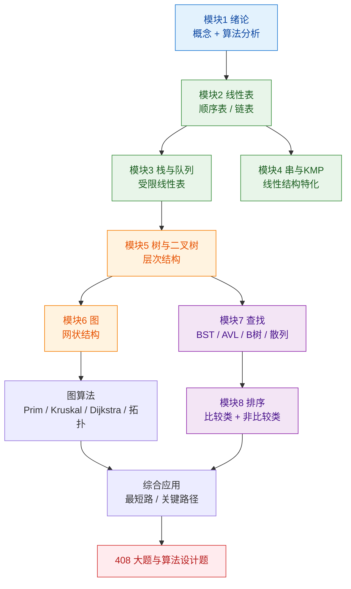

### 0.2 三阶段学习法

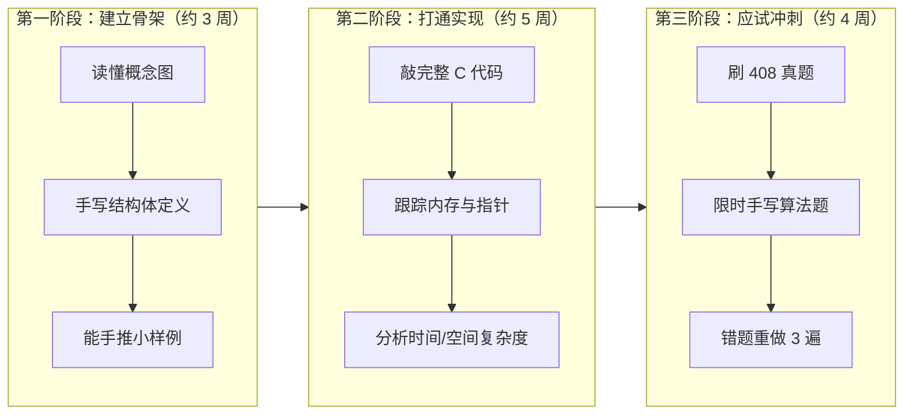

### 0.3 如何使用本手册

1. **每模块按固定五步走**：概念 → 易错点 → 代码 → 实操 → 习题。**不要跳步**，尤其不要跳过"易错点"。
2. **代码必须手敲一遍**，不要复制粘贴。指针类错误只有亲手踩过才会记住。
3. **408 习题先做后看**。答案放在 `<details>` 折叠块中，VSCode 预览下点击即可展开，请克制住先看的冲动。
4. **每周做一次模块 11 的交互出题**，用随机抽题检验遗忘曲线。
5. **三色标记法**：🟢 已掌握 / 🟡 会但不熟 / 🔴 不会。红色项当天必须复盘。

### 0.4 常见学习误区（先看，能省 30 小时）

| 误区               | 后果                | 正确做法                        |
| :----------------- | :------------------ | :------------------------------ |
| 只背代码不看原理   | 题目变形就废        | 先想清"为什么这样设计"          |
| 忽略复杂度推导     | 大题失分重灾区      | 每段代码都写出复杂度            |
| 跳过链表直接学树   | 递归彻底懵          | 递归本质是链式思维              |
| 认为排序只需背结论 | 稳定性/最坏情况混淆 | 记住每种排序"为什么稳定/不稳定" |
| 图论只背算法流程   | 手算容易错          | 至少手推 3 次 Dijkstra 表格     |

---

## 模块 1 · 绪论：基本概念与算法分析

### 1.1 核心概念

**数据结构三要素**：

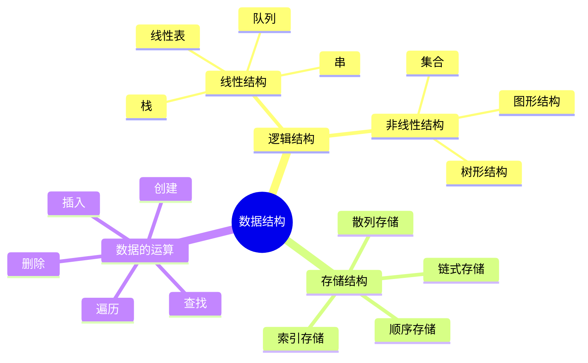

- **逻辑结构**：数据元素之间的抽象关系，与计算机无关，独立于存储。
- **存储结构（物理结构）**：逻辑结构在计算机中的实现，是**有依赖**的。
- **要点**：逻辑结构决定算法思路，存储结构决定算法效率。

**四种基本存储方式对比**：

| 存储方式 | 优点                      | 缺点                         | 典型应用               |
| :------- | :------------------------ | :--------------------------- | :--------------------- |
| 顺序存储 | 随机访问 O(1)、存储密度高 | 插入删除慢、需预估容量       | 顺序表、数组、堆       |
| 链式存储 | 插入删除快、动态扩容      | 只能顺序访问、指针额外开销   | 链表、二叉树、图邻接表 |
| 索引存储 | 检索速度快                | 索引表占空间、增删需维护     | 索引顺序表（分块查找） |
| 散列存储 | 查找接近 O(1)             | 冲突处理复杂、不支持顺序遍历 | 哈希表                 |

**关键术语**：

- **数据项** ⊂ **数据元素（结点/记录）** ⊂ **数据对象** ⊂ **数据**
- **数据类型**：值的集合 + 定义在该集合上的操作集合
- **抽象数据类型（ADT）**：只关心逻辑特性与操作，不关心实现（三元组表示：D, S, P）

### 1.2 易错点

1. 🔴 **顺序存储 ≠ 线性结构**。顺序存储是**存储方式**，线性结构是**逻辑结构**，二者是不同维度。栈是线性结构，但既可用顺序存储也可用链式存储。
2. 🔴 **"数据的逻辑结构独立于存储结构"** —— 这句话是对的，常考判断题。
3. 🟡 **抽象数据类型是"逻辑结构 + 操作"**，不含存储实现。
4. 🟡 循环队列、链表等都属于**线性结构**（逻辑上），不要因为物理实现特殊就归为非线性。
5. 🟡 **算法 ≠ 程序**。算法必须有穷、程序可以死循环。

### 1.3 算法与复杂度

**算法五个特性**：有穷性、确定性、可行性、输入（0 个或多个）、输出（1 个或多个）。

对比记忆：

| 特性   | 含义                   | 易混点                         |
| :----- | :--------------------- | :----------------------------- |
| 有穷性 | 有限步后结束           | 与"程序"区别（程序可无限运行） |
| 确定性 | 相同输入输出唯一       | —                              |
| 可行性 | 每步可执行有限次完成   | —                              |
| 输入   | **可以没有输入**       | 常考陷阱                       |
| 输出   | **必须至少有一个输出** | 必有                           |

**复杂度推导步骤**：

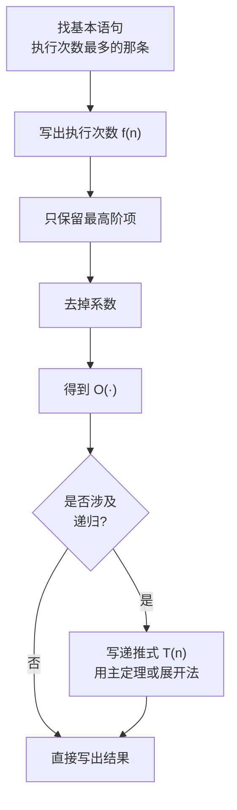

**常见复杂度增速**（由慢到快）：

O(1) < O(log₂n) < O(n) < O(n log₂n) < O(n²) < O(n³) < O(2ⁿ) < O(n!) < O(nⁿ)

> 记忆口诀：**常对幂指阶**（常数、对数、幂、指数、阶乘）。

### 1.4 代码示例：复杂度判定

```c
/* 示例 1：O(1) —— 与 n 无关 */
int sum3(int a, int b, int c) {
    return a + b + c;
}

/* 示例 2：O(n) */
int sum_n(int a[], int n) {
    int s = 0;
    for (int i = 0; i < n; i++)   /* 执行 n 次 */
        s += a[i];
    return s;
}

/* 示例 3：O(n^2) —— 双重循环 */
void bubble(int a[], int n) {
    for (int i = 0; i < n - 1; i++)          /* n-1 次 */
        for (int j = 0; j < n - 1 - i; j++)  /* 内层次数递减 */
            if (a[j] > a[j + 1]) {
                int t = a[j]; a[j] = a[j + 1]; a[j + 1] = t;
            }
}   /* 总次数 = n(n-1)/2 => O(n^2) */

/* 示例 4：O(log n) —— 每轮规模减半 */
int binary_search_iter(int a[], int n, int key) {
    int lo = 0, hi = n - 1;
    while (lo <= hi) {                 /* 每次区间长度减半 */
        int mid = lo + (hi - lo) / 2;
        if (a[mid] == key) return mid;
        else if (a[mid] < key) lo = mid + 1;
        else hi = mid - 1;
    }
    return -1;
}

/* 示例 5：O(n log n) —— 双层但内层是 log */
void f_loop(int n) {
    for (int i = 1; i <= n; i <<= 1)   /* log2(n) 次 */
        for (int j = 0; j < n; j++)     /* n 次 */
            ; /* 空语句 */
}
```

**递归复杂度推导示例**（用展开法）：

```c
/* T(n) = 2*T(n/2) + n  =>  O(n log n)  —— 归并排序 */
int fib_rec(int n) {                 /* T(n)=T(n-1)+T(n-2)+O(1) => O(2^n) */
    if (n < 2) return n;
    return fib_rec(n - 1) + fib_rec(n - 2);
}
```

### 1.5 实操练习

- **练习 1-1**：写出下列代码的时间复杂度（n 为正整数）。

  ```c
  int i = 1;
  while (i <= n) i = i * 2;
  ```

  > 提示：循环变量按 2 的幂增长，循环次数 ≈ log₂n。

- **练习 1-2**：计算 `x = 0; for(i=0;i<n;i++) for(j=i+1;j<n;j++) x++;` 中 `x++` 的总次数与复杂度。
- **练习 1-3**：写出 `T(1)=1, T(n)=T(n-1)+n` 的通项，并给出复杂度。
- **练习 1-4**：用 C 语言实现一个函数，参数为整型数组和长度，返回数组中最大值与次大值，要求时间复杂度 O(n)，并说明为什么不需要排序。

### 1.6 408 相关习题

**题 1-1（选择）** 以下关于数据的存储结构的说法，正确的是（　）。
A. 数据的存储结构是数据间关系的抽象描述
B. 数据的存储结构分为顺序、链式、索引、散列四种
C. 数据的存储结构独立于计算机
D. 一种数据的逻辑结构只能有一种存储结构

<details>
<summary>👉 点击查看答案与解析</summary>

> **答案：B**

- A 错误：描述"数据间关系的抽象"的是**逻辑结构**，不是存储结构。
- B 正确：四种基本存储结构的标准分类。
- C 错误：逻辑结构独立于计算机，存储结构**依赖于**计算机。
- D 错误：一种逻辑结构可以有多种存储结构，如线性表可用顺序表也可用链表。

</details>

**题 1-2（选择）** 设 n 是描述问题规模的非负整数，下面程序片段的时间复杂度是（　）。

```c
int x = 2;
while (x < n / 2)
    x = x * 2;
```

A. O(log₂n)
B. O(n)
C. O(n log₂n)
D. O(n²)

<details>
<summary>👉 点击查看答案与解析</summary>

> **答案：A**

设循环执行 k 次，则 x = 2^(k+1)。循环终止条件为 2^(k+1) ≥ n/2，即 k ≥ log₂(n/2) - 1 = log₂n - 2。
因此 k ≈ log₂n，复杂度 O(log₂n)。

**易错提示**：`x = x * 2` 是**乘法增长**（对数级）；`x = x + 2` 才是**加法增长**（线性级）。看到 `*= 2`、`/= 2`、`<<= 1` 就要条件反射想到 log。

</details>

**题 1-3（判断）** 算法和程序没有区别，算法可以用任意语言实现。（　）

<details>
<summary>👉 点击查看答案与解析</summary>

> **答案：错误**

算法 ≠ 程序。核心区别：算法必须满足**有穷性**（有限步内结束），而程序可以无限运行（如操作系统、死循环服务）。此外，算法是抽象描述，程序是具体实现。

</details>

**题 1-4（408 真题风格·简答）** 有两个算法 A 和 B，A 的时间复杂度为 O(n)，B 为 O(n²)。是否说明在任何输入规模下 A 都比 B 快？请说明理由。

<details>
<summary>👉 点击查看答案与解析</summary>

> **答案：不能。**

理由分三层：

1. **大 O 描述的只是量级（渐近上界）**，忽略了常数因子。A 可能是 `10000n`，B 可能是 `0.5n²`。
2. 当 n 较小时，低阶项和常数项起决定作用，例如 n = 10 时 `10000n = 100000` 远大于 `0.5n² = 50`。
3. 只有当 n 超过某个阈值（本例约 n > 20000）后，O(n) 才真正优于 O(n²)。

**结论**：渐近复杂度描述的是规模充分大时的增长趋势，小规模场景需要实测。

</details>

---

## 模块 2 · 线性表

### 2.1 核心概念

**定义**：n 个**相同数据类型**数据元素的**有限**序列。除首元素外每个元素有且仅有一个前驱，除尾元素外每个元素有且仅有一个后继。

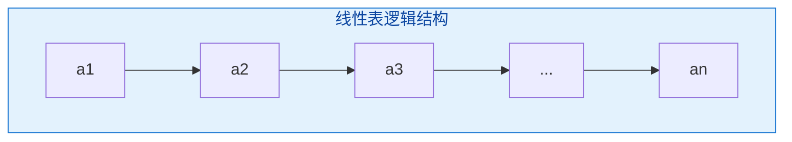

**两种实现对比**：

| 维度                | 顺序表（数组）              | 单链表                                    |
| :------------------ | :-------------------------- | :---------------------------------------- |
| 存储                | 连续空间，逻辑相邻=物理相邻 | 离散空间，靠指针链接                      |
| 随机访问            | ✅ O(1)                      | ❌ O(n)                                    |
| 按位插入/删除       | O(n)（需移动元素）          | O(n)（需找位置），但**指针操作本身** O(1) |
| 已知指针的插入/删除 | O(1)（若已知下标）          | O(1)（若已知前驱指针）                    |
| 空间                | 需预分配，可能溢出或浪费    | 按需分配，指针有额外开销                  |
| 存储密度            | 高（=1）                    | 低（<1）                                  |

**存储密度** = 数据本身占用空间 / 结点总占用空间。顺序表为 1，单链表为 `sizeof(ElemType) / (sizeof(ElemType) + sizeof(Node*))`。

### 2.2 易错点

1. 🔴 **头指针 vs 头结点**：
   - **头指针**：指向链表第一个结点的指针，**永远存在**（空表时指向 NULL 或头结点）。
   - **头结点**：附加在第一个元素结点之前的结点，**可以不设**，其数据域通常不用。
   - 引入头结点的好处：**统一了空表和非空表、首位置和其他位置的插入删除操作**。
2. 🔴 **单链表插入的顺序**：必须先 `s->next = p->next;` 再 `p->next = s;`，顺序反了会**丢失后继链**，这是最经典的手写代码扣分点。
3. 🔴 **删除结点时**：要先保存被删结点 `q = p->next`，再 `p->next = q->next`，最后 `free(q)`。
4. 🟡 求单链表长度的时间复杂度是 **O(n)**，不是 O(1)（除非额外维护 size 字段）。
5. 🟡 **静态链表**用数组模拟指针，下标 0 通常作头结点，`next = -1` 表示结束。
6. 🟡 顺序表"删除第 i 个元素"平均移动 `(n-1)/2` 个元素；"插入到第 i 个位置"平均移动 `n/2` 个元素。**插入平均移动 n/2，删除平均移动 (n-1)/2**，注意区分。
7. 🟡 **循环双链表**中 `p->prior->next == p` 与 `p->next->prior == p` 都成立。

### 2.3 代码示例

#### 2.3.1 顺序表（动态分配）

```c
#include <stdio.h>
#include <stdlib.h>

#define INIT_CAP 8
#define OK  1
#define ERR 0

typedef int ElemType;

typedef struct {
    ElemType *data;   /* 动态数组基址 */
    int length;       /* 当前长度 */
    int capacity;     /* 当前容量 */
} SeqList;

/* 初始化：O(1) */
int InitList(SeqList *L) {
    L->data = (ElemType *)malloc(sizeof(ElemType) * INIT_CAP);
    if (!L->data) return ERR;
    L->length = 0;
    L->capacity = INIT_CAP;
    return OK;
}

/* 扩容：O(n) */
static int Expand(SeqList *L) {
    int newCap = L->capacity * 2;
    ElemType *p = (ElemType *)realloc(L->data, sizeof(ElemType) * newCap);
    if (!p) return ERR;
    L->data = p;
    L->capacity = newCap;
    return OK;
}

/* 按位插入：1 <= i <= length+1，平均 O(n) */
int ListInsert(SeqList *L, int i, ElemType e) {
    if (i < 1 || i > L->length + 1) return ERR;      /* 位置非法 */
    if (L->length == L->capacity && !Expand(L)) return ERR;
    for (int j = L->length; j >= i; j--)             /* 后移，从尾部开始！ */
        L->data[j] = L->data[j - 1];                 /* 注意下标 0-based */
    L->data[i - 1] = e;
    L->length++;
    return OK;
}

/* 按位删除：1 <= i <= length，平均 O(n) */
int ListDelete(SeqList *L, int i, ElemType *e) {
    if (i < 1 || i > L->length) return ERR;
    *e = L->data[i - 1];
    for (int j = i; j < L->length; j++)              /* 前移，从前往后 */
        L->data[j - 1] = L->data[j];
    L->length--;
    return OK;
}

/* 按值查找：O(n) */
int LocateElem(SeqList *L, ElemType e) {
    for (int i = 0; i < L->length; i++)
        if (L->data[i] == e) return i + 1;           /* 返回位序（1-based） */
    return 0;
}

void DestroyList(SeqList *L) { free(L->data); L->data = NULL; L->length = L->capacity = 0; }
```

#### 2.3.2 带头结点的单链表

```c
#include <stdio.h>
#include <stdlib.h>

typedef int ElemType;

typedef struct LNode {
    ElemType data;
    struct LNode *next;
} LNode, *LinkList;

/* 初始化（带头结点）：O(1) */
int InitList(LinkList *L) {
    *L = (LNode *)malloc(sizeof(LNode));
    if (!*L) return 0;
    (*L)->next = NULL;
    return 1;
}

/* 头插法建立：O(n)，得到逆序 */
void CreateListHead(LinkList L, int a[], int n) {
    for (int i = 0; i < n; i++) {
        LNode *s = (LNode *)malloc(sizeof(LNode));
        s->data = a[i];
        s->next = L->next;      /* ① 先接后继 */
        L->next = s;            /* ② 再接前驱 */
    }
}

/* 尾插法建立：O(n)，得到正序（需尾指针） */
void CreateListTail(LinkList L, int a[], int n) {
    LNode *r = L;                       /* r 为尾指针 */
    for (int i = 0; i < n; i++) {
        LNode *s = (LNode *)malloc(sizeof(LNode));
        s->data = a[i];
        r->next = s;
        r = s;
    }
    r->next = NULL;
}

/* 按位查找，返回第 i 个结点：O(n) */
LNode *GetElem(LinkList L, int i) {
    if (i < 0) return NULL;
    LNode *p = L;
    int j = 0;
    while (p && j < i) { p = p->next; j++; }
    return p;
}

/* 按值查找：O(n) */
LNode *LocateElem(LinkList L, ElemType e) {
    LNode *p = L->next;
    while (p && p->data != e) p = p->next;
    return p;
}

/* 在第 i 个位置插入 e：O(n) */
int ListInsert(LinkList L, int i, ElemType e) {
    LNode *p = GetElem(L, i - 1);        /* 找到前驱 */
    if (!p) return 0;
    LNode *s = (LNode *)malloc(sizeof(LNode));
    s->data = e;
    s->next = p->next;                   /* ① 先接后继，顺序不能反！ */
    p->next = s;                         /* ② 断开旧链 */
    return 1;
}

/* 删除第 i 个结点：O(n) */
int ListDelete(LinkList L, int i, ElemType *e) {
    LNode *p = GetElem(L, i - 1);
    if (!p || !p->next) return 0;
    LNode *q = p->next;
    *e = q->data;
    p->next = q->next;
    free(q);
    return 1;
}

/* 就地逆置单链表：O(n) 时间，O(1) 空间（408 高频） */
void ReverseList(LinkList L) {
    LNode *p = L->next, *r;
    L->next = NULL;                       /* 断头 */
    while (p) {
        r = p->next;                      /* 暂存后继 */
        p->next = L->next;                /* 头插 */
        L->next = p;
        p = r;
    }
}

/* 求长度：O(n) */
int Length(LinkList L) {
    int len = 0;
    for (LNode *p = L->next; p; p = p->next) len++;
    return len;
}
```

#### 2.3.3 双向链表

```c
typedef struct DNode {
    ElemType data;
    struct DNode *prior, *next;
} DNode, *DLinkList;

/* 在 p 之后插入 s：注意四条指针，顺序敏感 */
void InsertAfter(DNode *p, DNode *s) {
    s->next = p->next;
    if (p->next) p->next->prior = s;
    s->prior = p;
    p->next = s;
}

/* 删除 p 的后继结点 q */
void DeleteAfter(DNode *p) {
    DNode *q = p->next;
    if (!q) return;
    p->next = q->next;
    if (q->next) q->next->prior = p;
    free(q);
}
```

### 2.4 实操练习

- **练习 2-1**：设计算法，在顺序表中删除所有值为 x 的元素，要求时间 O(n)、空间 O(1)。
- **练习 2-2**：设计算法，将顺序表所有元素逆置，空间复杂度 O(1)。
- **练习 2-3**：在单链表中删除所有值为 x 的结点（带头结点）。
- **练习 2-4**：判断单链表是否存在环（快慢指针 / Floyd 判圈），返回环的入口结点。
- **练习 2-5**：将两个**递增有序**的单链表归并为一个递减有序的单链表，空间 O(1)。
- **练习 2-6**：找出两个单链表的公共后缀起点（先对齐长度再同步走）。

### 2.5 408 相关习题

**题 2-1（选择）** 在长度为 n 的顺序表的第 i 个位置（1 ≤ i ≤ n+1）插入一个元素，需要移动的元素个数是（　）。
A. n - i
B. n - i + 1
C. n - i - 1
D. i

<details>
<summary>👉 点击查看答案与解析</summary>

> **答案：B**

在第 i 个位置插入，需要把原第 i 至第 n 个元素整体后移，共 `n - i + 1` 个元素。

- i = 1（表头插入）：移动 n 个 → `n - 1 + 1 = n` ✅
- i = n+1（表尾追加）：移动 0 个 → `n - (n+1) + 1 = 0` ✅

**对比删除**：删除第 i 个元素需移动 `n - i` 个元素。请不要混淆。

</details>

**题 2-2（选择）** 对于一个头指针为 head 的带头结点的单链表，判定该表为空表的条件是（　）。
A. `head == NULL`
B. `head->next == NULL`
C. `head->next == head`
D. `head != NULL`

<details>
<summary>👉 点击查看答案与解析</summary>

> **答案：B**

带头结点时，`head` 始终非空（它指向头结点本身），空表由**头结点的 next 为空**表示。

- A 是**不带头结点**时判空的条件。
- C 是**循环链表**空表的判定条件。

**记忆**：带头结点 → 看 `head->next`；不带头结点 → 看 `head`。

</details>

**题 2-3（408 算法设计题·经典）** 设计一个算法，将带头结点的单链表中所有值为 x 的结点删除，要求时间复杂度 O(n)、空间复杂度 O(1)。

<details>
<summary>👉 点击查看答案与解析</summary>

**思路**：用 `p` 遍历，`pre` 始终指向 `p` 的前驱。若 `p->data == x`，则 `pre->next = p->next` 后释放 p，且 **pre 不动**；否则 `pre = p`，再 `p = p->next`。

```c
void DeleteX(LinkList L, ElemType x) {
    LNode *pre = L, *p = L->next, *q;
    while (p) {
        if (p->data == x) {
            q = p;
            pre->next = p->next;   /* 摘链 */
            p = p->next;
            free(q);               /* pre 保持不变 */
        } else {
            pre = p;               /* 只有保留结点才推进 pre */
            p = p->next;
        }
    }
}
```

**关键点**：

1. `pre` 只在**保留结点**时推进，删除时不动，否则会漏判连续相同元素。
2. `free` 后必须先把 `p` 移到下一个，防止使用已释放内存（use-after-free）。
3. 复杂度：遍历一次 O(n)，只用两个辅助指针 O(1)。

</details>

**题 2-4（408 算法设计题）** 设有一个带头结点的单链表，设计算法将其就地逆置（不得新建结点）。说明时间与空间复杂度。

<details>
<summary>👉 点击查看答案与解析</summary>

**思路**：头插法重建。每次取原表首结点，插入到"新表"头部。

```c
void Reverse(LinkList L) {
    LNode *p = L->next, *r;
    L->next = NULL;                /* 头结点摘下，新表为空 */
    while (p) {
        r = p->next;               /* 暂存后继，防断链 */
        p->next = L->next;         /* 头插 */
        L->next = p;
        p = r;                     /* 继续处理原表剩余 */
    }
}
```

**复杂度**：时间 O(n)，空间 O(1)（只用两个指针）。

**常见错误**：

- 忘记 `L->next = NULL`，导致形成自环，程序死循环。
- 忘记用 `r` 暂存后继，`p->next` 被改写后无法继续遍历。

**变体**：若要求"从第 i 个到第 n 个逆置"，先定位第 i-1 个结点作为新的头，其余逻辑相同。

</details>

**题 2-5（简答）** 试比较顺序表和链表的优缺点，并说明在什么场景下应选用哪一种。

<details>
<summary>👉 点击查看答案与解析</summary>

| 比较项   | 顺序表                           | 链表                         |
| :------- | :------------------------------- | :--------------------------- |
| 存取方式 | 随机存取，O(1)                   | 顺序存取，O(n)               |
| 插入删除 | O(n)，需移动                     | O(1)（已知位置），不需移动   |
| 空间分配 | 静态预分配，可能溢出/浪费        | 动态分配，无溢出，有指针开销 |
| 存储密度 | = 1                              | < 1                          |
| 适用场景 | 表长可预估、频繁随机访问、少增删 | 表长变化大、频繁插入删除     |

**结论**：查询为主 → 顺序表；增删为主且表长不定 → 链表。

</details>

**题 2-6（真题风格·判断改错）** 下面程序段用于在第 i 个位置插入结点 s，指出错误。

```c
s->next = p->next;
p->next = s;        /* 假设 p 是第 i-1 个结点 */
```

<details>
<summary>👉 点击查看答案与解析</summary>

**答案：该程序段本身没有指针顺序错误**（先接后继再接前驱是正确的）。

但如果题目给的原始版本是：

```c
p->next = s;        /* ❌ 先写了这行 */
s->next = p->next;  /* ❌ 此时 p->next 已经是 s，变成 s->next = s，自环！ */
```

那么错误在于：**先执行 `p->next = s` 会覆盖掉原来的后继指针，导致 `s->next` 指向自身，链表断裂并形成自环**。

**正确顺序必须**：先建新链（`s->next = p->next`），再改旧链（`p->next = s`）。

</details>

---

## 模块 3 · 栈、队列与数组

### 3.1 核心概念

**栈（Stack）**：**后进先出（LIFO）**的线性表，只允许在**栈顶**进行插入（push）和删除（pop）。

**队列（Queue）**：**先进先出（FIFO）**的线性表，**队尾入队，队头出队**。

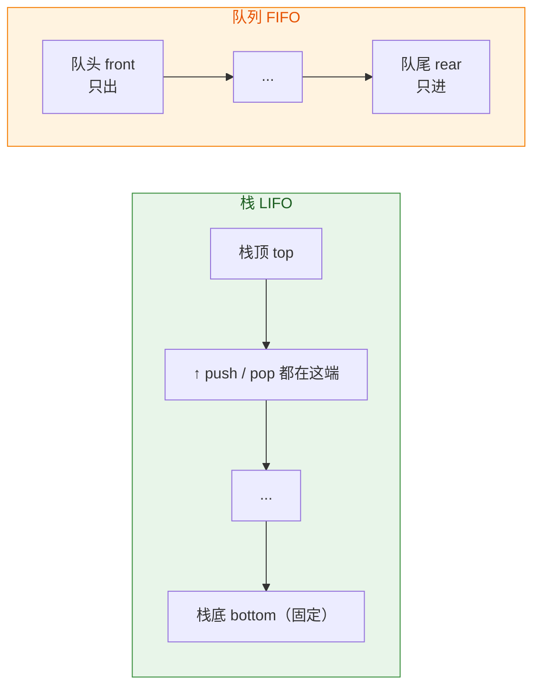

**循环队列的三种"判满"方案**：

| 方案           | 队空条件                | 队满条件                      | 元素个数                             |
| :------------- | :---------------------- | :---------------------------- | :----------------------------------- |
| 牺牲一个单元   | `front == rear`         | `(rear+1) % MaxSize == front` | `(rear - front + MaxSize) % MaxSize` |
| 设 size 计数器 | `size == 0`             | `size == MaxSize`             | `size`                               |
| 设 tag 标志位  | `front==rear && tag==0` | `front==rear && tag==1`       | 由 front/rear/tag 推导               |

**栈的典型应用**：括号匹配、表达式求值（中缀转后缀）、递归实现、深度优先搜索（DFS）、函数调用栈。

**队列的典型应用**：层序遍历、广度优先搜索（BFS）、缓冲区、任务调度、打印队列。

**特殊线性表**：

| 名称             | 插入/删除限制  | 特点     |
| :--------------- | :------------- | :------- |
| 栈               | 只在一端       | LIFO     |
| 队列             | 一端进另一端出 | FIFO     |
| 双端队列 Deque   | 两端都可进出   | 两端操作 |
| 输入受限双端队列 | 只允许一端插入 | 考频高   |
| 输出受限双端队列 | 只允许一端删除 | 考频高   |

### 3.2 易错点

1. 🔴 **循环队列判满不能用 `rear == front`**，因为这与队空条件冲突。要么牺牲一个存储单元，要么引入 size/tag。
2. 🔴 **取模运算的下标范围**是 `0 ~ MaxSize-1`，写 `(rear+1) % MaxSize` 时注意 **MaxSize 是容量**，若牺牲一个单元则实际最多存 `MaxSize-1` 个元素。
3. 🔴 **中缀转后缀的手算规则**：遇到**操作数直接输出**；遇到**运算符**，弹出栈中优先级 **≥（大于等于）**当前运算符的运算符，再压栈；`(` 直接压栈；遇到 `)` 则弹栈直到 `(`。**括号不输出**。
4. 🟡 **栈和队列的逻辑结构仍是线性表**，不要因为操作受限就归为非线性。
5. 🟡 共享栈（两个栈共享一段空间）判满条件：`top0 + 1 == top1`（top0 从 -1 开始向上，top1 从 MaxSize 开始向下）。
6. 🟡 **队列不能实现"随机访问"**，栈也不能（除非用数组实现且按下标访问，但那不属于栈的定义操作）。
7. 🟡 求后缀表达式值时：**遇操作数入栈，遇运算符弹出两个操作数（先弹的是右操作数）**，结果入栈。顺序写反会导致减法和除法结果错误。

### 3.3 代码示例

#### 3.3.1 顺序栈

```c
#define MaxSize 50
typedef int ElemType;

typedef struct {
    ElemType data[MaxSize];
    int top;                 /* 栈顶指针，指向栈顶元素 */
} SqStack;

void InitStack(SqStack *S) { S->top = -1; }
int StackEmpty(SqStack *S) { return S->top == -1; }
int StackFull(SqStack *S) { return S->top == MaxSize - 1; }

int Push(SqStack *S, ElemType x) {
    if (StackFull(S)) return 0;        /* 上溢 */
    S->data[++S->top] = x;
    return 1;
}

int Pop(SqStack *S, ElemType *x) {
    if (StackEmpty(S)) return 0;       /* 下溢 */
    *x = S->data[S->top--];
    return 1;
}

int GetTop(SqStack *S, ElemType *x) {
    if (StackEmpty(S)) return 0;
    *x = S->data[S->top];              /* 不移动指针 */
    return 1;
}
```

#### 3.3.2 循环队列（牺牲一个单元）

```c
typedef struct {
    ElemType data[MaxSize];
    int front, rear;          /* front 指向队头元素，rear 指向队尾元素的下一个位置 */
} SqQueue;

void InitQueue(SqQueue *Q) { Q->front = Q->rear = 0; }
int QueueEmpty(SqQueue *Q) { return Q->front == Q->rear; }
int QueueFull(SqQueue *Q) { return (Q->rear + 1) % MaxSize == Q->front; }
int QueueLength(SqQueue *Q) { return (Q->rear - Q->front + MaxSize) % MaxSize; }

int EnQueue(SqQueue *Q, ElemType x) {
    if (QueueFull(Q)) return 0;
    Q->data[Q->rear] = x;
    Q->rear = (Q->rear + 1) % MaxSize;
    return 1;
}

int DeQueue(SqQueue *Q, ElemType *x) {
    if (QueueEmpty(Q)) return 0;
    *x = Q->data[Q->front];
    Q->front = (Q->front + 1) % MaxSize;
    return 1;
}
```

#### 3.3.3 括号匹配（栈的经典应用）

```c
#include <string.h>

int BracketMatch(const char *s) {
    SqStack S; InitStack(&S);
    for (int i = 0; s[i]; i++) {
        char c = s[i];
        if (c == '(' || c == '[' || c == '{') {
            Push(&S, c);
        } else if (c == ')' || c == ']' || c == '}') {
            if (StackEmpty(&S)) return 0;          /* 右括号多余 */
            ElemType t;
            Pop(&S, &t);
            if ((c == ')' && t != '(') ||
                (c == ']' && t != '[') ||
                (c == '}' && t != '{')) return 0;  /* 类型不匹配 */
        }
    }
    return StackEmpty(&S);                         /* 左括号是否多余 */
}
```

#### 3.3.4 中缀转后缀（含优先级处理）

```c
#include <string.h>
#include <ctype.h>

/* 优先级：乘除 > 加减；'(' 返回 0 特殊处理 */
static int Priority(char op) {
    if (op == '*' || op == '/') return 2;
    if (op == '+' || op == '-') return 1;
    return 0;
}

void InFixToPostFix(const char *in, char *out) {
    SqStack S; InitStack(&S);
    int k = 0;
    for (int i = 0; in[i]; i++) {
        char c = in[i];
        if (isdigit((unsigned char)c)) {
            out[k++] = c;                      /* 操作数直接输出 */
        } else if (c == '(') {
            Push(&S, c);
        } else if (c == ')') {
            ElemType t;
            while (!StackEmpty(&S) && (GetTop(&S, &t), t != '(')) {
                Pop(&S, &t);
                out[k++] = (char)t;
            }
            Pop(&S, &t);                       /* 弹出 '('，不输出 */
        } else {                               /* 运算符 */
            ElemType t;
            while (!StackEmpty(&S) && (GetTop(&S, &t), Priority((char)t) >= Priority(c))) {
                Pop(&S, &t);
                out[k++] = (char)t;
            }
            Push(&S, c);
        }
    }
    ElemType t;
    while (!StackEmpty(&S)) { Pop(&S, &t); out[k++] = (char)t; }
    out[k] = '\0';
}
```

#### 3.3.5 用两个栈实现队列 / 两个队列实现栈

```c
/* 思路：入队压入 in 栈；出队时若 out 栈为空，把 in 全部倒入 out，再弹 out */
typedef struct {
    SqStack in, out;
} StackQueue;

int SQ_Push(StackQueue *q, ElemType x) { return Push(&q->in, x); }

int SQ_Pop(StackQueue *q, ElemType *x) {
    if (StackEmpty(&q->in) && StackEmpty(&q->out)) return 0;
    if (StackEmpty(&q->out)) {
        ElemType t;
        while (!StackEmpty(&q->in)) { Pop(&q->in, &t); Push(&q->out, t); }
    }
    return Pop(&q->out, x);
}
```

> **复杂度**：入队 O(1)，出队**均摊 O(1)**（每个元素最多被搬运一次），单次最坏 O(n)。

### 3.4 实操练习

- **练习 3-1**：实现共享栈（两个栈共用一段数组），给出 push/pop 与判满判空条件。
- **练习 3-2**：用栈判断一个字符串是否为回文。
- **练习 3-3**：用"不牺牲单元 + size 计数"的方式实现循环队列，写出全部基本操作。
- **练习 3-4**：手工将中缀表达式 `A+B*(C-D)-E/F` 转成后缀表达式，并用栈求值（A=6,B=2,C=5,D=3,E=8,F=4）。
- **练习 3-5**：用两个队列实现一个栈。
- **练习 3-6**：实现"求后缀表达式值"的完整函数，支持多位数。

### 3.5 408 相关习题

**题 3-1（选择·高频）** 已知循环队列存储在一维数组 `A[0..n-1]` 中，且队列非空时 front 和 rear 分别指向队头元素和队尾元素的**下一个位置**。若初始时队列为空，且 front = rear = 0，则判断队满的条件是（　）。
A. `(rear + 1) % n == front`
B. `(front + 1) % n == rear`
C. `rear == front`
D. `rear + 1 == front`

<details>
<summary>👉 点击查看答案与解析</summary>

> **答案：A**

队尾指针指向"队尾元素的下一个位置"时：

- **队空**：`front == rear`
- **队满**：`(rear + 1) % n == front`（牺牲一个单元）

若把题意改成"rear 指向队尾元素本身"，则队满条件变为 `(rear + 1) % n == front` 仍成立，但队空条件变为 `(rear + 1) % n == front`，此时必须配合 size 或 tag 才能区分。**这就是为什么多数教材选择"rear 指向下一个位置"** —— 让队满和队空条件天然区分。

</details>

**题 3-2（选择）** 设有一个栈，元素依次按 1, 2, 3, 4 的顺序入栈，则下列**不可能**的出栈序列是（　）。
A. 1, 2, 3, 4
B. 4, 3, 2, 1
C. 1, 4, 3, 2
D. 4, 1, 2, 3

<details>
<summary>👉 点击查看答案与解析</summary>

> **答案：D**

判断法则：**对于出栈序列中的任意元素，其后比它小的元素必须按递减顺序排列**（因为比它小的元素在它之后出栈，只能是逆序弹出）。

逐一验证：

- A ✅ 入 1 出 1，入 2 出 2，……
- B ✅ 全部入栈再全部出栈
- C ✅ 入 1 出 1，入 2 3 4，出 4 3 2
- D ❌ 出 4 时栈内还有 1 2 3，出栈顺序只能是 3 2 1。序列要求出 1 2 3，**顺序递增，不可能**。

**快速判据**：找出栈序列中"比某元素先出栈的更小元素"，若出现递增（如 4 后面是 1 2 3），则非法。

</details>

**题 3-3（选择）** 中缀表达式 `(A+B)*C-D/E` 对应的后缀表达式是（　）。
A. `AB+C*DE/-`
B. `AB+C*DE-/`
C. `ABC+*DE/-`
D. `AB+CD*E/-`

<details>
<summary>👉 点击查看答案与解析</summary>

> **答案：A**

转换过程（栈内为底→顶）：

|  步   | 字符  | 动作                          | 后缀输出      | 栈    |
| :---: | :---: | :---------------------------- | :------------ | :---- |
|   1   |  `(`  | 压栈                          |               | `(`   |
|   2   |   A   | 输出                          | A             | `(`   |
|   3   |  `+`  | 压栈                          | A             | `( +` |
|   4   |   B   | 输出                          | AB            | `( +` |
|   5   |  `)`  | 弹到 `(`                      | AB+           | —     |
|   6   |  `*`  | 压栈                          | AB+           | `*`   |
|   7   |   C   | 输出                          | AB+C          | `*`   |
|   8   |  `-`  | 优先级 1 < 2，弹 `*` 后压 `-` | AB+C*         | `-`   |
|   9   |   D   | 输出                          | AB+C*D        | `-`   |
|  10   |  `/`  | 优先级 2 > 1，压栈            | AB+C*D        | `- /` |
|  11   |   E   | 输出                          | AB+C*DE       | `- /` |
|  12   | 结束  | 全部弹出                      | **AB+C*DE/-** | —     |

</details>

**题 3-4（408 算法设计题）** 用两个栈 S1、S2 模拟一个队列，要求给出入队、出队算法的思路与实现，并分析复杂度。

<details>
<summary>👉 点击查看答案与解析</summary>

**思路**：

- **入队**：直接压入 S1。
- **出队**：若 S2 非空，直接从 S2 弹出；否则把 S1 中所有元素逐个弹出并压入 S2（此时顺序被反转，队头在 S2 栈顶），再从 S2 弹出。

```c
typedef struct { SqStack s1, s2; } QueueByStack;

int EnQueue(QueueByStack *Q, ElemType x) {
    return Push(&Q->s1, x);                    /* 入队 O(1) */
}

int DeQueue(QueueByStack *Q, ElemType *x) {
    if (StackEmpty(&Q->s1) && StackEmpty(&Q->s2)) return 0;
    if (StackEmpty(&Q->s2)) {
        ElemType t;
        while (!StackEmpty(&Q->s1)) { Pop(&Q->s1, &t); Push(&Q->s2, t); }
    }
    return Pop(&Q->s2, x);
}
```

**复杂度分析**：

- 入队：O(1)。
- 出队：单次最坏 O(n)（需要搬运），但 **n 次出队操作总代价 O(n)**，故**均摊复杂度为 O(1)**。这是"均摊分析"的经典案例。

**易错点**：不要在出队时每次都清空 S1，那样均摊会退化为 O(n)。

</details>

**题 3-5（判断）** 栈和队列都是线性表，因此都可以进行随机访问。（　）

<details>
<summary>👉 点击查看答案与解析</summary>

> **答案：错误**

栈和队列是**操作受限的线性表**。它们的逻辑结构确实是线性表，但**运算被限制**：

- 栈只能在栈顶插入删除；
- 队列只能队尾进、队头出。

因此**不支持随机访问**（不能直接访问第 k 个元素）。前半句对，后半句错。

</details>

---

### 3.6 数组与特殊矩阵的压缩存储（补充）

**多维数组的存储**：C 语言按**行优先**（Row-Major）存储。对 `A[m][n]`，元素 `A[i][j]` 的地址为：

```text
LOC(i, j) = LOC(0, 0) + (i * n + j) * sizeof(ElemType)
```

> 若为**列优先**（如 Fortran），则为 `(j * m + i) * sizeof(ElemType)`。

**对称矩阵压缩**（`a[i][j] == a[j][i]`）：只存下三角，共 `n(n+1)/2` 个元素，存入一维数组 `B[0 .. n(n+1)/2 - 1]`。

| 情形            | 下标映射（B 下标从 0 开始，a 下标从 1 开始） |
| :-------------- | :------------------------------------------- |
| i ≥ j（下三角） | `k = i(i-1)/2 + (j-1)`                       |
| i < j（上三角） | `k = j(j-1)/2 + (i-1)`（利用对称性翻转）     |

**三角矩阵**：下三角矩阵存 `n(n+1)/2 + 1` 个（额外 1 个存常量 c）。

**三对角（带状）矩阵**：共 `3n - 2` 个非零元素，`k = 2i + j - 3`（a 下标从 1 开始）。

**稀疏矩阵**两种存储方式对比：

| 方式     | 结构                    | 优点     | 缺点                     |
| :------- | :---------------------- | :------- | :----------------------- |
| 三元组表 | `(行, 列, 值)` 顺序存储 | 节省空间 | 丧失随机访问，转置需重排 |
| 十字链表 | 每行每列各成链表        | 增删方便 | 结构复杂，指针开销大     |

### 3.7 数组易错点补充

1. 🔴 **行优先/列优先搞混**是最常见的计算错误。看到 408 题目先确认存储方式（题干通常会说明）。
2. 🔴 下标起始位置：C 语言从 0 开始，但很多 408 题目用 `a[1][1]` 起始，**公式必须跟着调整**。做题时先把 `i, j, k` 的起始值写在草稿纸上。
3. 🟡 **对称矩阵**压缩后是一维数组，**转置**操作只需交换 `i, j` 即可（因为对称）。
4. 🟡 稀疏矩阵的**快速转置**需要两个辅助数组 `num[]`（每列非零元素个数）和 `cpot[]`（每列首个非零元素在结果中的位置），时间复杂度 O(n + t)。

### 3.8 实操练习（数组）

- **练习 3-7**：设 `A[6][8]` 按行优先存储，每个元素占 4 字节，`LOC(A[0][0]) = 1000`，求 `A[3][5]` 的地址。
- **练习 3-8**：10 阶对称矩阵采用压缩存储（存下三角，行优先），求 `a[6][3]` 在 B 中的下标（假设 a 从 1 开始，B 从 0 开始）。
- **练习 3-9**：写出 `n×n` 三对角矩阵的压缩存储下标公式（a 从 1 开始）。

<details>
<summary>👉 练习题答案</summary>

**3-7**：`LOC(A[3][5]) = 1000 + (3*8 + 5) * 4 = 1000 + 29*4 = 1116`

**3-8**：`k = i(i-1)/2 + (j-1) = 6*5/2 + 2 = 15 + 2 = 17`（下标从 0 开始）

**3-9**：`k = 2i + j - 3`（i, j 从 1 开始），此时 k 从 0 开始，共 `3n-2` 个元素。

</details>

---

## 模块 4 · 串与 KMP 算法

### 4.1 核心概念

**串（String）**：由**零个或多个字符**组成的**有限序列**。是特殊的线性表，**数据元素限定为字符**。

- **空串**：长度为 0 的串，`""`。
- **空格串**：由一个或多个空格组成，`"   "` 长度为 3。**空串 ≠ 空格串**（高频考点）。
- **子串**：串中任意个**连续**字符组成的子序列；**主串**包含子串；**子串位置**是子串第一个字符在主串中的位置。
- **模式匹配**：在主串 S 中查找子串 T（模式串）的过程。

**朴素匹配 vs KMP 对比**：

| 维度               | 朴素匹配（BF）              | KMP                    |
| :----------------- | :-------------------------- | :--------------------- |
| 时间复杂度（最坏） | O(n × m)                    | O(n + m)               |
| 主串指针 i         | **会回溯**                  | **永不回溯**           |
| 核心思想           | 逐个字符比较，失配则 i 回退 | 利用已匹配信息，j 跳转 |
| 预处理             | 无                          | 需计算 next 数组 O(m)  |
| 空间               | O(1)                        | O(m)                   |

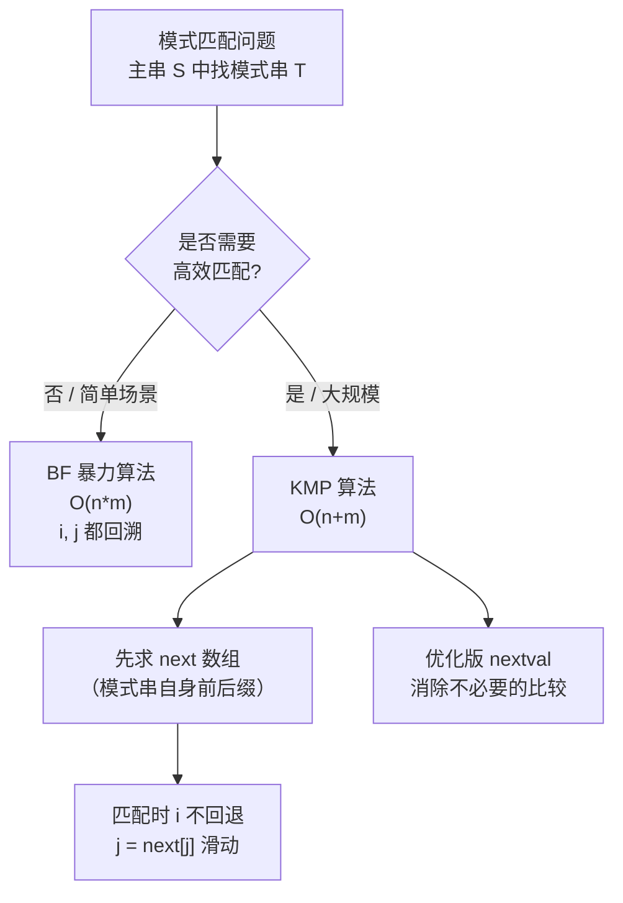

### 4.2 KMP 的 next 数组（必考）

**next[j] 的定义**（1-based，教材常见版本）：

> `next[j]` = 模式串 `T[1..j-1]` 中**最长相等前后缀**的长度 **+ 1**。

**next 数组计算步骤**：

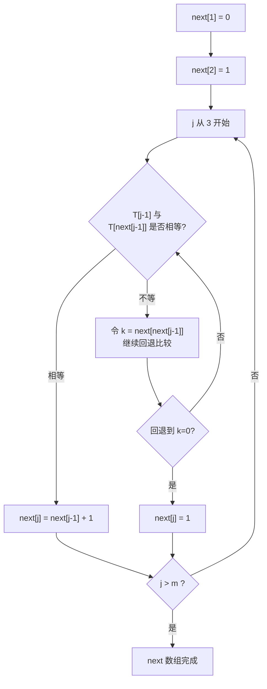

**手工计算实例**：模式串 `T = "abaabc"`（下标 1..6）

|       j        |   1   |   2   |   3   |   4   |   5   |   6   |
| :------------: | :---: | :---: | :---: | :---: | :---: | :---: |
|      T[j]      |   a   |   b   |   a   |   a   |   b   |   c   |
|  **next[j]**   |   0   |   1   |   1   |   2   |   2   |   3   |
| **nextval[j]** |   0   |   1   |   0   |   2   |   1   |   3   |

**另一种常见定义**（0-based，LeetCode 风格，`next` 表示回退位置，`next[0] = -1`）：

|      j      |   0   |   1   |   2   |   3   |   4   |   5   |
| :---------: | :---: | :---: | :---: | :---: | :---: | :---: |
|    T[j]     |   a   |   b   |   a   |   a   |   b   |   c   |
| **next[j]** |  -1   |   0   |   0   |   1   |   1   |   2   |

> **考试提示**：408 使用**教材版（1-based, next[1]=0）**。两种定义差 1，做题前务必确认题目用的是哪种。

### 4.3 易错点

1. 🔴 **空串 vs 空格串**：空串长度 0，空格串长度 ≥ 1。二者绝不相等。
2. 🔴 **next[1] 恒为 0，next[2] 恒为 1**（教材版）。无论模式串是什么，这两个值固定。
3. 🔴 **KMP 中主串指针 i 不回溯**，这是 KMP 优于 BF 的根本原因。
4. 🔴 **nextval 的求法**：若 `T[j] == T[next[j]]`，则 `nextval[j] = nextval[next[j]]`；否则 `nextval[j] = next[j]`。
5. 🟡 **"最长相等前后缀"要求前后缀不重叠且长度 < j-1**（真前后缀）。
6. 🟡 模式串长度为 m 时，`next[]` 数组只需计算到 `m` 即可（教材版）；有些题目要求多算一位，注意题干。
7. 🟡 **求 next 的复杂度是 O(m)**，整个 KMP 是 **O(n+m)**，其中 n 是主串长度、m 是模式串长度。

### 4.4 代码示例

#### 4.4.1 朴素模式匹配（BF）

```c
/* 返回模式串 T 在主串 S 中首次出现的位序（1-based），未找到返回 0 */
/* S[0] 与 T[0] 存储长度（教材版），也可传参 */
int Index_BF(const char *S, const char *T, int n, int m) {
    int i = 0, j = 0;                       /* 0-based 实现 */
    while (i < n && j < m) {
        if (S[i] == T[j]) { i++; j++; }
        else { i = i - j + 1; j = 0; }      /* i 回溯！这是 BF 的代价 */
    }
    return (j == m) ? (i - m + 1) : 0;      /* 返回 1-based 位序 */
}
/* 最坏 O(n*m)：如 S="aaaaaab", T="aaab" */
```

#### 4.4.2 KMP 求 next 数组（教材版，1-based）

```c
/* T 下标从 1 开始，T[0] 不使用（或存放长度）；next 下标从 1 开始 */
void GetNext(const char *T, int m, int next[]) {
    int i = 1, j = 0;
    next[1] = 0;
    while (i < m) {
        if (j == 0 || T[i] == T[j]) {
            i++; j++;
            next[i] = j;          /* 递推：next[i+1] = j+1 */
        } else {
            j = next[j];          /* 回退 */
        }
    }
}
```

#### 4.4.3 KMP 求 nextval（优化版）

```c
void GetNextVal(const char *T, int m, int nextval[]) {
    int i = 1, j = 0;
    nextval[1] = 0;
    while (i < m) {
        if (j == 0 || T[i] == T[j]) {
            i++; j++;
            if (T[i] != T[j]) nextval[i] = j;      /* 不同则用 j */
            else              nextval[i] = nextval[j]; /* 相同则继承 */
        } else {
            j = nextval[j];
        }
    }
}
```

#### 4.4.4 KMP 匹配主函数

```c
/* 返回首次匹配的 1-based 起始位置，失败返回 0 */
int Index_KMP(const char *S, const char *T, int n, int m, const int next[]) {
    int i = 1, j = 1;                    /* 1-based */
    while (i <= n && j <= m) {
        if (j == 0 || S[i] == T[j]) {    /* j==0 表示模式串第一个字符就失配 */
            i++; j++;
        } else {
            j = next[j];                 /* i 不回溯！ */
        }
    }
    if (j > m) return i - m;             /* 匹配成功 */
    return 0;
}
```

#### 4.4.5 0-based KMP（LeetCode 风格，实用向）

```c
/* 返回首次匹配的下标，失败返回 -1 */
static void buildNext(const char *p, int m, int *nxt) {
    nxt[0] = -1;
    int i = 0, j = -1;
    while (i < m) {
        if (j == -1 || p[i] == p[j]) { i++; j++; nxt[i] = j; }
        else j = nxt[j];
    }
}

int strStr(const char *s, const char *p) {
    int n = 0, m = 0;
    while (s[n]) n++;
    while (p[m]) m++;
    if (m == 0) return 0;
    int *nxt = (int *)malloc(sizeof(int) * (m + 1));
    buildNext(p, m, nxt);
    int i = 0, j = 0;
    while (i < n && j < m) {
        if (j == -1 || s[i] == p[j]) { i++; j++; }
        else j = nxt[j];
    }
    free(nxt);
    return (j == m) ? (i - m) : -1;
}
```

### 4.5 实操练习

- **练习 4-1**：手工求模式串 `"ababaa"` 的 next 与 nextval（教材 1-based 版）。
- **练习 4-2**：手工求模式串 `"aaab"` 的 next，并说明为什么 KMP 比 BF 快。
- **练习 4-3**：写一个函数统计子串在主串中出现的次数（可重叠）。
- **练习 4-4**：实现"判断字符串是否为另一个字符串的循环移位"（技巧：判断 T 是否为 S+S 的子串）。
- **练习 4-5**：给定主串 `"ababaababac"` 和模式 `"ababac"`，写出 KMP 的完整匹配过程表（i, j 变化）。

### 4.6 408 相关习题

**题 4-1（选择·高频）** 串 `"ababaaababaa"` 的 next 数组（教材 1-based 版）为（　）。
A. 0,1,1,2,3,4,2,2,3,4,5,6
B. 0,1,1,2,3,1,2,2,3,4,5,6
C. 0,1,1,2,3,4,1,2,3,4,5,6
D. 0,1,2,3,4,5,6,7,8,9,0,1

<details>
<summary>👉 点击查看答案与解析</summary>

> **答案：A**

模式串：`a b a b a a a b a b a a`（j = 1..12）

|   j   |   1   |   2   |   3   |   4   |   5   |   6   |   7   |   8   |   9   |  10   |  11   |  12   |
| :---: | :---: | :---: | :---: | :---: | :---: | :---: | :---: | :---: | :---: | :---: | :---: | :---: |
|   T   |   a   |   b   |   a   |   b   |   a   |   a   |   a   |   b   |   a   |   b   |   a   |   a   |
| next  |   0   |   1   |   1   |   2   |   3   |   4   |   2   |   2   |   3   |   4   |   5   |   6   |

**推导要点**：

- `next[1]=0`，`next[2]=1`（固定值）。
- j=3：T[1..2]="ab"，最长相等前后缀长度 0 → next=1。
- j=4：T[1..3]="aba"，前缀 "a" = 后缀 "a"，长度 1 → next=2。
- j=5：T[1..4]="abab"，前缀 "ab" = 后缀 "ab"，长度 2 → next=3。
- j=6：T[1..5]="ababa"，前缀 "aba" = 后缀 "aba"，长度 3 → next=4。
- j=7：T[1..6]="ababaa"，最长相等前后缀：前缀 "a"=后缀 "a" 长度 1 → next=2。

**技巧**：算 `next[j]` 时，把它理解为"在 T[j] 处失配时，应该把 j 退到哪里重新比较"。

</details>

**题 4-2（选择）** 设主串长度为 n，模式串长度为 m（n >> m），KMP 算法的时间复杂度是（　）。
A. O(n)
B. O(m)
C. O(n + m)
D. O(n × m)

<details>
<summary>👉 点击查看答案与解析</summary>

> **答案：C**

KMP 分为两步：

1. 求 next 数组：O(m)
2. 匹配过程：主串指针 i 全程**只前进不回退**，最多走 n 步，故 O(n)

总计 **O(n + m)**。

**易错**：有人误选 A（以为只和主串有关），但忽略了求 next 的开销。也有人误选 D（那是 BF 的复杂度）。

</details>

**题 4-3（408 算法设计题·经典）** 编写算法，求模式串 T 的 next 数组，并说明算法的时间复杂度。

<details>
<summary>👉 点击查看答案与解析</summary>

```c
/* T[1..m]，next[1..m] */
void GetNext(const char *T, int m, int next[]) {
    int i = 1, j = 0;
    next[1] = 0;
    while (i < m) {
        if (j == 0 || T[i] == T[j]) {
            i++;
            j++;
            next[i] = j;
        } else {
            j = next[j];
        }
    }
}
```

**复杂度分析**：

- **关键观察**：`j` 每次循环最多增加 1（在 `j++` 那一步），而 `i` 从 1 增加到 m。
- 在 `else` 分支中 `j = next[j]`，由于 `next[j] < j`，**j 严格减小**。
- 因此 `j` 的总增加次数 ≤ m，总减少次数也 ≤ m，**循环总执行次数 ≤ 2m**。
- **时间复杂度 O(m)**，空间复杂度 O(m)（next 数组本身）。

**为什么不是 O(m²)**：直觉上"每次失配都要回退很多步"，但均摊分析证明 j 的回退总量受其增长总量约束。这是"均摊分析"在串匹配中的又一次经典应用。

</details>

**题 4-4（简答）** 说明 next 与 nextval 的区别，并解释 nextval 为什么能进一步优化。

<details>
<summary>👉 点击查看答案与解析</summary>

**区别与优化原理**：

设 `T = "aaaab"`，其 next 与 nextval：

|     j      |   1   |   2   |   3   |   4   |   5   |
| :--------: | :---: | :---: | :---: | :---: | :---: |
|    T[j]    |   a   |   a   |   a   |   a   |   b   |
|  next[j]   |   0   |   1   |   2   |   3   |   4   |
| nextval[j] |   0   |   0   |   0   |   0   |   4   |

**优化逻辑**：当 `T[j] == T[next[j]]` 时，若在主串某位置因 `T[j]` 失配，那么退到 `T[next[j]]` 后**必然再次失配**（因为两个字符相同），这次回退是**无用功**。

因此，nextval 直接"跳过"这些必然失配的位置，让 `j` 一次退到位。

**总结**：

- `next[j]`：失配后 j 应该退到的位置。
- `nextval[j]`：失配后 j 应该退到的"有效"位置，**跳过了所有与 T[j] 相同的中间位置**。
- 二者在**模式串有大量重复字符**时差异明显，nextval 能显著减少比较次数。

</details>

---

## 模块 5 · 树与二叉树

### 5.1 核心概念

**树**：n（n ≥ 0）个结点的有限集合。n = 0 时为空树；否则有且仅有一个**根**，其余结点可分为 m 个**互不相交**的子树。

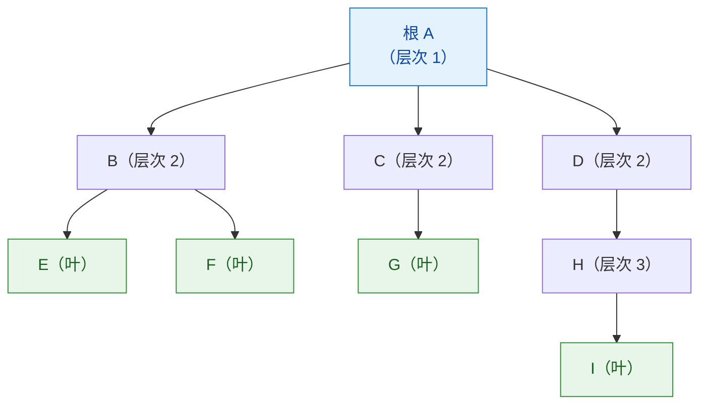

**树的基本术语**：

| 术语                   | 定义                                   |
| :--------------------- | :------------------------------------- |
| 结点的度               | 该结点拥有的**子树个数**               |
| 树的度                 | 树中所有结点度的**最大值**             |
| 叶子（终端结点）       | 度 = 0 的结点                          |
| 分支结点（非终端结点） | 度 > 0 的结点                          |
| 层次                   | 根为第 1 层，其孩子为第 2 层，依此类推 |
| 树的高度（深度）       | 结点所在的**最大层次**                 |
| 路径                   | 从祖先到后代经过的结点序列             |
| 森林                   | m（m ≥ 0）棵互不相交的树的集合         |

**重要性质**：

1. 树中结点数 = 所有结点的度之和 + 1。
2. n 个结点的树有 **n - 1 条边**。
3. 度为 m 的树中，第 i 层最多有 `m^(i-1)` 个结点。
4. 高度为 h 的 m 叉树最多有 `(m^h - 1) / (m - 1)` 个结点。

### 5.2 二叉树

**二叉树**：每个结点**至多有两棵子树**，且子树**有左右之分**（有序树）。

**二叉树 ≠ 度为 2 的树**：二叉树允许结点只有右孩子（左孩子为空），度为 2 的树不允许。

**五种基本形态**：


**核心性质（必背）**：

| 编号 | 内容                                                          |
| :--- | :------------------------------------------------------------ |
| ①    | 非空二叉树第 i 层最多有 `2^(i-1)` 个结点                      |
| ②    | 高度为 h 的二叉树最多有 `2^h - 1` 个结点（满二叉树）          |
| ③    | **n₀ = n₂ + 1**（叶子数 = 度为 2 的结点数 + 1）★              |
| ④    | n 个结点的完全二叉树高度 `h = ⌊log₂n⌋ + 1`                    |
| ⑤    | 完全二叉树中，若 i 有左孩子，则左孩子编号为 `2i`（1-based）   |
| ⑥    | 完全二叉树中，若 i 有右孩子，则右孩子编号为 `2i+1`（1-based） |
| ⑦    | 完全二叉树中，结点 i 的父结点编号为 `⌊i/2⌋`（1-based）        |

> **③ 的证明**：结点总数 n = n₀ + n₁ + n₂；边数 = n - 1 = 0·n₀ + 1·n₁ + 2·n₂。两式联立得 `n₀ = n₂ + 1`。

**特殊二叉树对比**：

| 类型           | 定义                           | 结点数                         |
| :------------- | :----------------------------- | :----------------------------- |
| 满二叉树       | 每层都满，叶子全在最底层       | `2^h - 1`                      |
| 完全二叉树     | 只允许最后一层**右侧**连续缺失 | h 层时 `2^(h-1) ≤ n ≤ 2^h - 1` |
| 二叉排序树 BST | 左 < 根 < 右                   | 任意                           |
| 平衡二叉树 AVL | 任意结点左右子树高度差 ≤ 1     | 任意                           |
| 线索二叉树     | 空指针指向遍历前驱/后继        | 任意                           |

### 5.3 二叉树的遍历

**四种遍历方式**：

| 遍历           | 顺序         | 典型用途                   |
| :------------- | :----------- | :------------------------- |
| 先序（根左右） | 根 → 左 → 右 | 复制树、序列化             |
| 中序（左根右） | 左 → 根 → 右 | **BST 得到有序序列**       |
| 后序（左右根） | 左 → 右 → 根 | 释放树、计算表达式         |
| 层序           | 逐层从左到右 | 求宽度、求高度（配合队列） |

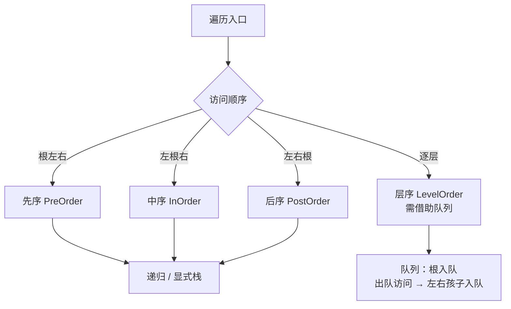

**由遍历序列确定二叉树**：

| 已知序列组合 | 能否唯一确定 | 说明                             |
| :----------- | :----------- | :------------------------------- |
| 先序 + 中序  | ✅            | 先序定根，中序分左右             |
| 后序 + 中序  | ✅            | 后序定根（最后一个），中序分左右 |
| 层序 + 中序  | ✅            | 层序定根，中序分左右             |
| 先序 + 后序  | ❌            | 无法区分只有一个孩子的左右情形   |
| 先序 + 层序  | ❌            | 一般不能                         |

### 5.4 易错点

1. 🔴 **n₀ = n₂ + 1** 是最常考也最常错的性质。注意是 **n₀ = n₂ + 1**，不是 n₀ = n₁ + 1。
2. 🔴 **完全二叉树高度公式**：`h = ⌊log₂n⌋ + 1`。别写成 `⌈log₂n⌉`（虽然多数情况等价，但 n = 2^k 时 `⌈log₂n⌉ = k` 而正确答案是 k+1，⌊⌋+1 才正确）。
3. 🔴 **"度为 2 的树"与"二叉树"不同**：度为 2 的树中每个结点要么有 0 个孩子要么有 2 个孩子，**不存在度为 1 的结点**；二叉树允许。
4. 🔴 **中序线索二叉树找后继**：
   - 若 `rtag == 1`，后继就是 `rchild`；
   - 若 `rtag == 0`，后继是右子树的**最左下结点**。
5. 🟡 **先序/后序 + 中序可唯一确定**，但**先序 + 后序不能**。
6. 🟡 **满二叉树一定是完全二叉树**，反之不成立。
7. 🟡 完全二叉树中叶子结点只可能出现在**最后两层**。
8. 🟡 n 个结点的完全二叉树，叶子结点数为 `⌊n/2⌋` 或 `⌈n/2⌉`（推导：编号大于 `⌊n/2⌋` 的都是叶子）→ **叶子数 = ⌈n/2⌉**。
9. 🟡 **哈夫曼树中没有度为 1 的结点**，故 `n = 2n₀ - 1`，即 `n₀ = (n+1)/2`。

### 5.5 代码示例

#### 5.5.1 二叉树结构体与四种递归遍历

```c
#include <stdio.h>
#include <stdlib.h>

typedef char ElemType;

typedef struct BiTNode {
    ElemType data;
    struct BiTNode *lchild, *rchild;
} BiTNode, *BiTree;

/* 先序遍历：根 → 左 → 右 */
void PreOrder(BiTree T) {
    if (!T) return;
    printf("%c ", T->data);
    PreOrder(T->lchild);
    PreOrder(T->rchild);
}

/* 中序遍历：左 → 根 → 右 */
void InOrder(BiTree T) {
    if (!T) return;
    InOrder(T->lchild);
    printf("%c ", T->data);
    InOrder(T->rchild);
}

/* 后序遍历：左 → 右 → 根 */
void PostOrder(BiTree T) {
    if (!T) return;
    PostOrder(T->lchild);
    PostOrder(T->rchild);
    printf("%c ", T->data);
}
```

#### 5.5.2 非递归中序遍历（用栈）

```c
void InOrderNonRec(BiTree T) {
    BiTree stack[100];
    int top = -1;
    BiTree p = T;
    while (p || top != -1) {
        if (p) {                      /* 一路向左，沿途入栈 */
            stack[++top] = p;
            p = p->lchild;
        } else {                      /* 左边空了，弹出访问，转向右子树 */
            p = stack[top--];
            printf("%c ", p->data);
            p = p->rchild;
        }
    }
}
```

#### 5.5.3 层序遍历（用队列）

```c
void LevelOrder(BiTree T) {
    if (!T) return;
    BiTree q[100];
    int front = 0, rear = 0;
    q[rear++] = T;                     /* 根入队 */
    while (front < rear) {
        BiTree p = q[front++];         /* 出队 */
        printf("%c ", p->data);
        if (p->lchild) q[rear++] = p->lchild;
        if (p->rchild) q[rear++] = p->rchild;
    }
}
```

#### 5.5.4 求树高 / 结点数 / 叶子数

```c
int TreeHeight(BiTree T) {
    if (!T) return 0;
    int l = TreeHeight(T->lchild), r = TreeHeight(T->rchild);
    return (l > r ? l : r) + 1;
}

int NodeCount(BiTree T) {
    if (!T) return 0;
    return NodeCount(T->lchild) + NodeCount(T->rchild) + 1;
}

int LeafCount(BiTree T) {
    if (!T) return 0;
    if (!T->lchild && !T->rchild) return 1;
    return LeafCount(T->lchild) + LeafCount(T->rchild);
}
```

#### 5.5.5 由先序 + 中序序列重建二叉树（408 高频）

```c
/* pre[0..n-1] 先序，in[0..n-1] 中序，n 为结点个数 */
BiTree BuildTree(const ElemType *pre, const ElemType *in, int n) {
    if (n <= 0) return NULL;
    BiTree root = (BiTree)malloc(sizeof(BiTNode));
    root->data = pre[0];                    /* 先序首个即根 */
    int k = 0;
    while (in[k] != pre[0]) k++;            /* 在中序中定位根 */
    root->lchild = BuildTree(pre + 1, in, k);
    root->rchild = BuildTree(pre + k + 1, in + k + 1, n - k - 1);
    return root;
}
```

#### 5.5.6 线索二叉树

```c
typedef struct ThreadNode {
    ElemType data;
    struct ThreadNode *lchild, *rchild;
    int ltag, rtag;      /* 0 表示指向孩子，1 表示指向前驱/后继 */
} ThreadNode, *ThreadTree;

static ThreadNode *pre = NULL;   /* 全局前驱指针 */

/* 中序线索化 */
void InThread(ThreadTree p) {
    if (!p) return;
    InThread(p->lchild);
    if (!p->lchild) { p->ltag = 1; p->lchild = pre; }   /* 左空指前驱 */
    if (pre && !pre->rchild) { pre->rtag = 1; pre->rchild = p; } /* 前驱右空指后继 */
    pre = p;
    InThread(p->rchild);
}

void CreateInThread(ThreadTree T) {
    pre = NULL;
    if (T) {
        InThread(T);
        if (!pre->rchild) pre->rtag = 1;    /* 最后一个结点右指针置线索 */
    }
}
```

#### 5.5.7 哈夫曼树与哈夫曼编码（贪心）

```c
/* 哈夫曼树思想：每次取权值最小的两棵树合并，新权值 = 二者之和 */
#define N 100
typedef struct {
    int weight;
    int parent, lchild, rchild;
} HTNode;

/* 构造哈夫曼树：n 个叶子，共 2n-1 个结点 */
void CreateHuffmanTree(HTNode HT[], int w[], int n) {
    int m = 2 * n - 1;
    for (int i = 1; i <= m; i++) {           /* 初始化 */
        HT[i].weight = (i <= n) ? w[i - 1] : 0;
        HT[i].parent = HT[i].lchild = HT[i].rchild = 0;
    }
    for (int i = n + 1; i <= m; i++) {       /* 合并 n-1 次 */
        int s1 = 0, s2 = 0;                  /* s1<s2 为权值最小的两个根 */
        for (int j = 1; j < i; j++) {
            if (HT[j].parent != 0) continue;
            if (s1 == 0 || HT[j].weight < HT[s1].weight) { s2 = s1; s1 = j; }
            else if (s2 == 0 || HT[j].weight < HT[s2].weight) { s2 = j; }
        }
        HT[s1].parent = HT[s2].parent = i;
        HT[i].lchild = s1; HT[i].rchild = s2;
        HT[i].weight = HT[s1].weight + HT[s2].weight;
    }
}
```

**WPL（带权路径长度）** = Σ(叶子权值 × 叶子深度)。哈夫曼树是**WPL 最小**的二叉树。

#### 5.5.8 并查集（集合的表示，408 常考）

```c
#define MAXN 1000
int parent[MAXN];        /* parent[i] 表示 i 的双亲；负数表示是根，绝对值=集合大小 */

void InitUF(int n) {
    for (int i = 0; i < n; i++) parent[i] = -1;
}

/* 查找根 + 路径压缩 */
int Find(int x) {
    int root = x;
    while (parent[root] >= 0) root = parent[root];   /* 找根 */
    while (x != root) {                              /* 路径压缩 */
        int t = parent[x];
        parent[x] = root;
        x = t;
    }
    return root;
}

/* 按大小合并（小树并入大树）*/
void Union(int a, int b) {
    int ra = Find(a), rb = Find(b);
    if (ra == rb) return;
    if (parent[ra] > parent[rb]) { int t = ra; ra = rb; rb = t; } /* 保证 ra 更大 */
    parent[ra] += parent[rb];
    parent[rb] = ra;
}
```

> **复杂度**：仅路径压缩 → 均摊 O(log n)；路径压缩 + 按大小合并 → 均摊 **O(α(n))**（近似 O(1)）。

### 5.6 树与二叉树对比表

| 对比项          | 二叉树                                 | 树（度为 m）                           | 森林                            |
| :-------------- | :------------------------------------- | :------------------------------------- | :------------------------------ |
| 结点数 n（n>0） | 边数 n-1                               | 边数 n-1                               | 边数 n-（树的棵数）             |
| 子树有序性      | 左右有序，不可交换                     | 一般无序                               | —                               |
| 结点 i 的孩子数 | 最多 2                                 | 最多 m                                 | —                               |
| 存储方式        | 顺序（完全二叉树）、二叉链表、三叉链表 | 双亲表示法、孩子表示法、孩子兄弟表示法 | —                               |
| 与二叉树的转换  | —                                      | 树 → 二叉树（左孩子右兄弟）            | 森林 → 二叉树（树间用右指针连） |

**树 / 森林 / 二叉树的对应关系**（左孩子右兄弟表示法）：

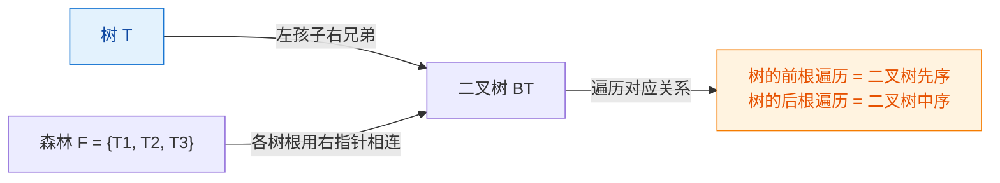

### 5.7 实操练习

- **练习 5-1**：已知先序 `ABDECFG`、中序 `DBEAFCG`，画出二叉树并写出后序序列。
- **练习 5-2**：一棵完全二叉树有 768 个结点，求叶子结点数和树高。
- **练习 5-3**：编写函数交换二叉树的左右子树（递归 + 非递归两种）。
- **练习 5-4**：判断一棵二叉树是否为完全二叉树（利用层序遍历 + 空结点标志）。
- **练习 5-5**：求二叉树中结点值等于 x 的结点所在的层次。
- **练习 5-6**：给定字符及其权值 {a:5, b:9, c:12, d:13, e:16, f:45}，构造哈夫曼树并求 WPL。

### 5.8 408 相关习题

**题 5-1（选择·必考）** 若一棵二叉树有 15 个度为 2 的结点、8 个度为 1 的结点，则叶子结点个数为（　）。
A. 15　B. 16　C. 17　D. 23

<details>
<summary>👉 点击查看答案与解析</summary>

> **答案：B**

利用性质 **n₀ = n₂ + 1**：`n₀ = 15 + 1 = 16`。

**注意**：度为 1 的结点数（8）是**干扰项**，与 n₀ 无关。

**验证**：总结点数 `n = n₀ + n₁ + n₂ = 16 + 8 + 15 = 39`。
边数 = `n₁ + 2n₂ = 8 + 30 = 38 = 39 - 1` ✅（树的性质：边数 = n - 1）

</details>

**题 5-2（选择）** 已知一棵完全二叉树共有 1000 个结点，则叶子结点个数为（　）。
A. 489　B. 500　C. 501　D. 512

<details>
<summary>👉 点击查看答案与解析</summary>

> **答案：B**

**方法一（编号法）**：完全二叉树中，编号 > ⌊n/2⌋ = 500 的结点都是叶子，即编号 501 ~ 1000，共 **500** 个。

**方法二（公式法）**：n = 1000 为偶数时，n₁ = 1（只有一个度为 1 的结点），故
`n₀ = (n - n₁) / 2 + ...` 更严谨的推导：

- n = n₀ + n₁ + n₂，n₀ = n₂ + 1
- 若 n 为偶数，则 n₁ = 1；代入：1000 = n₀ + 1 + (n₀ - 1) → `2n₀ = 1000` → **n₀ = 500** ✅
- 若 n 为奇数，则 n₁ = 0；代入：n = 2n₀ - 1 → n₀ = (n+1)/2

**速记**：

- n 为偶数 → 叶子数 = n/2，度为 1 的结点 = 1
- n 为奇数 → 叶子数 = (n+1)/2，度为 1 的结点 = 0

</details>

**题 5-3（选择）** 一棵二叉树的先序遍历为 ABCDEF，中序遍历为 CBAEDF，则后序遍历为（　）。
A. CBEFDA　B. FEDCBA　C. CBEDFA　D. 不确定

<details>
<summary>👉 点击查看答案与解析</summary>

> **答案：A**

**重建过程**：

1. 先序首字符 A 是根。中序中以 A 分割：左 `{C,B}`，右 `{E,D,F}`。
2. 左子树：先序为 `BC`（A 之后长度 2），中序为 `CB` → 根 B，B 的左孩子 C（因为中序 C 在 B 前）。
3. 右子树：先序为 `DEF`，中序为 `EDF` → 根 D，左子树中序 `{E}`、右子树中序 `{F}` → D 的左孩子 E、右孩子 F。

树结构：

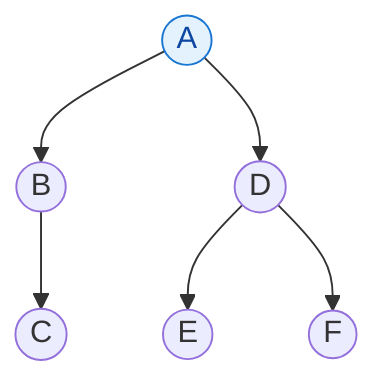

4. 后序（左右根）：C → B → E → F → D → A = **CBEFDA** ✅

**校验技巧**：后序的最后一个字符一定是根 A，选项中只有 A 以 A 结尾。

</details>

**题 5-4（408 算法设计题）** 编写一个算法，判断给定的二叉树是否为二叉排序树（BST）。要求给出思路并分析复杂度。

<details>
<summary>👉 点击查看答案与解析</summary>

**思路**：BST 的**中序遍历是递增序列**。因此只需中序遍历，检查是否严格递增即可。

```c
/* 用全局（或静态）变量记录中序前驱 */
static BiTree prev = NULL;

int IsBST(BiTree T) {
    if (!T) return 1;
    if (!IsBST(T->lchild)) return 0;         /* 左子树不是 BST */
    if (prev && prev->data >= T->data) return 0; /* 违反递增 */
    prev = T;                                 /* 更新前驱 */
    return IsBST(T->rchild);                  /* 右子树 */
}
```

**复杂度**：时间 O(n)（每个结点访问一次），空间 O(h)（递归栈深度 = 树高）。

**常见错误**：

1. 只检查"左孩子 < 根 < 右孩子"，这是**局部检查**，不能保证整体有序。
   - 反例：根 10，左子树根 5，但 5 的右孩子是 12 → 局部满足（12 > 5 且 12 在 10 的左子树中）却违反 BST。
2. 忘记用 `prev` 记录中序前驱，导致无法比较。

**另一种解法**：用中序遍历 + 全局数组，再检查数组是否递增，需要 O(n) 额外空间。

</details>

**题 5-5（408 算法设计题）** 给定两个序列，分别是一棵二叉树的先序和中序，编写算法构造该二叉树并返回根结点。

<details>
<summary>👉 点击查看答案与解析</summary>

```c
typedef char ElemType;

BiTree CreateByPreIn(const ElemType *pre, const ElemType *in, int n) {
    if (n == 0) return NULL;
    BiTree root = (BiTree)malloc(sizeof(BiTNode));
    root->data = pre[0];
    int k = 0;
    while (in[k] != pre[0]) k++;      /* 找到根在中序中的位置 */
    root->lchild = CreateByPreIn(pre + 1, in, k);
    root->rchild = CreateByPreIn(pre + 1 + k, in + k + 1, n - 1 - k);
    return root;
}
```

**复杂度**：

- 时间：最坏 O(n²)（每次都要线性查找根的位置）。若用哈希表预存"值 → 中序下标"，可优化到 **O(n)**。
- 空间：O(h)，h 为树高（递归栈）。

**关键细节**：

1. **右子树先序起点** = `pre + 1 + k`（跳过根 + 左子树共 k 个结点）。
2. **右子树中序起点** = `in + k + 1`（跳过左子树 k 个 + 根 1 个）。
3. 左子树大小 = k，右子树大小 = `n - 1 - k`。

**同理**：后序 + 中序构造时，根在后序的**最后一个**位置，递归顺序应先构造右子树再左子树（或者用下标计算）。

</details>

---

## 模块 6 · 图

### 6.1 核心概念

**图 G = (V, E)**：V 是顶点集，E 是边集。图是**多对多**的关系，比线性表和树更一般。

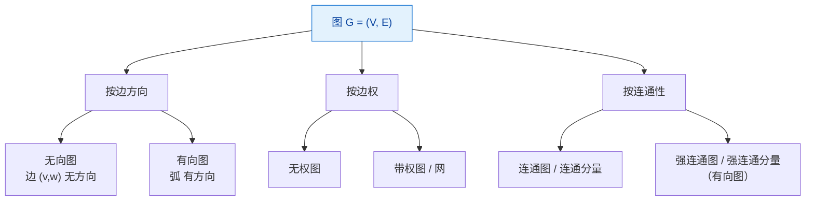

**关键术语**：

| 术语           | 定义                                                                        |
| :------------- | :-------------------------------------------------------------------------- |
| 顶点的度 TD(v) | 与该顶点相关联的边的数目（有向图分**入度 ID** 和**出度 OD**，TD = ID + OD） |
| 路径           | 顶点序列；**回路（环）**是首尾相同的路径                                    |
| 简单路径       | 顶点不重复出现的路径                                                        |
| 连通图         | 无向图中任意两顶点都有路径                                                  |
| 连通分量       | 无向图的**极大**连通子图                                                    |
| 强连通图       | 有向图中任意两顶点 v→w 且 w→v 都有路径                                      |
| 强连通分量     | 有向图的**极大**强连通子图                                                  |
| 生成树         | 连通图的**极小连通子图**，含 n 个顶点、n-1 条边                             |
| 生成森林       | 非连通图的各连通分量的生成树集合                                            |

**重要性质**：

- 无向图：`ΣTD(v) = 2E`（每条边贡献 2 度）
- 有向图：`ΣID(v) = ΣOD(v) = E`
- n 个顶点的无向完全图有 `n(n-1)/2` 条边；有向完全图有 `n(n-1)` 条弧
- n 个顶点的连通图**至少**有 n-1 条边；强连通图**至少**有 n 条边

### 6.2 存储结构对比

| 存储方式       | 空间   | 判断 (i,j) 是否有边 | 求某顶点的所有邻接点 | 适用场景                 |
| :------------- | :----- | :------------------ | :------------------- | :----------------------- |
| **邻接矩阵**   | O(n²)  | O(1)                | O(n)                 | 稠密图、需频繁判边       |
| **邻接表**     | O(n+e) | O(度)               | O(度)                | 稀疏图、需遍历邻接点     |
| **十字链表**   | O(n+e) | O(出度+入度)        | 方便                 | 有向图，求入度出度都方便 |
| **邻接多重表** | O(n+e) | 方便                | 方便                 | 无向图，删边方便         |

**邻接矩阵的性质**：

- 无向图的邻接矩阵是**对称矩阵**（可压缩存储）。
- 第 i 行非零元素个数 = 顶点 i 的**度**（无向图）或**出度**（有向图）。
- 第 i 列非零元素个数 = 顶点 i 的**入度**（有向图）。
- `A^n` 中 `A^n[i][j]` = 从 i 到 j 长度为 n 的**路径条数**。

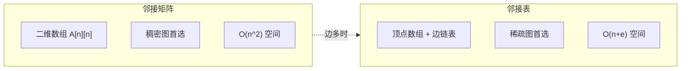

### 6.3 图的遍历

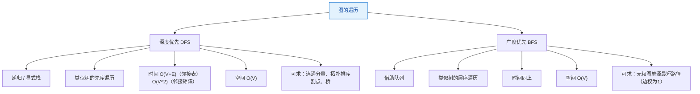

**DFS 与 BFS 对比**：

| 维度             | DFS                    | BFS                                  |
| :--------------- | :--------------------- | :----------------------------------- |
| 数据结构         | 栈（递归栈）           | 队列                                 |
| 时间（邻接表）   | O(V+E)                 | O(V+E)                               |
| 时间（邻接矩阵） | O(V²)                  | O(V²)                                |
| 空间             | O(V)                   | O(V)                                 |
| 特殊能力         | 求强连通分量、拓扑排序 | **无权图最短路径**                   |
| 遍历序列         | **不唯一**             | **不唯一**（取决于起点和邻接点顺序） |

> 🔴 **重点**：给定邻接表时，DFS/BFS 序列**唯一**（因为邻接点顺序已定）；给定邻接矩阵时，按**编号递增**顺序访问则序列也唯一。题目说"不唯一"通常指未指定邻接点访问顺序。

### 6.4 最小生成树（MST）

**适用**：**带权连通无向图**。MST 的边数为 n-1。

| 算法        | 思想                                                 | 时间复杂度                                 | 适用       |
| :---------- | :--------------------------------------------------- | :----------------------------------------- | :--------- |
| **Prim**    | 从顶点出发，每次选**连接已选集合与未选集合的最小边** | O(V²)（邻接矩阵）<br/>O(E log V)（堆优化） | **稠密图** |
| **Kruskal** | 按边权**从小到大**排序，用并查集判环，不构成环就加入 | O(E log E)                                 | **稀疏图** |

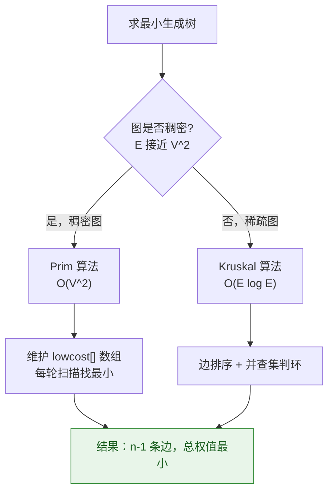

> **MST 性质**：若图中所有边权**互不相同**，则 MST **唯一**；若存在相同权值的边，MST 可能不唯一，但**总权值一定相同**。

### 6.5 最短路径

| 算法             | 解决什么问题               | 复杂度              | 能否处理负权边 | 能否处理负环        |
| :--------------- | :------------------------- | :------------------ | :------------- | :------------------ |
| **BFS**          | 无权图单源最短路           | O(V+E)              | 无负权概念     | —                   |
| **Dijkstra**     | 单源最短路，**非负权**     | O(V²) 或 O(E log V) | ❌ **不能**     | ❌                   |
| **Floyd**        | **多源**最短路（任意两点） | O(V³)               | ✅ 可以         | ❌（会得到错误结果） |
| **Bellman-Ford** | 单源最短路，可负权         | O(VE)               | ✅              | ✅ 可检测            |

**Dijkstra 手算流程**（必考）：

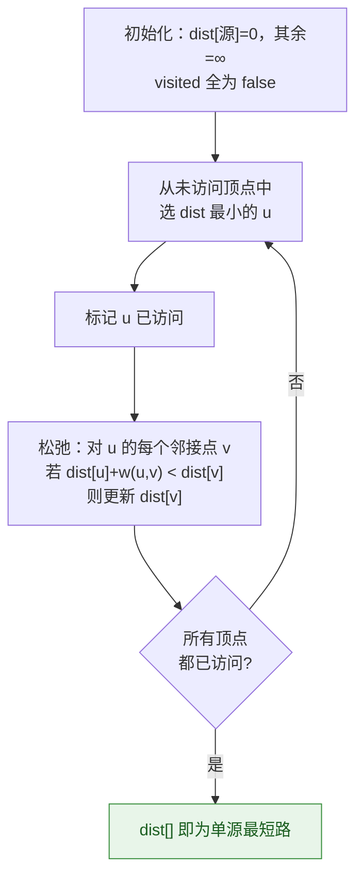

**Floyd 核心三重循环**：

```c
for (int k = 0; k < n; k++)          /* 中转点必须最外层！ */
    for (int i = 0; i < n; i++)
        for (int j = 0; j < n; j++)
            if (A[i][k] + A[k][j] < A[i][j])
                A[i][j] = A[i][k] + A[k][j];
```

> 🔴 **k 必须是最外层循环**。如果把 k 放内层，会导致路径信息不完整，结果错误。这是 Floyd 最容易出错的地方。

### 6.6 拓扑排序与关键路径

**AOV 网**：顶点表示活动，弧表示活动间的**先后关系**。拓扑排序是 AOV 网的**可行线性序列**。

**AOE 网**：顶点表示事件，弧表示活动（带权，权为持续时间）。关键路径是**从源点到汇点的最长路径**。

| 术语                         | 定义                                             |
| :--------------------------- | :----------------------------------------------- |
| 事件 vᵢ 的最早发生时间 ve(i) | 从源点到 vᵢ 的**最长**路径长度                   |
| 事件 vᵢ 的最晚发生时间 vl(i) | 不推迟整个工期的前提下，vᵢ 必须发生的最迟时间    |
| 活动 aₖ 的最早开始时间 e(k)  | = 该活动起点事件的最早发生时间 ve                |
| 活动 aₖ 的最晚开始时间 l(k)  | = 该活动终点事件的最晚发生时间 vl − 活动持续时间 |
| **时间余量**                 | `l(k) − e(k)`；为 0 的活动就是**关键活动**       |

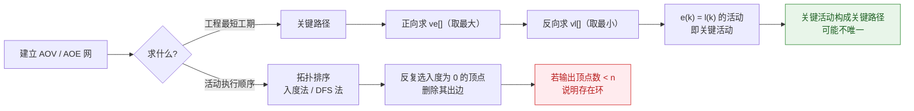

**拓扑排序（入度法）**：

```c
/* 返回 1 表示成功（无环），0 表示有环 */
int TopologicalSort(ALGraph G, int topo[]) {
    int indegree[MAXV] = {0};
    for (int i = 0; i < G.vexnum; i++)                 /* 统计入度 */
        for (EdgeNode *p = G.adj[i].first; p; p = p->next)
            indegree[p->adjvex]++;

    int stack[MAXV], top = -1, cnt = 0;
    for (int i = 0; i < G.vexnum; i++)
        if (indegree[i] == 0) stack[++top] = i;        /* 入度 0 入栈 */

    while (top != -1) {
        int u = stack[top--];
        topo[cnt++] = u;                               /* 输出 */
        for (EdgeNode *p = G.adj[u].first; p; p = p->next) {
            int v = p->adjvex;
            if (--indegree[v] == 0) stack[++top] = v;  /* 入度变 0 则入栈 */
        }
    }
    return cnt == G.vexnum;                            /* 全部输出则无环 */
}
```

> 用**栈**得到一种拓扑序；用**队列**得到另一种（仍合法）。若要求"字典序最小"，则用优先队列。

### 6.7 易错点

1. 🔴 **Dijkstra 不能处理负权边**。有负权必须用 Bellman-Ford 或 Floyd。这是选择题高频陷阱。
2. 🔴 **Floyd 的三重循环 k 必须在最外层**。
3. 🔴 **Prim 用于稠密图，Kruskal 用于稀疏图**，选择依据是 V 和 E 的相对大小，不是"哪个更好"。
4. 🔴 **拓扑排序序列不唯一**（除非图是链状）；但**拓扑排序存在性唯一**（有环则不存在）。
5. 🟡 **MST 的边权总和唯一，但 MST 本身未必唯一**（有等权边时）。
6. 🟡 **关键路径可能不唯一**；**缩短工期时必须缩短关键活动**，但缩短某个关键活动后，关键路径可能改变。
7. 🟡 **邻接矩阵适合稠密图，邻接表适合稀疏图**。判断标准：`E << V²` 为稀疏。
8. 🟡 无向图的邻接表边结点数是 `2E`；有向图是 `E`。做空间计算题时注意。
9. 🟡 **n 个顶点的无向连通图至少有 n-1 条边**，但这也是**生成树**的边数，与完全图的 `n(n-1)/2` 区分开。
10. 🟡 求**强连通分量**的方法：Kosaraju（两次 DFS + 逆图）或 Tarjan。408 一般不要求手写，但要知道概念。

### 6.8 代码示例

#### 6.8.1 邻接矩阵存储 + DFS/BFS

```c
#include <stdio.h>
#include <stdlib.h>
#include <string.h>

#define MAXV 100
#define INF  0x3f3f3f3f

typedef struct {
    char vex[MAXV];             /* 顶点表 */
    int  edge[MAXV][MAXV];      /* 邻接矩阵，INF 表示无边 */
    int  vexnum, edgenum;
} MGraph;

int visited[MAXV];

/* 邻接矩阵 DFS：O(V^2) */
void DFS_Matrix(MGraph *G, int v) {
    printf("%c ", G->vex[v]);
    visited[v] = 1;
    for (int w = 0; w < G->vexnum; w++)
        if (G->edge[v][w] != INF && !visited[w])
            DFS_Matrix(G, w);
}

/* 邻接矩阵 BFS：O(V^2) */
void BFS_Matrix(MGraph *G, int v) {
    int q[MAXV], front = 0, rear = 0;
    memset(visited, 0, sizeof(visited));
    printf("%c ", G->vex[v]);
    visited[v] = 1;
    q[rear++] = v;
    while (front < rear) {
        int u = q[front++];
        for (int w = 0; w < G->vexnum; w++)
            if (G->edge[u][w] != INF && !visited[w]) {
                printf("%c ", G->vex[w]);
                visited[w] = 1;
                q[rear++] = w;
            }
    }
}
```

#### 6.8.2 邻接表存储 + DFS

```c
typedef struct EdgeNode {
    int adjvex;                     /* 邻接点下标 */
    int weight;                     /* 边权 */
    struct EdgeNode *next;
} EdgeNode;

typedef struct VNode {
    char data;
    EdgeNode *first;
} VNode, AdjList[MAXV];

typedef struct {
    AdjList adj;
    int vexnum, edgenum;
} ALGraph;

/* 邻接表 DFS：O(V+E) */
void DFS_List(ALGraph *G, int v) {
    printf("%c ", G->adj[v].data);
    visited[v] = 1;
    for (EdgeNode *p = G->adj[v].first; p; p = p->next)
        if (!visited[p->adjvex])
            DFS_List(G, p->adjvex);
}
```

#### 6.8.3 Prim 算法（邻接矩阵）

```c
/* 返回 MST 总权值，parent[] 记录 MST 的边 */
int Prim(MGraph *G, int start, int parent[]) {
    int dist[MAXV], inMST[MAXV];
    for (int i = 0; i < G->vexnum; i++) {
        dist[i] = G->edge[start][i];    /* 到已选集合的最小边权 */
        inMST[i] = 0;
        parent[i] = start;
    }
    dist[start] = 0;
    inMST[start] = 1;
    int total = 0;

    for (int cnt = 1; cnt < G->vexnum; cnt++) {
        int u = -1, min = INF;
        for (int i = 0; i < G->vexnum; i++)          /* 找最小 dist */
            if (!inMST[i] && dist[i] < min) { min = dist[i]; u = i; }
        if (u == -1) return -1;                      /* 不连通 */
        inMST[u] = 1;
        total += min;
        for (int v = 0; v < G->vexnum; v++)          /* 更新 dist */
            if (!inMST[v] && G->edge[u][v] < dist[v]) {
                dist[v] = G->edge[u][v];
                parent[v] = u;
            }
    }
    return total;
}
```

#### 6.8.4 Kruskal 算法（并查集）

```c
typedef struct { int u, v, w; } Edge;

static int cmpEdge(const void *a, const void *b) {
    return ((Edge *)a)->w - ((Edge *)b)->w;
}

int uf[MAXV];
static int find(int x) { while (uf[x] >= 0) x = uf[x]; return x; }

/* edges 已按权值升序排列，m 为边数，n 为顶点数 */
int Kruskal(Edge *edges, int m, int n) {
    for (int i = 0; i < n; i++) uf[i] = -1;
    qsort(edges, m, sizeof(Edge), cmpEdge);      /* O(E log E) */
    int total = 0, chosen = 0;
    for (int i = 0; i < m && chosen < n - 1; i++) {
        int ru = find(edges[i].u), rv = find(edges[i].v);
        if (ru != rv) {                          /* 不构成环 */
            uf[ru] = rv;
            total += edges[i].w;
            chosen++;
        }
    }
    return (chosen == n - 1) ? total : -1;       /* -1 表示不连通 */
}
```

#### 6.8.5 Dijkstra（邻接矩阵，非负权）

```c
void Dijkstra(MGraph *G, int src, int dist[], int path[]) {
    int done[MAXV] = {0};
    for (int i = 0; i < G->vexnum; i++) {
        dist[i] = G->edge[src][i];
        path[i] = (dist[i] < INF) ? src : -1;
    }
    dist[src] = 0; done[src] = 1;

    for (int cnt = 1; cnt < G->vexnum; cnt++) {
        int u = -1, min = INF;
        for (int i = 0; i < G->vexnum; i++)
            if (!done[i] && dist[i] < min) { min = dist[i]; u = i; }
        if (u == -1) break;                     /* 剩余顶点不可达 */
        done[u] = 1;
        for (int v = 0; v < G->vexnum; v++)
            if (!done[v] && G->edge[u][v] != INF &&
                dist[u] + G->edge[u][v] < dist[v]) {
                dist[v] = dist[u] + G->edge[u][v];   /* 松弛 */
                path[v] = u;
            }
    }
}
```

#### 6.8.6 Floyd（多源最短路径）

```c
void Floyd(int A[MAXV][MAXV], int n, int path[MAXV][MAXV]) {
    for (int i = 0; i < n; i++)
        for (int j = 0; j < n; j++)
            path[i][j] = (A[i][j] != INF && i != j) ? i : -1;

    for (int k = 0; k < n; k++)              /* ★ k 必须最外层 */
        for (int i = 0; i < n; i++)
            for (int j = 0; j < n; j++)
                if (A[i][k] != INF && A[k][j] != INF &&
                    A[i][k] + A[k][j] < A[i][j]) {
                    A[i][j] = A[i][k] + A[k][j];
                    path[i][j] = path[k][j];
                }
}
```

### 6.9 实操练习

- **练习 6-1**：给定一个含 6 个顶点的带权无向图，分别用 Prim 和 Kruskal 求 MST，比较结果。
- **练习 6-2**：手算下图从 v1 到各顶点的 Dijkstra 最短路径（要求写出逐步的 dist 表格）。
- **练习 6-3**：给定一个有向图，求其所有可能的拓扑排序序列（至少写出 3 种）。
- **练习 6-4**：给定 AOE 网，求 ve[]、vl[]、e[]、l[]，并找出所有关键活动。
- **练习 6-5**：编写算法，判断无向图是否连通（一次 DFS 能否遍历所有顶点）。
- **练习 6-6**：编写算法，求无向图的连通分量个数。

### 6.10 408 相关习题

**题 6-1（选择）** 下列关于最小生成树的说法中，正确的是（　）。
A. 最小生成树一定是唯一的
B. Prim 算法适用于稀疏图，Kruskal 算法适用于稠密图
C. 最小生成树的边数为 n-1
D. 最小生成树中一定包含图中权值最小的边

<details>
<summary>👉 点击查看答案与解析</summary>

> **答案：C**

- A ❌ 当存在权值相同的边时，MST 可能不唯一（但总权值唯一）。
- B ❌ **说反了**。Prim 是 O(V²)，适合**稠密图**；Kruskal 是 O(E log E)，适合**稀疏图**。
- C ✅ n 个顶点的连通图，生成树必含 n-1 条边。
- D ⚠️ 这个说法**在"所有边权互不相同"时成立**（切割性质）；若存在等权边，权值最小的边**一定至少出现在某个 MST 中**，但不一定在每一个 MST 中。因此作为绝对陈述不严谨，故选 C 最稳。

**易错点**：B 选项的方向记忆口诀 —— **"普里姆（P）配稠密（Dense），克鲁斯卡尔（K）配稀疏"**。

</details>

**题 6-2（选择）** 使用 Dijkstra 算法求下图的单源最短路径，若图中存在负权边，则（　）。
A. 结果仍然正确
B. 结果可能错误
C. 算法无法运行，会死循环
D. 需要把负权边转为正权边

<details>
<summary>👉 点击查看答案与解析</summary>

> **答案：B**

Dijkstra 的贪心正确性依赖于"**已确定的 dist 不会再变小**"这一前提，该前提要求所有边权非负。
存在负权边时，后续可能通过负权路径使已标记顶点的 dist 变小，但算法已不再更新它，导致**结果错误**。

**反例（3 个顶点即可击穿）**：

顶点 S、A、B，边权：`S→A = 2`，`S→B = 1`，`A→B = -5`。

| 步骤  | 动作                                                   | dist[S] | dist[A] |   dist[B]    |
| :---: | :----------------------------------------------------- | :-----: | :-----: | :----------: |
| 初始  | —                                                      |    0    |    ∞    |      ∞       |
|   ①   | 选定 S，松弛 A、B                                      |    0    |    2    |      1       |
|   ②   | 从 A、B 中选 **B**（dist=1 最小），**标记 B 为已确定** |    0    |    2    |     1 ✅      |
|   ③   | 选定 A，松弛 B：`2 + (-5) = -3 < 1`                    |    0    |    2    | **仍为 1 ❌** |

第 ③ 步中，算法算出 `dist[A] + (-5) = -3` 比 B 当前的 1 更小，但 **B 早在第 ② 步就被标记为"已确定"，Dijkstra 不会回头修正它**。

**真实最短路径**：`S → A → B = 2 - 5 = -3`，而 Dijkstra 给出的却是 `1`，**答案错误**。

**根因**：Dijkstra 的贪心依赖于"**先出队的顶点不可能再被更短的路径更新**"这一性质，该性质要求所有边权**非负**。负权边破坏了单调性，使已出队顶点的 dist 也可能被后续路径推翻。

**正确做法**：含负权边时改用 **Bellman-Ford**（O(VE)，可检测负环）或 **Floyd**（O(V³)，多源）。

</details>

**题 6-3（选择·真题风格）** 对有 n 个顶点和 e 条边的有向图，采用邻接表存储，则进行拓扑排序的时间复杂度为（　）。
A. O(n)　B. O(e)　C. O(n + e)　D. O(n × e)

<details>
<summary>👉 点击查看答案与解析</summary>

> **答案：C**

拓扑排序流程：

1. 求各顶点入度：需要遍历所有边表，O(n + e)。
2. 顶点入栈/出栈：每个顶点至多进出一次，O(n)。
3. 删除边（减少邻接点入度）：每条边被处理一次，O(e)。

总计 **O(n + e)**。

**对比**：若用邻接矩阵，求入度需 O(n²)，总复杂度 O(n²)。

</details>

**题 6-4（408 算法设计题）** 设计算法，判断一个有向图中是否存在环，并说明思路。

<details>
<summary>👉 点击查看答案与解析</summary>

**方法一（拓扑排序法）**：

有向图存在环 ⟺ **拓扑排序无法输出全部顶点**。

```c
/* G 为邻接表存储的有向图，返回 1 表示有环 */
int HasCycle(ALGraph *G) {
    int indegree[MAXV] = {0};
    for (int i = 0; i < G->vexnum; i++)
        for (EdgeNode *p = G->adj[i].first; p; p = p->next)
            indegree[p->adjvex]++;

    int stack[MAXV], top = -1, cnt = 0;
    for (int i = 0; i < G->vexnum; i++)
        if (indegree[i] == 0) stack[++top] = i;

    while (top != -1) {
        int u = stack[top--];
        cnt++;
        for (EdgeNode *p = G->adj[u].first; p; p = p->next)
            if (--indegree[p->adjvex] == 0) stack[++top] = p->adjvex;
    }
    return cnt != G->vexnum;      /* 未输出全部 => 有环 */
}
```

**方法二（DFS 三色标记法）**：

用三种状态标记顶点：**未访问(0) / 正在访问(1，在递归栈中) / 已完成(2)**。
DFS 过程中若遇到状态为 1 的邻接点，说明存在**回边**，即存在环。

```c
static int state[MAXV];   /* 0 未访问, 1 在栈中, 2 已完成 */

int DFSHasCycle(ALGraph *G, int u) {
    state[u] = 1;                                  /* 标记进入递归栈 */
    for (EdgeNode *p = G->adj[u].first; p; p = p->next) {
        int v = p->adjvex;
        if (state[v] == 1) return 1;               /* 回边 => 有环 */
        if (state[v] == 0 && DFSHasCycle(G, v)) return 1;
    }
    state[u] = 2;                                  /* 标记完成 */
    return 0;
}
```

**复杂度**：两种方法均为 **O(V + E)**（邻接表），空间 O(V)。

**注意**：**无向图**判环不能简单用拓扑排序，需要用**并查集**或 **DFS 时忽略父结点**的方法。

</details>

**题 6-5（408 算法设计题）** 给定一个带权无向图，编写算法求其最小生成树的总权值，并说明所选算法适合的场景。

<details>
<summary>👉 点击查看答案与解析</summary>

**完整解答**：

```c
/* Prim 算法：适合稠密图，O(V^2) */
int Prim(MGraph *G, int start) {
    int dist[MAXV], inMST[MAXV];
    for (int i = 0; i < G->vexnum; i++) { dist[i] = G->edge[start][i]; inMST[i] = 0; }
    dist[start] = 0; inMST[start] = 1;
    int total = 0;

    for (int cnt = 1; cnt < G->vexnum; cnt++) {
        int u = -1, min = INF;
        for (int i = 0; i < G->vexnum; i++)
            if (!inMST[i] && dist[i] < min) { min = dist[i]; u = i; }
        if (u == -1) return -1;               /* 图不连通 */
        inMST[u] = 1;
        total += min;
        for (int v = 0; v < G->vexnum; v++)
            if (!inMST[v] && G->edge[u][v] < dist[v]) dist[v] = G->edge[u][v];
    }
    return total;
}
```

**算法选择依据**：

| 场景              | 选择             | 理由                            |
| :---------------- | :--------------- | :------------------------------ |
| E 接近 V²（稠密） | Prim + 邻接矩阵  | O(V²) 与 E 无关，避免了排序开销 |
| E << V²（稀疏）   | Kruskal + 并查集 | O(E log E)，E 小时极快          |

**共同结论**：两者都是**贪心算法**，都得到总权值最小的生成树，边数都是 n-1。

</details>

---

## 模块 7 · 查找

### 7.1 核心概念

**查找**：在数据集合中找出满足给定条件的数据元素。**平均查找长度 ASL**（Average Search Length）是衡量查找效率的核心指标。

```text
ASL = Σ (Pᵢ × Cᵢ)
```

- `Pᵢ`：查找第 i 个元素的**概率**
- `Cᵢ`：找到第 i 个元素所需比较的**次数**
- 等概率时 `Pᵢ = 1/n`

**查找方法总览**：

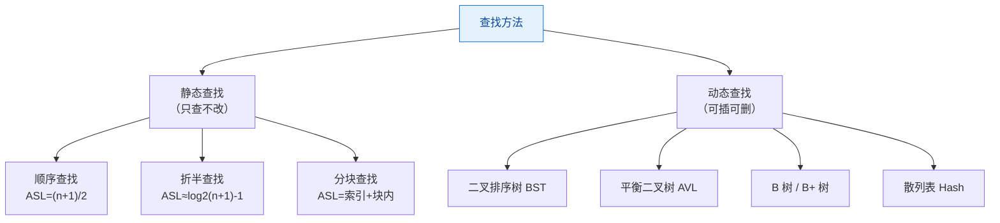

### 7.2 各查找方法对比

| 方法           | 存储要求                | 时间（平均）      | 时间（最坏）         | 能否动态插入删除 | 备注             |
| :------------- | :---------------------- | :---------------- | :------------------- | :--------------- | :--------------- |
| 顺序查找       | 顺序/链式皆可           | O(n)，ASL=(n+1)/2 | O(n)                 | 可以             | 无序也能用       |
| 折半查找       | **必须有序 + 顺序存储** | O(log₂n)          | O(log₂n)             | ❌ 难（需移动）   | 判定树是平衡 BST |
| 分块查找       | 块间有序、块内无序      | O(√n)             | O(√n)                | 可以             | ASL 最小时 s=√n  |
| 二叉排序树     | 链式                    | O(log₂n)（理想）  | **O(n)**（退化成链） | 可以             | 中序有序         |
| 平衡二叉树 AVL | 链式                    | O(log₂n)          | O(log₂n)             | 可以（需旋转）   | 严格平衡         |
| B 树           | 多路平衡                | O(log_m n)        | O(log_m n)           | 可以             | 磁盘友好         |
| 散列表         | 散列存储                | **O(1)**（理想）  | O(n)（冲突严重）     | 可以             | 依赖散列函数     |

> 🔴 **折半查找要求"有序 + 顺序存储"**（链表无法随机访问，不能用折半）。

### 7.3 折半查找

**ASL 推导**：折半查找的判定树是一棵**平衡二叉树**。

- 查找成功的 ASL ≈ **log₂(n+1) − 1**
- 查找失败的 ASL ≈ **log₂(n+1)**
- 树高 `h = ⌊log₂n⌋ + 1`

**代码（迭代 + 递归）**：

```c
/* 迭代版：O(log n) */
int BinarySearch(const int a[], int n, int key) {
    int lo = 0, hi = n - 1;
    while (lo <= hi) {
        int mid = lo + (hi - lo) / 2;      /* 防溢出写法 */
        if (a[mid] == key) return mid;
        else if (a[mid] < key) lo = mid + 1;
        else hi = mid - 1;
    }
    return -1;                             /* 未找到 */
}

/* 递归版 */
int BinarySearchRec(const int a[], int lo, int hi, int key) {
    if (lo > hi) return -1;
    int mid = lo + (hi - lo) / 2;
    if (a[mid] == key) return mid;
    if (a[mid] < key) return BinarySearchRec(a, mid + 1, hi, key);
    return BinarySearchRec(a, lo, mid - 1, key);
}
```

> 🟡 **`mid = lo + (hi - lo) / 2` 优于 `(lo + hi) / 2`**：后者在 lo、hi 很大时可能整型溢出。这是工程实践中的细节。

### 7.4 二叉排序树（BST）

**定义**：或为空树，或满足：**左子树所有结点 < 根 < 右子树所有结点**，且左右子树也是 BST。

**关键操作复杂度**：

| 操作 | 平均     | 最坏（退化成链） |
| :--- | :------- | :--------------- |
| 查找 | O(log₂n) | O(n)             |
| 插入 | O(log₂n) | O(n)             |
| 删除 | O(log₂n) | O(n)             |

**删除的三种情形**：

```mermaid
flowchart TD
    A["删除结点 z"] --> B{"z 的子树情况"}
    B -- "叶子结点" --> C["直接删除"]
    B -- "只有一棵子树" --> D["用唯一的子树<br/>替代 z 的位置"]
    B -- "左右子树都有" --> E["用 z 的中序前驱<br/>或中序后继替代 z<br/>再删除该前驱/后继"]
    C --> F["BST 性质保持"]
    D --> F
    E --> F
    style F fill:#e8f5e9,stroke:#388e3c,color:#1b5e20
```

**代码**：

```c
typedef struct BSTNode {
    int key;
    struct BSTNode *lchild, *rchild;
} BSTNode, *BSTree;

/* 查找（迭代） */
BSTNode *BSTSearch(BSTree T, int key) {
    while (T && T->key != key)
        T = (key < T->key) ? T->lchild : T->rchild;
    return T;
}

/* 插入：返回是否插入成功 */
int BSTInsert(BSTree *T, int key) {
    if (!*T) {
        *T = (BSTNode *)malloc(sizeof(BSTNode));
        (*T)->key = key; (*T)->lchild = (*T)->rchild = NULL;
        return 1;
    }
    if (key == (*T)->key) return 0;             /* 已存在，不插入 */
    if (key < (*T)->key) return BSTInsert(&(*T)->lchild, key);
    return BSTInsert(&(*T)->rchild, key);
}

/* 删除 */
int BSTDelete(BSTree *T, int key) {
    if (!*T) return 0;
    if (key < (*T)->key)       return BSTDelete(&(*T)->lchild, key);
    else if (key > (*T)->key)  return BSTDelete(&(*T)->rchild, key);
    else {                                       /* 找到待删结点 */
        BSTNode *q = *T;
        if (!(*T)->lchild) { *T = (*T)->rchild; free(q); }        /* 只有右子树 */
        else if (!(*T)->rchild) { *T = (*T)->lchild; free(q); }   /* 只有左子树 */
        else {                                   /* 左右都有：用中序前驱替代 */
            BSTNode *s = (*T)->lchild;
            while (s->rchild) s = s->rchild;     /* 找左子树最右结点 */
            (*T)->key = s->key;                  /* 值替换 */
            BSTDelete(&(*T)->lchild, s->key);    /* 递归删除前驱 */
        }
        return 1;
    }
}
```

### 7.5 平衡二叉树（AVL）

**平衡因子 BF** = 左子树高度 − 右子树高度。AVL 要求 **|BF| ≤ 1**。

**四种旋转**：

| 失衡类型 | 判断条件（以 A 为失衡结点）   | 调整方法                 |
| :------- | :---------------------------- | :----------------------- |
| **LL**   | 在 A 的**左孩子的左子树**插入 | **右旋**（单旋）         |
| **RR**   | 在 A 的**右孩子的右子树**插入 | **左旋**（单旋）         |
| **LR**   | 在 A 的**左孩子的右子树**插入 | **先左旋再右旋**（双旋） |
| **RL**   | 在 A 的**右孩子的左子树**插入 | **先右旋再左旋**（双旋） |

```mermaid
flowchart TD
    A["插入导致失衡<br/>找到最小失衡子树根 A"] --> B{"A 的 BF"}
    B -- "BF > 1<br/>（左重）" --> C{"A 左孩子的 BF"}
    C -- "≥ 0" --> D["LL 型 → 右旋 A"]
    C -- "< 0" --> E["LR 型 → 先左旋 A.left<br/>再右旋 A"]
    B -- "BF < -1<br/>（右重）" --> F{"A 右孩子的 BF"}
    F -- "≤ 0" --> G["RR 型 → 左旋 A"]
    F -- "> 0" --> H["RL 型 → 先右旋 A.right<br/>再左旋 A"]
    style D fill:#e8f5e9,stroke:#388e3c,color:#1b5e20
    style E fill:#e8f5e9,stroke:#388e3c,color:#1b5e20
    style G fill:#e8f5e9,stroke:#388e3c,color:#1b5e20
    style H fill:#e8f5e9,stroke:#388e3c,color:#1b5e20
```

**树高与最少结点数**：设 `N(h)` 为高度为 h 的 AVL 树最少结点数，则 `N(h) = N(h-1) + N(h-2) + 1`，`N(0)=0, N(1)=1`。
序列：0, 1, 2, 4, 7, 12, 20, 33, 54, 88, 143 ...

**旋转代码**：

```c
typedef struct AVLNode {
    int key, height;
    struct AVLNode *lchild, *rchild;
} AVLNode, *AVLTree;

static int H(AVLNode *p) { return p ? p->height : 0; }
static int Max(int a, int b) { return a > b ? a : b; }

static void UpdateH(AVLNode *p) { if (p) p->height = Max(H(p->lchild), H(p->rchild)) + 1; }

/* 右旋 */
static AVLNode *RotateRight(AVLNode *y) {
    AVLNode *x = y->lchild;
    y->lchild = x->rchild;
    x->rchild = y;
    UpdateH(y); UpdateH(x);
    return x;                       /* 新的子树根 */
}

/* 左旋 */
static AVLNode *RotateLeft(AVLNode *x) {
    AVLNode *y = x->rchild;
    x->rchild = y->lchild;
    y->lchild = x;
    UpdateH(x); UpdateH(y);
    return y;
}

/* 插入 + 自动平衡 */
AVLNode *AVLInsert(AVLNode *T, int key) {
    if (!T) {
        AVLNode *p = (AVLNode *)malloc(sizeof(AVLNode));
        p->key = key; p->height = 1; p->lchild = p->rchild = NULL;
        return p;
    }
    if (key < T->key)      T->lchild = AVLInsert(T->lchild, key);
    else if (key > T->key) T->rchild = AVLInsert(T->rchild, key);
    else                   return T;                 /* 重复值不插入 */

    UpdateH(T);
    int bf = H(T->lchild) - H(T->rchild);
    if (bf > 1 && key < T->lchild->key)        return RotateRight(T);          /* LL */
    if (bf < -1 && key > T->rchild->key)       return RotateLeft(T);           /* RR */
    if (bf > 1 && key > T->lchild->key) { T->lchild = RotateLeft(T->lchild); return RotateRight(T); } /* LR */
    if (bf < -1 && key < T->rchild->key) { T->rchild = RotateRight(T->rchild); return RotateLeft(T); } /* RL */
    return T;
}
```

### 7.6 B 树与 B+ 树

**B 树（m 阶）的定义**（必背，408 高频考点）：

1. 每个结点**最多**有 m 棵子树（m-1 个关键字）。
2. 若根结点不是叶子，则**至少**有 **2** 棵子树。
3. 除根以外的所有非叶结点**至少**有 **⌈m/2⌉** 棵子树（即至少 `⌈m/2⌉ - 1` 个关键字）。
4. 所有叶结点都在**同一层**，且**不含信息**（可视为失败结点）。
5. 有 k 棵子树的非叶结点恰有 **k-1 个关键字**，关键字按递增排列。

**B 树 vs B+ 树**：

| 对比项       | B 树                 | B+ 树                                |
| :----------- | :------------------- | :----------------------------------- |
| 关键字与记录 | 每个结点都可能存记录 | **只有叶子结点存记录**，非叶仅作索引 |
| 关键字重复   | 不重复               | 非叶结点的关键字**会在叶子中再现**   |
| 叶子链接     | 无                   | **叶子间用指针顺序链接**             |
| 查找         | 可能在非叶结点命中   | **必须走到叶子**（查找路径长度稳定） |
| 范围查询     | 不便                 | **非常方便**（叶子链表顺序扫描）     |
| 典型应用     | 文件索引             | **数据库索引**（MySQL InnoDB）       |

**B 树高度与结点数（含 n 个关键字的 m 阶 B 树）**：

- 最小高度：`h_min = ⌈log_m (n+1)⌉`（每个结点都满）
- 最大高度：`h_max = ⌊log_⌈m/2⌉ ((n+1)/2)⌋ + 1`

### 7.7 散列表（Hash Table）

**核心问题**：如何构造散列函数、如何处理冲突。

**常见散列函数**：

| 方法       | 公式                     | 特点                                   |
| :--------- | :----------------------- | :------------------------------------- |
| 除留余数法 | `H(key) = key % p`       | **最常用**，p 取**小于表长的最大质数** |
| 直接定址法 | `H(key) = a × key + b`   | 无冲突，但空间浪费                     |
| 数字分析法 | 取关键字分布均匀的若干位 | 适用于关键字已知                       |
| 平方取中法 | 取 `key²` 的中间几位     | 适用于关键字位数少                     |

**冲突处理**：

| 方法                   | 原理                              | 优缺点                                 |
| :--------------------- | :-------------------------------- | :------------------------------------- |
| **线性探测法**         | `Hᵢ = (H(key) + i) % m`           | 简单，但**容易产生堆积/聚集**          |
| **平方探测法**         | `Hᵢ = (H(key) ± i²) % m`          | 减少堆积，但**不能保证探测到所有单元** |
| **双散列法**           | `Hᵢ = (H(key) + i × H₂(key)) % m` | 效果好，需设计第二个散列函数           |
| **再散列法**           | 用另一个散列函数                  | 通用                                   |
| **拉链法（链地址法）** | 同义词挂成链表                    | **不产生堆积**，删除方便，适合表长不定 |

**装填因子**：

```text
α = 表中记录数 n / 散列表长度 m
```

> 🔴 **ASL 只依赖于装填因子 α，与表长 m 无关**（这是 408 常考的结论性判断）。

### 7.8 易错点

1. 🔴 **折半查找要求顺序存储**。链表不能折半查找（无法 O(1) 定位 mid）。
2. 🔴 **折半查找判定树的高度**：`h = ⌊log₂n⌋ + 1`，与完全二叉树相同。
3. 🔴 **BST 删除有两个孩子的结点**时，用**中序前驱或中序后继**替代，**不能随便挑一个结点**。
4. 🔴 **AVL 的旋转类型判断方向**：LL → 右旋，RR → 左旋。**"L 和 R 指的是插入位置相对于失衡点的方向，旋转方向与之相反"**。
   - 易错：把 LL 写成"左旋"。
5. 🔴 **B 树非根非叶结点最少关键字数 = ⌈m/2⌉ - 1**，不是 `⌈m/2⌉`。例如 5 阶 B 树最少 2 个关键字。
6. 🟡 **B 树的叶结点不含信息**，是所有查找失败到达的位置。所以"B 树的高度"通常不含叶（失败）层，注意题干。
7. 🟡 **B 树的查找过程中，每个结点内部是顺序/折半查找**，不是只比较一个关键字。
8. 🟡 **散列表的 ASL** 分**成功**和**失败**两种，计算失败 ASL 时**分母是散列函数值域大小（表长）**，分子是各位置探测次数之和。这是最容易算错的地方。
9. 🟡 **线性探测法删除元素时不能直接置空**，需做**删除标记**（否则会截断其他元素的探测链）。拉链法无此问题。
10. 🟡 **散列表的 ASL 与表长 m 无关，只与 α 有关**。

### 7.9 实操练习

- **练习 7-1**：对有序表 `{5, 13, 19, 21, 37, 56, 64, 75, 80, 88, 92}` 画出折半查找判定树，并计算 ASL（成功/失败）。
- **练习 7-2**：依次插入 `{45, 24, 53, 12, 37, 93}` 构造 BST，再删除 45，画出结果。
- **练习 7-3**：依次插入 `{16, 3, 7, 11, 9, 26, 18, 14, 15}` 构造 AVL 树，写出每次旋转的类型。
- **练习 7-4**：在长度为 13 的散列表中（`H(key) = key % 13`）用线性探测法依次插入 `{18, 41, 22, 44, 59, 32, 31, 73}`，求成功与失败的 ASL。
- **练习 7-5**：3 阶 B 树（2-3 树）中依次插入 `{1,2,3,4,5,6,7}`，画出分裂过程。

### 7.10 408 相关习题

**题 7-1（选择）** 对长度为 12 的有序表进行折半查找，则查找成功时的平均查找长度为（　）。
A. 3　B. 37/12　C. 4　D. 39/12

<details>
<summary>👉 点击查看答案与解析</summary>

> **答案：B**

n = 12，按 `mid = ⌊(lo+hi)/2⌋`（1-based 位置）画判定树，逐层分布如下：

```mermaid
flowchart TD
    N6(("6")) --> N3(("3"))
    N6 --> N9(("9"))
    N3 --> N1(("1"))
    N3 --> N4(("4"))
    N9 --> N7(("7"))
    N9 --> N11(("11"))
    N1 --> N2(("2"))
    N4 --> N5(("5"))
    N7 --> N8(("8"))
    N11 --> N10(("10"))
    N11 --> N12(("12"))
    style N6 fill:#e3f2fd,stroke:#1976d2,color:#0d47a1
    style N3 fill:#e8f5e9,stroke:#388e3c,color:#1b5e20
    style N9 fill:#e8f5e9,stroke:#388e3c,color:#1b5e20
    style N1 fill:#fff3e0,stroke:#f57c00,color:#e65100
    style N4 fill:#fff3e0,stroke:#f57c00,color:#e65100
    style N7 fill:#fff3e0,stroke:#f57c00,color:#e65100
    style N11 fill:#fff3e0,stroke:#f57c00,color:#e65100
    style N2 fill:#ffebee,stroke:#d32f2f,color:#b71c1c
    style N5 fill:#ffebee,stroke:#d32f2f,color:#b71c1c
    style N8 fill:#ffebee,stroke:#d32f2f,color:#b71c1c
    style N10 fill:#ffebee,stroke:#d32f2f,color:#b71c1c
    style N12 fill:#ffebee,stroke:#d32f2f,color:#b71c1c
```

|   层次   | 结点            |  个数  | 该层比较次数 |
| :------: | :-------------- | :----: | :----------: |
| 第 1 层  | 6               |   1    |      1       |
| 第 2 层  | 3, 9            |   2    |      2       |
| 第 3 层  | 1, 4, 7, 11     |   4    |      3       |
| 第 4 层  | 2, 5, 8, 10, 12 |   5    |      4       |
| **合计** |                 | **12** |              |

`ASL = (1×1 + 2×2 + 3×4 + 4×5) / 12 = (1 + 4 + 12 + 20) / 12 = 37/12` ✅

**校验**：各层结点数之和 1+2+4+5 = 12 = n ✅。
**失败 ASL（补充）**：外部结点（失败位置）共 13 = n + 1 个，其中第 4 层 3 个（来自结点 1、4、7 各自缺失的左孩子）、第 5 层 10 个，`ASL_失败 = (3×4 + 10×5)/13 = 62/13 ≈ 4.77`。

**速算口诀**：n 个元素的折半查找判定树，各层结点数按 1、2、4、8… 增长，**最后一层可能不满**。`ASL = Σ(层号 × 该层结点数) / n`。

</details>

**题 7-2（选择）** 在含有 n 个关键字的平衡二叉树（AVL）中查找一个元素，其时间复杂度为（　）。
A. O(1)　B. O(log₂n)　C. O(n)　D. O(n log₂n)

<details>
<summary>👉 点击查看答案与解析</summary>

> **答案：B**

AVL 的性质保证了树高 `h = O(log₂n)`（严格证明：高度为 h 的 AVL 树最少结点数 `N(h)` 满足 `N(h) = N(h-1) + N(h-2) + 1`，解得 `N(h) ≈ φ^h / √5`，故 `h ≈ log_φ N ≈ 1.44 log₂N`）。

因此查找、插入、删除都是 **O(log₂n)**，这是 AVL 优于普通 BST（最坏 O(n)）的核心价值。

**注意区别**：普通 BST 的**平均**查找是 O(log₂n)，但**最坏**是 O(n)（退化成单链）；AVL 的**最坏**也是 O(log₂n)。

</details>

**题 7-3（选择·高频）** 含有 n 个关键字的 5 阶 B 树中，除根结点外的非叶结点最少有（　）个关键字。
A. 1　B. 2　C. 3　D. 5

<details>
<summary>👉 点击查看答案与解析</summary>

> **答案：B**

m 阶 B 树（m = 5）：非根非叶结点至少有 **⌈m/2⌉ = ⌈5/2⌉ = 3** 棵子树，因而有 **3 - 1 = 2** 个关键字。

**通用公式**：非根非叶结点的**最少关键字数 = ⌈m/2⌉ - 1**；**最多关键字数 = m - 1**。

验证：

|   m   | 最少关键字 | 最多关键字 |
| :---: | :--------: | :--------: |
|   3   |     1      |     2      |
|   4   |     1      |     3      |
|   5   |     2      |     4      |
|   6   |     2      |     5      |
|   7   |     3      |     6      |

**记忆技巧**：`⌈m/2⌉ - 1 = ⌊(m-1)/2⌋`，即"向上取整减一"等价于"向下取整"。

</details>

**题 7-4（408 综合题）** 将关键字序列 `{7, 8, 30, 11, 18, 9, 14}` 依次插入初始为空的散列表中。散列函数 `H(key) = key % 11`，用**线性探测法**处理冲突，求：
（1）画出最终的散列表；
（2）等概率下查找成功的 ASL；
（3）等概率下查找失败的 ASL。

<details>
<summary>👉 点击查看答案与解析</summary>

> **（1）散列表（表长 11，下标 0~10）**

|  key  | H(key) | 探测过程                   | 最终位置 |
| :---: | :----: | :------------------------- | :------: |
|   7   |   7    | 空                         |    7     |
|   8   |   8    | 空                         |    8     |
|  30   |   8    | 8 被占 → 9 空              |    9     |
|  11   |   0    | 空                         |    0     |
|  18   |   7    | 7 占 → 8 占 → 9 占 → 10 空 |    10    |
|   9   |   9    | 9 占 → 10 占 → 0 占 → 1 空 |    1     |
|  14   |   3    | 空                         |    3     |

最终表：

| 下标  |   0   |   1   |   2   |   3   |   4   |   5   |   6   |   7   |   8   |   9   |  10   |
| :---: | :---: | :---: | :---: | :---: | :---: | :---: | :---: | :---: | :---: | :---: | :---: |
|  key  |  11   |   9   |   —   |  14   |   —   |   —   |   —   |   7   |   8   |  30   |  18   |

> **（2）查找成功的 ASL**

各元素的比较次数 = 插入时的探测次数：

- 7: 1 次；8: 1 次；30: 2 次；11: 1 次；18: 4 次；9: 4 次；14: 1 次

`ASL_成功 = (1+1+2+1+4+4+1) / 7 = 14 / 7 = 2`

> **（3）查找失败的 ASL**

对每个散列地址 0~10 计算"从该位置起连续探测直到遇到空位所需的次数"：

| 起始地址 | 探测序列           | 失败比较次数 |
| :------: | :----------------- | :----------: |
|    0     | 0→1→2(空)          |      3       |
|    1     | 1→2(空)            |      2       |
|    2     | 2(空)              |      1       |
|    3     | 3→4(空)            |      2       |
|    4     | 4(空)              |      1       |
|    5     | 5(空)              |      1       |
|    6     | 6(空)              |      1       |
|    7     | 7→8→9→10→0→1→2(空) |      7       |
|    8     | 8→9→10→0→1→2(空)   |      6       |
|    9     | 9→10→0→1→2(空)     |      5       |
|    10    | 10→0→1→2(空)       |      4       |

`ASL_失败 = (3+2+1+2+1+1+1+7+6+5+4) / 11 = 33 / 11 = 3`

**关键提示**：

- **失败 ASL 的分母是散列函数的值域大小（= 表长 11）**，不是元素个数 7！
- 线性探测在 7、8、9、10 附近形成了明显的**聚集（堆积）**，导致 ASL_失败 偏大。这正是线性探测的缺点。

</details>

**题 7-5（简答）** 试说明 B 树和 B+ 树的区别，以及为什么数据库索引普遍使用 B+ 树。

<details>
<summary>👉 点击查看答案与解析</summary>

**核心区别**：

| 维度           | B 树                         | B+ 树                                   |
| :------------- | :--------------------------- | :-------------------------------------- |
| 记录存放位置   | 所有结点都可能存记录         | **仅叶子结点存记录**，非叶结点只作索引  |
| 关键字是否重复 | 不重复                       | 非叶关键字在叶子中**再次出现**          |
| 叶子结点链接   | 无                           | **有顺序链表**                          |
| 查找路径长度   | 不定（可能在非叶命中）       | **固定**（都要走到叶子）                |
| 范围查询       | 需中序遍历，多次回溯         | **沿叶子链表顺序扫描**，高效            |
| 单个结点容量   | 记录占用空间，能放的关键字少 | 非叶只存 key+指针，**扇出更大**，树更矮 |

**数据库选用 B+ 树的原因**：

1. **磁盘 I/O 次数少**：非叶结点不存记录，同样大小的磁盘块能容纳更多关键字，**扇出（分支因子）更大**，树高更低。3 层 B+ 树通常可索引千万级数据。
2. **查找性能稳定**：任何查找都必须走到叶子，**路径长度一致**，最坏与平均相同。
3. **范围查询高效**：叶子结点的**双向链表**支持 `BETWEEN`、`ORDER BY` 等操作顺序扫描，无需回溯上层。
4. **全表扫描快**：只需遍历叶子链表即可获得全部记录的有序序列。
5. **结点利用率高**：非叶结点空间几乎全部用于索引，缓存命中率高。

**一句话总结**：B+ 树用"叶子存全部数据 + 非叶只做索引 + 叶子链表串联"的代价，换来了**更矮的树、更稳的查找、更强的范围查询能力**。

</details>

---

## 模块 8 · 排序

### 8.1 排序算法总览

```mermaid
flowchart TD
    A["排序算法"] --> B["插入类"]
    A --> C["交换类"]
    A --> D["选择类"]
    A --> E["归并类"]
    A --> F["非比较类"]
    B --> B1["直接插入排序"]
    B --> B2["折半插入排序"]
    B --> B3["希尔排序"]
    C --> C1["冒泡排序"]
    C --> C2["快速排序"]
    D --> D1["简单选择排序"]
    D --> D2["堆排序"]
    E --> E1["二路归并排序"]
    F --> F1["基数排序"]
    F --> F2["计数排序"]
    style A fill:#e3f2fd,stroke:#1976d2,color:#0d47a1
    style C2 fill:#ffebee,stroke:#d32f2f,color:#b71c1c
    style D2 fill:#ffebee,stroke:#d32f2f,color:#b71c1c
    style E1 fill:#ffebee,stroke:#d32f2f,color:#b71c1c
```

### 8.2 八大排序算法对比表（核心）

| 排序算法     | 平均时间       | 最好            | 最坏           | 空间         | 稳定性       | 是否原地 | 适用场景             |
| :----------- | :------------- | :-------------- | :------------- | :----------- | :----------- | :------- | :------------------- |
| **直接插入** | O(n²)          | **O(n)**        | O(n²)          | O(1)         | ✅ **稳定**   | ✅        | 基本有序、n 小       |
| **折半插入** | O(n²)          | O(n log n) 比较 | O(n²)          | O(1)         | ✅ **稳定**   | ✅        | 减少比较次数         |
| **希尔排序** | O(n^1.3)       | O(n log n)      | O(n²)          | O(1)         | ❌ **不稳定** | ✅        | 中等规模             |
| **冒泡排序** | O(n²)          | **O(n)**        | O(n²)          | O(1)         | ✅ **稳定**   | ✅        | 教学、基本有序       |
| **快速排序** | **O(n log n)** | O(n log n)      | **O(n²)**      | **O(log n)** | ❌ **不稳定** | ✅        | **通用最快**         |
| **简单选择** | O(n²)          | O(n²)           | O(n²)          | O(1)         | ❌ **不稳定** | ✅        | 移动次数少           |
| **堆排序**   | **O(n log n)** | O(n log n)      | **O(n log n)** | **O(1)**     | ❌ **不稳定** | ✅        | 只需前 k 大/最坏保证 |
| **归并排序** | **O(n log n)** | O(n log n)      | **O(n log n)** | **O(n)**     | ✅ **稳定**   | ❌        | 外部排序、链表       |
| **基数排序** | O(d(n+r))      | O(d(n+r))       | O(d(n+r))      | O(r)         | ✅ **稳定**   | ❌        | 关键字可分解、d 小   |

> 🔴 **稳定性速记**：**"快、希、选、堆"不稳定**（快排、希尔、简单选择、堆排序），其余稳定。
> 口诀：**"快些选堆"（快、希、选、堆）不稳定**。

**不稳定的具体原因**（理解记忆，防止选择判断出错）：

| 算法     | 不稳定原因                                     |
| :------- | :--------------------------------------------- |
| 快速排序 | partition 时跨越交换，相同元素的相对次序被打乱 |
| 希尔排序 | 分组插入，相同元素可能被分到不同组             |
| 简单选择 | 交换最小值时可能把前面的相同元素换到后面       |
| 堆排序   | 堆顶与末尾交换 + 反复调整，破坏相对次序        |

**空间复杂度速记**：

- **O(1)**：插入、折半插入、希尔、冒泡、简单选择、堆排序
- **O(log n)**：快速排序（递归栈）
- **O(n)**：归并排序（辅助数组）、基数排序（桶）

### 8.3 代码示例

#### 8.3.1 直接插入排序

```c
/* 思想：把 a[i] 插入到前面已排好序的序列中 */
void InsertSort(int a[], int n) {
    for (int i = 1; i < n; i++) {
        int key = a[i], j = i - 1;
        while (j >= 0 && a[j] > key) {   /* 从后往前找插入位置 */
            a[j + 1] = a[j];             /* 后移 */
            j--;
        }
        a[j + 1] = key;
    }
}
/* 最好 O(n)（已有序，每次只比较 1 次），最坏 O(n^2)（逆序），稳定，O(1) */
```

#### 8.3.2 希尔排序

```c
void ShellSort(int a[], int n) {
    for (int gap = n / 2; gap > 0; gap /= 2) {      /* 增量序列 */
        for (int i = gap; i < n; i++) {
            int key = a[i], j = i - gap;
            while (j >= 0 && a[j] > key) {          /* 组内插入排序 */
                a[j + gap] = a[j];
                j -= gap;
            }
            a[j + gap] = key;
        }
    }
}
/* 平均约 O(n^1.3)，最坏 O(n^2)，不稳定，O(1) */
```

#### 8.3.3 冒泡排序（带优化）

```c
void BubbleSort(int a[], int n) {
    for (int i = 0; i < n - 1; i++) {
        int swapped = 0;
        for (int j = 0; j < n - 1 - i; j++) {
            if (a[j] > a[j + 1]) {
                int t = a[j]; a[j] = a[j + 1]; a[j + 1] = t;
                swapped = 1;
            }
        }
        if (!swapped) break;      /* 本趟无交换 => 已有序，提前结束 */
    }
}
/* 最好 O(n)（有序，一趟即退出），最坏 O(n^2)，稳定，O(1) */
```

#### 8.3.4 快速排序（重点）

```c
/* 划分：返回枢轴最终位置 */
static int Partition(int a[], int lo, int hi) {
    int pivot = a[lo];                     /* 取首元素为枢轴 */
    while (lo < hi) {
        while (lo < hi && a[hi] >= pivot) hi--;   /* 从右找小于 pivot 的 */
        a[lo] = a[hi];
        while (lo < hi && a[lo] <= pivot) lo++;   /* 从左找大于 pivot 的 */
        a[hi] = a[lo];
    }
    a[lo] = pivot;                         /* pivot 归位 */
    return lo;
}

void QuickSort(int a[], int lo, int hi) {
    if (lo < hi) {
        int p = Partition(a, lo, hi);
        QuickSort(a, lo, p - 1);
        QuickSort(a, p + 1, hi);
    }
}
/* 平均 O(n log n)，最坏 O(n^2)（已有序且取首元素为枢轴），空间 O(log n)，不稳定 */
```

**快排最坏情况**：当每次划分极不均匀（如已排好序且取首元素为枢轴），递归深度达到 n，退化为 O(n²)。

**优化方法**：

1. **随机选取枢轴**（随机化快排）→ 期望 O(n log n)
2. **三数取中**（取首、中、尾的中位数作枢轴）→ 避免有序输入退化
3. **小区间用插入排序**（如 < 10 个元素时）

#### 8.3.5 堆排序

```c
/* 大顶堆调整：以 i 为根，向下调整，n 为堆大小 */
static void SiftDown(int a[], int i, int n) {
    int tmp = a[i];
    for (int child = 2 * i + 1; child < n; child = 2 * child + 1) {
        if (child + 1 < n && a[child + 1] > a[child]) child++;  /* 选较大的孩子 */
        if (tmp >= a[child]) break;
        a[i] = a[child];
        i = child;
    }
    a[i] = tmp;
}

/* 建堆：从最后一个非叶结点开始向下调整 */
static void BuildHeap(int a[], int n) {
    for (int i = n / 2 - 1; i >= 0; i--) SiftDown(a, i, n);
}

void HeapSort(int a[], int n) {
    BuildHeap(a, n);                        /* O(n) 建堆 */
    for (int i = n - 1; i > 0; i--) {
        int t = a[0]; a[0] = a[i]; a[i] = t;    /* 堆顶（最大）与末尾交换 */
        SiftDown(a, 0, i);                      /* 重新调整为堆 */
    }
}
/* 所有情况 O(n log n)，空间 O(1)，不稳定 */
```

> 🟡 **建堆的时间复杂度是 O(n)**，不是 O(n log n)。因为大部分结点的调整深度很小（高度为 h 的结点数 ~ n/2^(h+1)），求和后收敛到 O(n)。**这是高频考点**。

#### 8.3.6 归并排序

```c
static void Merge(int a[], int lo, int mid, int hi, int tmp[]) {
    int i = lo, j = mid + 1, k = lo;
    while (i <= mid && j <= hi)
        tmp[k++] = (a[i] <= a[j]) ? a[i++] : a[j++];   /* <= 保证稳定 */
    while (i <= mid) tmp[k++] = a[i++];
    while (j <= hi)  tmp[k++] = a[j++];
    for (i = lo; i <= hi; i++) a[i] = tmp[i];          /* 拷回 */
}

void MergeSort(int a[], int lo, int hi, int tmp[]) {
    if (lo >= hi) return;
    int mid = lo + (hi - lo) / 2;
    MergeSort(a, lo, mid, tmp);
    MergeSort(a, mid + 1, hi, tmp);
    Merge(a, lo, mid, hi, tmp);
}
/* 所有情况 O(n log n)，空间 O(n)，稳定 */
```

#### 8.3.7 简单选择排序

```c
void SelectSort(int a[], int n) {
    for (int i = 0; i < n - 1; i++) {
        int k = i;
        for (int j = i + 1; j < n; j++)
            if (a[j] < a[k]) k = j;          /* 找最小值的下标 */
        if (k != i) { int t = a[i]; a[i] = a[k]; a[k] = t; }
    }
}
/* 所有情况 O(n^2)，移动次数最少（≤ n-1 次交换），不稳定，O(1) */
```

#### 8.3.8 基数排序（LSD）

```c
/* 思想：按最低位优先，从个位到最高位，逐位进行"分配 + 收集" */
#define RADIX 10

void RadixSort(int a[], int n) {
    int maxv = a[0];
    for (int i = 1; i < n; i++) if (a[i] > maxv) maxv = a[i];

    int *bucket = (int *)malloc(sizeof(int) * n);
    for (int exp = 1; maxv / exp > 0; exp *= RADIX) {   /* 处理每一位 */
        int cnt[RADIX] = {0};
        for (int i = 0; i < n; i++) cnt[(a[i] / exp) % RADIX]++;   /* 统计 */
        for (int i = 1; i < RADIX; i++) cnt[i] += cnt[i - 1];      /* 前缀和 */
        for (int i = n - 1; i >= 0; i--) {                          /* 逆序保证稳定 */
            int d = (a[i] / exp) % RADIX;
            bucket[--cnt[d]] = a[i];
        }
        for (int i = 0; i < n; i++) a[i] = bucket[i];               /* 收集 */
    }
    free(bucket);
}
/* O(d(n+r))，d 为关键字位数，r 为基数；空间 O(n+r)；稳定 */
```

### 8.4 排序过程手算示例

**以 `{49, 38, 65, 97, 76, 13, 27, 49'}` 为例**（49' 表示与 49 相等的第二个元素）。

| 算法     | 第一趟结果                      | 第二趟结果                      | 最终是否稳定   |
| :------- | :------------------------------ | :------------------------------ | :------------- |
| 直接插入 | 38, 49, 65, 97, 76, 13, 27, 49' | 38, 49, 65, 97, 76, 13, 27, 49' | ✅ 49 在 49' 前 |
| 冒泡     | 38, 49, 65, 76, 13, 27, 49', 97 | 38, 49, 65, 13, 27, 49', 76, 97 | ✅              |
| 快排     | 27, 38, 13, 49, 76, 97, 65, 49' | 13, 27, 38, 49, 49', 65, 76, 97 | ❌              |
| 简单选择 | 13, 38, 65, 97, 76, 49, 27, 49' | 13, 27, 65, 97, 76, 49, 38, 49' | ❌              |
| 堆排序   | 建堆后逐次交换                  | …                               | ❌              |
| 归并     | 38, 49, 65, 97, 13, 27, 49', 76 | 38, 49, 65, 76, 13, 27, 49', 97 | ✅              |

> 🔴 **手算排序过程是 408 高频题型**。做题时务必**逐趟写出中间状态**，不要跳步。特别注意：
>
> - **一趟排序后至少有一个元素到了最终位置**：冒泡（最大值到位）、快排（枢轴到位）、选择（最小值到位）、堆排序（最大值到位）。
> - **归并排序一趟后每 2^k 个元素有序**。

### 8.5 易错点

1. 🔴 **"一趟排序后至少确定一个元素最终位置"的算法**：冒泡、快排、简单选择、堆排序。**插入排序和归并排序不具备这个性质**。
2. 🔴 **快排最坏 O(n²)** 出现在**序列基本有序**且取首元素为枢轴时。所以快排"对基本有序的序列反而最慢"，这与插入排序相反。
3. 🔴 **建堆是 O(n)**，整个堆排序是 O(n log n)。别把建堆算成 O(n log n)。
4. 🔴 **快速排序的空间复杂度是 O(log n)**（递归栈），最坏 O(n)。不是 O(1)！
5. 🔴 **稳定性口诀**："快、希、选、堆"不稳定。
6. 🟡 **折半插入排序的比较次数与初始序列无关**（总是 O(n log n) 次比较），但**移动次数仍与初始序列有关**。因此时间复杂度仍为 O(n²)。
7. 🟡 **希尔排序的时间复杂度依赖增量序列**，尚无统一结论，一般按 O(n^1.3) 计。
8. 🟡 **基数排序的时间复杂度 O(d(n+r))** 中，d 是**关键字的位数**（不是元素个数）。例如对 3 位数排序，d = 3。
9. 🟡 **堆排序的空间复杂度是 O(1)**（原地），这是它相对快排的优势之一。
10. 🟡 **递归实现快排/归并时，递归次数与序列初始状态有关**。快排对有序序列递归深度最大（O(n) 栈空间），归并总是 O(log n) 层。
11. 🟡 **外部排序**（408 有涉及）：多路平衡归并 + **败者树**（减少比较次数）+ **置换-选择排序**（生成初始归并段）+ **最佳归并树**（哈夫曼思想）。

### 8.6 实操练习

- **练习 8-1**：对 `{23, 12, 45, 8, 67, 34, 91, 5}` 分别写出直接插入、冒泡、快排、堆排序的**每一趟**结果。
- **练习 8-2**：证明建堆的时间复杂度为 O(n)。
- **练习 8-3**：实现"在 O(n) 时间内找出数组中第 k 大的元素"（快排 partition 思想 / BFPRT）。
- **练习 8-4**：设计算法，在 O(n log n) 时间内统计数组中元素的逆序对个数（归并排序变体）。
- **练习 8-5**：给定一个含大量重复元素的数组，如何优化快排（三路划分）。
- **练习 8-6**：对 1000 万条学生记录按学号排序，内存只够放 100 万条，设计外部排序方案。

### 8.7 408 相关习题

**题 8-1（选择·必考）** 下列排序算法中，时间复杂度为 O(n log₂n) 且空间复杂度为 O(1) 的算法是（　）。
A. 快速排序　B. 堆排序　C. 归并排序　D. 基数排序

<details>
<summary>👉 点击查看答案与解析</summary>

> **答案：B**

逐个核对：

| 算法     | 平均时间   | 空间                    |
| :------- | :--------- | :---------------------- |
| A 快排   | O(n log n) | **O(log n)**（递归栈）❌ |
| B 堆排序 | O(n log n) | **O(1)** ✅              |
| C 归并   | O(n log n) | **O(n)**（辅助数组）❌   |
| D 基数   | O(d(n+r))  | **O(n+r)**（桶）❌       |

**只有堆排序同时满足"O(n log n) + O(1) 空间"**。这是堆排序相对快排的最大优势（快排虽是平均最快，但栈空间 O(log n)，且最坏退化 O(n²)）。

</details>

**题 8-2（选择）** 若一组记录的初始序列为 `{49, 38, 65, 97, 76, 13, 27, 49}`，采用**快速排序**（取首元素为枢轴）进行排序，则**第一趟**划分后的结果是（　）。
A. 13, 27, 38, 49, 76, 97, 65, 49
B. 27, 38, 13, 49, 76, 97, 65, 49
C. 13, 27, 38, 49, 49, 65, 76, 97
D. 38, 49, 65, 97, 76, 13, 27, 49

<details>
<summary>👉 点击查看答案与解析</summary>

> **答案：B**

按教材"挖坑法"划分（pivot = 49）：

```text
初始:  49  38  65  97  76  13  27  49
       ↑lo                          ↑hi
hi 从右找 <49: 位置 6 的 27 → a[0] = 27
       27  38  65  97  76  13  [ ] 49
       lo 从左找 >49: 位置 2 的 65 → a[6] = 65
       27  38  [ ] 97  76  13  65  49
hi 继续找 <49: 位置 5 的 13 → a[2] = 13
       27  38  13  97  76  [ ] 65  49
lo 继续找 >49: 位置 3 的 97 → a[5] = 97
       27  38  13  [ ] 76  97  65  49
hi 继续找 <49: 位置 4 的 76 不满足，hi 移到 3，与 lo 相遇
a[3] = 49 (pivot 归位)
       27  38  13  49  76  97  65  49
```

**结果：27, 38, 13, 49, 76, 97, 65, 49** ✅

**校验要点**：

1. 枢轴 49 最终落在正确位置（下标 3），其左侧全 < 49，右侧全 ≥ 49。
2. 枢轴**左侧的元素位置是划分过程中确定的**，不要用"排序后"的顺序去凑。

</details>

**题 8-3（选择）** 对 n 个元素进行堆排序，其**建初堆**（构建初始堆）的时间复杂度为（　）。
A. O(n)　B. O(log₂n)　C. O(n log₂n)　D. O(n²)

<details>
<summary>👉 点击查看答案与解析</summary>

> **答案：A**

**推导过程**（自底向上建堆）：

高度为 h 的结点向下调整的最大比较次数为 O(h)。在 n 个结点的完全二叉树中，高度为 h 的结点数最多为 `⌈n / 2^(h+1)⌉`。

总代价：

```text
T(n) = Σ(h=0 → log n) [ n / 2^(h+1) × h ]
     = (n/2) × Σ(h=0 → log n) h / 2^h
     ≈ (n/2) × 2
     = O(n)
```

（利用 `Σ h/2^h = 2` 这一收敛级数）

**结论**：**建堆 O(n)**，而后续 n-1 次"交换 + 调整"是 O(n log n)，所以堆排序整体是 **O(n log n)**。

**对比**：如果用"逐个插入建堆"的方式（每次 push 后向上调整），则是 O(n log n)。**自底向上建堆才是 O(n)**。这是 408 的经典考点。

</details>

**题 8-4（408 算法设计题·经典）** 编写算法，在数组中找到第 k 小的元素，要求平均时间复杂度为 O(n)。

<details>
<summary>👉 点击查看答案与解析</summary>

**思路**：借用快排的 partition（快速选择 Quickselect）。每次划分后枢轴归位，若枢轴位置恰为 k-1，则找到；否则只在**一侧**递归。

```c
static int Partition(int a[], int lo, int hi) {
    int pivot = a[lo];
    while (lo < hi) {
        while (lo < hi && a[hi] >= pivot) hi--;
        a[lo] = a[hi];
        while (lo < hi && a[lo] <= pivot) lo++;
        a[hi] = a[lo];
    }
    a[lo] = pivot;
    return lo;
}

/* 返回第 k 小的元素（k 从 1 开始） */
int FindKth(int a[], int lo, int hi, int k) {
    if (lo == hi) return a[lo];
    int p = Partition(a, lo, hi);
    int cnt = p - lo + 1;                 /* 左半部分（含枢轴）的元素个数 */
    if (cnt == k)      return a[p];
    else if (cnt > k)  return FindKth(a, lo, p - 1, k);      /* 只在左侧找 */
    else               return FindKth(a, p + 1, hi, k - cnt); /* 只在右侧找 */
}
```

**复杂度分析**：

- **平均**：每次划分只在**一侧**递归，规模期望减半：
  `T(n) = T(n/2) + O(n)` → **T(n) = O(n)** ✅
- **最坏**：每次划分极不均匀（如已排序且取首元素），`T(n) = T(n-1) + O(n)` → **O(n²)**。
- **优化**：随机选取枢轴，或使用 BFPRT（中位数的中位数）算法，可保证**最坏 O(n)**（但常数较大）。

**对比**：

- 直接排序后取第 k 个 → O(n log n)
- 快速选择 → 平均 O(n)，**性能提升**

**注意**：partition 会**改变原数组**。若不允许修改，需先复制数组（O(n) 空间）。

</details>

**题 8-5（简答）** 试说明为什么快速排序在待排序列**基本有序**时效率反而最低，并给出两种改进方法。

<details>
<summary>👉 点击查看答案与解析</summary>

**原因**：

若每次选取**首元素**作为枢轴，当序列已经有序（或接近有序）时：

- 第一趟：枢轴是最小元素，划分结果为一侧空、另一侧 n-1 个元素
- 第二趟：同理，一侧空、另一侧 n-2 个元素
- ……

于是递归深度达到 **n**，每层划分需 O(n) 次比较，总时间

```text
T(n) = T(n-1) + O(n) = O(n²)
```

同时递归栈深度 O(n)，空间也从 O(log n) 退化为 O(n)。

**对比**：若序列**随机**，每次划分期望把序列均分成两半，`T(n) = 2T(n/2) + O(n) = O(n log n)`，递归深度 O(log n)。

**改进方法**：

1. **随机化枢轴**：每次从 `a[lo..hi]` 中随机选一个元素与 `a[lo]` 交换，再按常规划分。这样对**任何输入**（包括构造好的最坏输入）期望都是 O(n log n)。
2. **三数取中法**：取 `a[lo]`、`a[mid]`、`a[hi]` 三者的**中位数**与 `a[lo]` 交换。对基本有序的输入，中位数接近真实中位数，划分较均匀。
3. **三路划分（Dutch National Flag）**：把序列划分为 `< pivot`、`== pivot`、`> pivot` 三段。当存在**大量重复元素**时，可把复杂度从 O(n²) 降到 O(n)。

**反向对比**：**插入排序恰好相反** —— 基本有序时插入排序是 **O(n)**（每趟只比较 1 次），性能最优。这也是"小规模子数组用插入排序"这一优化的依据。

</details>

---

## 模块 9 · 全局对比表与复杂度速查

### 9.1 各数据结构操作复杂度总表

| 数据结构       | 查找             | 插入             | 删除             | 遍历   | 备注                |
| :------------- | :--------------- | :--------------- | :--------------- | :----- | :------------------ |
| 顺序表（数组） | O(n) / O(1) 按位 | O(n)             | O(n)             | O(n)   | 随机访问 O(1)       |
| 单链表         | O(n)             | O(1)（已知前驱） | O(1)（已知前驱） | O(n)   | 顺序访问            |
| 双向链表       | O(n)             | O(1)             | O(1)             | O(n)   | 可双向遍历          |
| 栈             | O(n)             | O(1)             | O(1)             | O(n)   | 只在栈顶操作        |
| 队列           | O(n)             | O(1)             | O(1)             | O(n)   | 队尾进队头出        |
| 二叉排序树     | O(log n) 平均    | O(log n) 平均    | O(log n) 平均    | O(n)   | 最坏 O(n)           |
| 平衡二叉树     | O(log n)         | O(log n)         | O(log n)         | O(n)   | 最坏也 O(log n)     |
| 哈夫曼树       | —                | O(n log n) 建树  | —                | O(n)   | WPL 最小            |
| 堆（二叉堆）   | O(1) 取顶        | O(log n)         | O(log n)         | O(n)   | 建堆 O(n)           |
| 并查集         | O(α(n)) ≈ O(1)   | O(α(n))          | O(α(n))          | —      | 路径压缩 + 按秩合并 |
| 散列表         | O(1) 平均        | O(1) 平均        | O(1) 平均        | O(n)   | 最坏 O(n)           |
| B 树 / B+ 树   | O(log_m n)       | O(log_m n)       | O(log_m n)       | O(n)   | 磁盘友好            |
| 邻接矩阵图     | O(1) 判边        | O(1)             | O(1)             | O(V²)  | 稠密图              |
| 邻接表图       | O(V) 判边        | O(1)             | O(1)             | O(V+E) | 稀疏图              |

### 9.2 各算法复杂度速查卡

```mermaid
flowchart LR
    subgraph L1["O(1)"]
        A1["哈希查找"]
        A2["数组随机访问"]
        A3["栈/队列基本操作"]
        A4["并查集(近似)"]
    end
    subgraph L2["O(log n)"]
        B1["折半查找"]
        B2["AVL 操作"]
        B3["堆插入删除"]
        B4["B 树查找"]
    end
    subgraph L3["O(n)"]
        C1["线性查找"]
        C2["建堆"]
        C3["链表遍历"]
        C4["快速选择(平均)"]
    end
    subgraph L4["O(n log n)"]
        D1["快排/堆排/归并(平均)"]
        D2["构建哈夫曼树"]
        D3["Kruskal"]
    end
    subgraph L5["O(n²) / 更高"]
        E1["冒泡/插入/选择"]
        E2["Floyd O(n^3)"]
        E3["快排最坏 O(n^2)"]
        E4["Prim(邻接矩阵) O(n^2)"]
    end
    style L1 fill:#e8f5e9,stroke:#388e3c,color:#1b5e20
    style L2 fill:#e3f2fd,stroke:#1976d2,color:#0d47a1
    style L3 fill:#fff3e0,stroke:#f57c00,color:#e65100
    style L4 fill:#f3e5f5,stroke:#8e24aa,color:#4a148c
    style L5 fill:#ffebee,stroke:#d32f2f,color:#b71c1c
```

### 9.3 高频易混概念对照表

| 易混对                 | 区别要点                                                             |
| :--------------------- | :------------------------------------------------------------------- |
| 空的二叉链表 vs 线索   | 线索化后空指针指向前驱/后继，`ltag/rtag` 为 1                        |
| 树 vs 二叉树           | 树不允许空（n≥1 时可无孩子），二叉树可为空树；二叉树的子树有左右之分 |
| 完全二叉树 vs 满二叉树 | 满二叉树每层都满；完全二叉树只允许最后一层右侧缺失                   |
| 折半查找 vs 二叉排序树 | 折半要求**顺序存储 + 有序**；BST 用链式，支持动态插入删除            |
| B 树 vs B+ 树          | B+ 树只有叶子存记录、叶子有链表                                      |
| 线性探测 vs 拉链法     | 线性探测会堆积、删除需标记；拉链法不堆积、删除方便                   |
| 邻接矩阵 vs 邻接表     | 矩阵 O(n²) 空间、O(1) 判边；表 O(n+e) 空间、O(度) 判边               |
| Prim vs Kruskal        | Prim 稠密图、从点扩展；Kruskal 稀疏图、从边扩展                      |
| Dijkstra vs Floyd      | Dijkstra 单源非负权；Floyd 多源可负权                                |
| 堆 vs 二叉排序树       | 堆只保证父子偏序，不保证左右子树；BST 保证整体有序                   |
| 快排 vs 归并           | 快排原地、不稳定、平均最优；归并稳定、需 O(n) 空间                   |
| 拓扑排序 vs 关键路径   | 前者求活动顺序（AOV），后者求最长路径（AOE）                         |
| 稳定排序 vs 原地排序   | 稳定 = 相同元素相对次序不变；原地 = 空间 O(1)                        |

### 9.4 时间复杂度推导速查

| 场景                               | 递推式                          | 结果          | 方法     |
| :--------------------------------- | :------------------------------ | :------------ | :------- |
| 二分递归（每层规模减半，只递一侧） | `T(n) = T(n/2) + O(1)`          | O(log n)      | 展开法   |
| 二分递归（两侧都递归）             | `T(n) = 2T(n/2) + O(n)`         | O(n log n)    | 主定理   |
| 线性递推（每次减 1）               | `T(n) = T(n-1) + O(n)`          | O(n²)         | 展开法   |
| 斐波那契式递归                     | `T(n) = T(n-1) + T(n-2) + O(1)` | O(2ⁿ)         | 特征方程 |
| 均摊（两个栈实现队列）             | n 次操作总代价 O(n)             | 单次均摊 O(1) | 均摊分析 |
| 建堆                               | 自底向上求和                    | O(n)          | 级数收敛 |

---

## 模块 10 · 自测题库

> **使用说明**：建议**先做题、再看答案**。每道题的答案与解析都在折叠块中，VSCode 预览下点击 `👉 点击查看答案` 即可展开。
> **评分建议**：每模块 10 题，正确率 ≥ 80% 可进入下一模块；< 60% 必须回到该模块重学。

### 10.1 自测一 · 绪论与线性表（10 题）

**1.** 数据的逻辑结构与存储结构的区别是什么？

**2.** 算法必须具备的五个特性中，哪一个将算法与程序区分开？

**3.** 在长度为 n 的顺序表中，删除第 i 个元素平均需要移动多少个元素？

**4.** 带头结点的单链表判空条件是什么？

**5.** `T(1)=1, T(n)=T(n-1)+n` 的解是什么？

**6.** 单链表就地逆置的空间复杂度是多少？

**7.** 顺序表的存储密度是多少？单链表的存储密度小于 1 的原因是什么？

**8.** 在单链表中，要删除结点 p 的直接后继，最少需要知道什么？

**9.** 静态链表用什么模拟指针？

**10.** 求单链表长度的时间复杂度是多少？

<details>
<summary>👉 点击查看答案与解析（自测一）</summary>

1. **逻辑结构**是数据元素间关系的抽象描述，**独立于计算机**；**存储结构**是逻辑结构在计算机中的表示，**依赖于计算机**。
2. **有穷性**。程序可以无限运行（如操作系统），算法必须在有限步内结束。
3. `(n-1)/2` 个。删除第 i 个元素需移动 `n - i` 个，等概率平均 `(1/n)Σ(n-i) = (n-1)/2`。
4. `head->next == NULL`（`head` 本身非空，始终指向头结点）。
5. `T(n) = n(n+1)/2`，即 **O(n²)**。
6. **O(1)**，只用两个辅助指针。
7. 顺序表存储密度 = **1**（数据占满全部空间）；单链表每个结点还有指针域，故 `< 1`。
8. 知道 **p 本身**即可（单链表删除 p 的后继 p->next 只需 p）。若要删除 **p 本身**，则需知道 **p 的前驱**。
9. **数组**（用下标代替指针，如 `next` 域存放下标，`-1` 表示结束）。
10. **O(n)**，除非额外维护 length 字段（那样是 O(1)）。

</details>

### 10.2 自测二 · 栈、队列、串（10 题）

**1.** 循环队列判满为什么要"牺牲一个存储单元"？

**2.** 中缀表达式 `(A+B)*C-D/E` 的后缀表达式是什么？

**3.** 空串与空格串有何区别？

**4.** 教材版（1-based）KMP 的 `next[1]` 和 `next[2]` 分别等于多少？

**5.** 用两个栈实现队列，出队操作的均摊复杂度是多少？

**6.** 出栈序列 `4,1,2,3`（入栈顺序 1,2,3,4）是否合法？

**7.** 三对角矩阵有多少个非零元素（n 阶）？

**8.** `A[6][8]` 行优先存储、元素占 4 字节、`LOC(A[0][0])=1000`，求 `LOC(A[3][5])`。

**9.** KMP 相比 BF 的核心改进是什么？

**10.** 对称矩阵压缩存储需要多少个存储单元？

<details>
<summary>👉 点击查看答案与解析（自测二）</summary>

1. 因为若用 `rear == front` 表示队满，就与队空条件冲突，无法区分；牺牲一个单元可让 `(rear+1)%MaxSize == front` 成为队满的唯一标志。
2. `AB+C*DE/-`
3. **空串**长度为 0（`""`）；**空格串**由一个或多个空格组成，长度 ≥ 1。二者不相等。
4. `next[1] = 0`，`next[2] = 1`（固定值）。
5. **均摊 O(1)**（单次最坏 O(n)）。
6. **不合法**。4 出栈时栈内为 1,2,3，只能按 3,2,1 出栈，不可能出现 1,2,3。
7. `3n - 2` 个。
8. `1000 + (3×8 + 5) × 4 = 1000 + 116 = 1116`。
9. KMP 让**主串指针 i 不回溯**，通过 `next` 数组让**模式串 j 滑动**，复杂度从 O(nm) 降到 O(n+m)。
10. `n(n+1)/2` 个。

</details>

### 10.3 自测三 · 树与二叉树（10 题）

**1.** 二叉树中 n₀ 与 n₂ 的关系是什么？

**2.** 一棵完全二叉树有 1000 个结点，叶子结点有多少个？

**3.** 先序 `ABDECFG`、中序 `DBEAFCG`，求后序。

**4.** 已知先序和后序能否唯一确定一棵二叉树？

**5.** 高度为 5 的满二叉树有多少个结点？

**6.** 哈夫曼树中是否存在度为 1 的结点？

**7.** 已知字符权值 {5, 9, 12, 13, 16, 45}，哈夫曼树的 WPL 是多少？

**8.** n 个结点的二叉树有多少条边？

**9.** 中序线索二叉树中，若某结点 `rtag == 0`，其后继是谁？

**10.** 树的后根遍历对应其转换后二叉树的哪种遍历？

<details>
<summary>👉 点击查看答案与解析（自测三）</summary>

1. **n₀ = n₂ + 1**。
2. n = 1000 为偶数 → 叶子数 = **n/2 = 500**，度为 1 的结点数 = 1。
3. 重建过程：
   - 先序首字符 A 为根。中序 `DBE | A | FCG` → 左子树 3 个结点，右子树 3 个结点。
   - 左子树：先序 `BDE`、中序 `DBE` → 根 B，左孩子 D，右孩子 E。
   - 右子树：先序 `CFG`、中序 `FCG` → 根 C，左孩子 F，右孩子 G。

   树结构：`A(B(D, E), C(F, G))`，后序（左右根）= **DEBFGCA**。
4. **不能**唯一确定（无法区分单孩子结点是左还是右）。
5. `2^5 - 1 = 31` 个。
6. **不存在**。哈夫曼树每次合并两棵树，不会产生度为 1 的结点。
7. 构造过程（每次取权值最小的两棵树合并）：
   - 5+9=14 → {12, 13, 14, 16, 45}
   - 12+13=25 → {14, 16, 25, 45}
   - 14+16=30 → {25, 30, 45}
   - 25+30=55 → {45, 55}
   - 45+55=100（根）

   树的形状：100 的孩子是 45 和 55；55 的孩子是 25 和 30；25 的孩子是 12 和 13；30 的孩子是 14 和 16；14 的孩子是 5 和 9。

   各字符深度：45 → 1；12, 13, 16 → 3；5, 9 → 4。

   `WPL = 45×1 + 12×3 + 13×3 + 16×3 + 5×4 + 9×4 = 45 + 36 + 39 + 48 + 20 + 36 = **224**`

   **验算技巧**：WPL 也等于**所有非叶（合并产生）结点的权值之和** = `14 + 25 + 30 + 55 + 100 = 224` ✅。两种算法结果一致，可用来自查。
8. **n - 1** 条。
9. 后继是其**右子树的最左下结点**（一直沿 `lchild` 走到底）。
10. **中序遍历**。对应关系：树的前根遍历 = 二叉树先序；树的后根遍历 = 二叉树中序；森林的遍历也按此对应。

</details>

### 10.4 自测四 · 图（10 题）

**1.** 无向图中所有顶点的度之和与边数的关系是什么？

**2.** n 个顶点的无向完全图有多少条边？

**3.** Prim 和 Kruskal 分别适合什么图？

**4.** Dijkstra 能否处理负权边？

**5.** Floyd 算法中为什么 k 必须在最外层循环？

**6.** 有向图中存在环的充要条件（从拓扑排序角度）是什么？

**7.** 一个图有 8 个顶点、9 条边，其生成树有多少条边？

**8.** DFS 和 BFS 哪种能求无权图的最短路径？

**9.** 关键路径上的活动叫什么？其时间余量是多少？

**10.** 无向图用邻接表存储时，边结点的总数是多少？

<details>
<summary>👉 点击查看答案与解析（自测四）</summary>

1. `ΣTD(v) = 2E`（每条边贡献 2 度）。
2. `n(n-1)/2` 条。
3. **Prim** 适合**稠密图**（O(V²)）；**Kruskal** 适合**稀疏图**（O(E log E)）。
4. **不能**。负权边会破坏"已确定的 dist 不再变小"这一贪心前提，导致结果错误。有负权应用 Bellman-Ford 或 Floyd。
5. 因为 `k` 表示**允许经过的中转顶点**。只有当"允许经过 {0..k} 这些顶点"这一状态被完整计算后，才能扩展到 k+1。若 k 放内层，路径信息不完整，结果错误。
6. **拓扑排序无法输出全部顶点**（输出顶点数 < n）⟺ 存在环。
7. 生成树的边数 = n - 1 = **7** 条（与图本身的边数无关，只要图连通）。
8. **BFS**。BFS 逐层扩展，第一次到达某顶点时即为最短路径（边权为 1 时）。
9. 叫**关键活动**，时间余量 `l(k) - e(k) = 0`。
10. **2E** 个（每条无向边在两个顶点的链表中各存一次）。

</details>

### 10.5 自测五 · 查找与排序（10 题）

**1.** 折半查找对存储结构有什么要求？

**2.** 长度为 12 的有序表折半查找成功的 ASL 是多少？

**3.** 5 阶 B 树的非根非叶结点最少有几个关键字？

**4.** 散列表的 ASL 与什么因素有关？

**5.** 快速排序最坏情况下时间复杂度是多少？什么情况下出现？

**6.** 下列四个中哪几个不稳定：快排、归并、堆排序、冒泡？

**7.** 建堆的时间复杂度是多少？

**8.** 堆排序的空间复杂度是多少？

**9.** 基数排序的时间复杂度 O(d(n+r)) 中 d 表示什么？

**10.** 哪个排序算法的移动次数最少（元素交换次数最少）？

<details>
<summary>👉 点击查看答案与解析（自测五）</summary>

1. **顺序存储 + 有序**（链表无法折半，因为不能 O(1) 定位 mid）。
2. **37/12**（各层结点数 1、2、4、5，比较次数 1、2、3、4 → (1+4+12+20)/12）。
3. `⌈5/2⌉ - 1 = 2` 个（至少有 ⌈m/2⌉ = 3 棵子树）。
4. 只与**装填因子 α = n/m** 有关，**与表长 m 无关**（这是结论性考点）。
5. **O(n²)**，出现在序列**基本有序**（或逆序）且**取首元素为枢轴**时，划分极不均匀，递归深度达 n。
6. **快排**和**堆排序**不稳定（归并、冒泡稳定）。口诀："快、希、选、堆"不稳定。
7. **O(n)**（自底向上建堆，级数收敛）。
8. **O(1)**（原地排序）。
9. **d** 表示**关键字的位数**（要处理的"趟"数），例如 3 位数 d = 3。
10. **简单选择排序**。每次只需最多 1 次交换，总交换次数 ≤ n-1 次（但比较次数仍是 O(n²)）。

</details>

### 10.6 综合大题（5 题）

**综合 1** 设有一个带头结点的单链表 L，设计算法判断它是否有环。若有环，返回环的入口结点；否则返回 NULL。要求空间 O(1)。

<details>
<summary>👉 点击查看答案与解析</summary>

**思路（Floyd 判圈）**：

1. **判环**：快指针 fast 每次走 2 步，慢指针 slow 每次走 1 步。若有环，二者必在环内相遇。
2. **找入口**：相遇后将 fast 重置为表头，然后 fast 和 slow **每次各走 1 步**，再次相遇处即为环入口。

```c
LNode *DetectCycle(LinkList L) {
    LNode *slow = L->next, *fast = L->next;
    /* 阶段一：判环 */
    while (fast && fast->next) {
        slow = slow->next;
        fast = fast->next->next;
        if (slow == fast) {                 /* 相遇，有环 */
            /* 阶段二：找入口 */
            fast = L->next;                 /* 重置到表头 */
            while (fast != slow) {
                fast = fast->next;
                slow = slow->next;
            }
            return fast;                    /* 环入口 */
        }
    }
    return NULL;                            /* 无环 */
}
```

**数学原理**：设头到环入口距离为 a，环长为 b。相遇时 slow 走了 `a + x`，fast 走了 `a + x + kb`。
由 fast = 2×slow 得 `a + x + kb = 2(a + x)`，即 `a + x = kb`，故 `a = kb - x`。
从表头走 a 步到达入口，从相遇点走 `kb - x` 步也到达入口 → 二者同时到达，相遇处即入口。

**复杂度**：时间 **O(n)**（slow 最多走 n 步），空间 **O(1)**。

**易错点**：

- 循环条件必须写 `fast && fast->next`（否则 `fast->next->next` 会空指针解引用）。
- 阶段二必须用**相同速度**（各走 1 步），否则不会在入口相遇。

</details>

**综合 2** 已知一棵二叉树采用二叉链表存储，设计算法输出从根结点到每个叶子结点的路径。

<details>
<summary>👉 点击查看答案与解析</summary>

**思路**：先序遍历 + 栈（或数组）记录当前路径。到达叶子时输出整个路径。

```c
typedef struct BiTNode {
    char data;
    struct BiTNode *lchild, *rchild;
} BiTNode, *BiTree;

static char path[100];
static int depth = 0;

void PrintAllPaths(BiTree T) {
    if (!T) return;
    path[depth++] = T->data;                /* 当前结点入路径 */
    if (!T->lchild && !T->rchild) {         /* 叶子：输出路径 */
        for (int i = 0; i < depth; i++) {
            putchar(path[i]);
            if (i < depth - 1) putchar('-');
        }
        putchar('\n');
    } else {
        PrintAllPaths(T->lchild);
        PrintAllPaths(T->rchild);
    }
    depth--;                                /* ★ 回溯：出路径 */
}
```

**复杂度**：时间 **O(n × h)**（n 个叶子，每个叶子路径长度 ≤ h；最坏 O(n²)），空间 **O(h)**（路径数组 + 递归栈）。

**关键点**：`depth--` 的**回溯**是核心。忘记回溯会导致后续路径包含了不属于它的结点。

**变体**：

- 求"最长路径" → 记录并比较 depth 最大值
- 求"和为某值的路径" → 累加路径上的权值
- 求"最近公共祖先" → 比较两条路径的前缀

</details>

**综合 3** 给定一个无向连通带权图，设计算法求其最小生成树，要求输出所选边。说明算法选择依据。

<details>
<summary>👉 点击查看答案与解析</summary>

**完整解答（Prim，邻接矩阵）**：

```c
#define MAXV 100
#define INF  0x3f3f3f3f

int Prim(MGraph *G, int start) {
    int dist[MAXV], parent[MAXV], inMST[MAXV];
    for (int i = 0; i < G->vexnum; i++) {
        dist[i] = G->edge[start][i];
        parent[i] = start;
        inMST[i] = 0;
    }
    dist[start] = 0;
    inMST[start] = 1;
    int total = 0;

    for (int cnt = 1; cnt < G->vexnum; cnt++) {
        /* 1. 从未加入的顶点中选 dist 最小的 */
        int u = -1, min = INF;
        for (int i = 0; i < G->vexnum; i++)
            if (!inMST[i] && dist[i] < min) { min = dist[i]; u = i; }
        if (u == -1) { printf("图不连通\n"); return -1; }

        /* 2. 加入 MST，输出这条边 */
        inMST[u] = 1;
        total += min;
        printf("边 (%c, %c) 权值 %d\n", G->vex[parent[u]], G->vex[u], min);

        /* 3. 松弛：更新未加入顶点到 MST 的最小距离 */
        for (int v = 0; v < G->vexnum; v++)
            if (!inMST[v] && G->edge[u][v] < dist[v]) {
                dist[v] = G->edge[u][v];
                parent[v] = u;
            }
    }
    return total;                 /* 返回 MST 总权值 */
}
```

**算法选择依据表**：

| 图的稠密程度    | 推荐算法    | 复杂度     | 理由                              |
| :-------------- | :---------- | :--------- | :-------------------------------- |
| E ≈ V²（稠密）  | **Prim**    | O(V²)      | 与 E 无关，避免边排序开销         |
| E << V²（稀疏） | **Kruskal** | O(E log E) | E 小，排序代价低，并查集判环 O(α) |

**结果校验**：

1. 选中的边数必须恰好是 **n - 1** 条。
2. 所有顶点必须被覆盖（否则图不连通）。
3. 若边权**两两不同**，MST 唯一。

**易错点**：

- `dist[]` 的含义是"**未加入顶点到已加入集合的最小边权**"，不是"到起点的距离"（这一点与 Dijkstra 不同！）。
- **Prim 与 Dijkstra 的代码结构极其相似**，唯一区别就是松弛那一步：Prim 是 `dist[v] = G->edge[u][v]`（取边权）；Dijkstra 是 `dist[v] = dist[u] + G->edge[u][v]`（累加路径）。**这是最容易写错的地方**。

</details>

**综合 4** 有两个有序数组 A 和 B，长度分别为 m 和 n。设计算法求它们的中位数，要求时间复杂度 O(log(m+n))。

<details>
<summary>👉 点击查看答案与解析</summary>

**思路（二分划分）**：

设 m ≤ n。在 A 中二分查找划分点 i（0 ≤ i ≤ m），则 B 的划分点 `j = (m + n + 1) / 2 - i`。

**正确划分的条件**：

- `A[i-1] ≤ B[j]` 且 `B[j-1] ≤ A[i]`

**中位数**：

- 若 m + n 为奇数：`max(A[i-1], B[j-1])`
- 若为偶数：`(max(A[i-1], B[j-1]) + min(A[i], B[j])) / 2`

```c
#define INF 0x3f3f3f3f
#define NEG_INF (-1048576)

static int Max(int a, int b) { return a > b ? a : b; }
static int Min(int a, int b) { return a < b ? a : b; }

double FindMedianSortedArrays(int A[], int m, int B[], int n) {
    if (m > n) return FindMedianSortedArrays(B, n, A, m);   /* 保证 m <= n */

    int lo = 0, hi = m;
    while (lo <= hi) {
        int i = (lo + hi) / 2;
        int j = (m + n + 1) / 2 - i;

        int A_left  = (i == 0) ? NEG_INF : A[i - 1];
        int A_right = (i == m) ? INF     : A[i];
        int B_left  = (j == 0) ? NEG_INF : B[j - 1];
        int B_right = (j == n) ? INF     : B[j];

        if (A_left > B_right)          hi = i - 1;          /* i 太大 */
        else if (B_left > A_right)     lo = i + 1;          /* i 太小 */
        else {                                              /* 找到正确划分 */
            int lower = Max(A_left, B_left);
            if ((m + n) % 2 == 1) return lower;
            return (lower + Min(A_right, B_right)) / 2.0;
        }
    }
    return -1;      /* 不会到达 */
}
```

**复杂度**：每次二分使区间减半，**时间 O(log(min(m,n)))**（满足 O(log(m+n)) 要求），**空间 O(1)**。

**关键点**：

1. 必须先保证 `m ≤ n`，否则 `j` 可能为负。
2. 边界用**哨兵值**（±INF）处理，避免数组越界判断。
3. 条件 `A[i-1] ≤ B[j]` 与 `B[j-1] ≤ A[i]` 必须**同时满足**，只满足一个就调整方向。

</details>

**综合 5** 设计一个数据结构，支持在 O(1) 时间内完成：插入元素、删除元素、随机返回一个元素（每个元素被返回的概率相等）。

<details>
<summary>👉 点击查看答案与解析</summary>

**思路（动态数组 + 哈希表）**：

- 用**动态数组** `arr[]` 存储元素，支持 O(1) 随机访问（随机返回用）。
- 用**哈希表** `index[val]` 记录每个元素在数组中的下标，支持 O(1) 定位（删除用）。
- **删除技巧**：把待删元素与**数组末尾元素交换**，然后 pop 末尾。这样避免了 O(n) 的元素移动。

```c
typedef struct {
    int *arr;                   /* 动态数组 */
    int  size, cap;
    /* 哈希表：key = 元素值，value = 下标 */
    int  keys[MAXN], vals[MAXN];
    int  used[MAXN];
} RandomizedSet;

static int hash(int key) { return ((key % MAXN) + MAXN) % MAXN; }

int RS_Insert(RandomizedSet *S, int val) {
    int h = hash(val);
    while (S->used[h] && S->keys[h] != val) h = (h + 1) % MAXN;
    if (S->used[h]) return 0;                    /* 已存在 */
    if (S->size == S->cap) {                     /* 扩容 */
        S->cap = S->cap ? S->cap * 2 : 8;
        S->arr = (int *)realloc(S->arr, sizeof(int) * S->cap);
    }
    S->arr[S->size] = val;
    S->keys[h] = val;
    S->vals[h] = S->size;                        /* 记录下标 */
    S->used[h] = 1;
    S->size++;
    return 1;
}

int RS_Remove(RandomizedSet *S, int val) {
    int h = hash(val);
    while (S->used[h] && S->keys[h] != val) h = (h + 1) % MAXN;
    if (!S->used[h]) return 0;                   /* 不存在 */

    int pos = S->vals[h];                        /* 待删元素的下标 */
    int last = S->arr[S->size - 1];              /* 末尾元素 */
    S->arr[pos] = last;                          /* 末尾元素填到空位 */

    int h2 = hash(last);                         /* 更新末尾元素的哈希下标 */
    while (S->used[h2] && S->keys[h2] != last) h2 = (h2 + 1) % MAXN;
    S->vals[h2] = pos;

    S->used[h] = 0;                              /* 删除记录 */
    S->size--;
    return 1;
}

int RS_GetRandom(RandomizedSet *S) {
    if (S->size == 0) return -1;
    return S->arr[rand() % S->size];             /* 等概率随机返回 */
}
```

**复杂度**：三个操作**均为 O(1)**（哈希表均摊 O(1)，交换删除 O(1)，随机索引 O(1)）。

**设计要点**：

1. **数组 + 哈希表互补**：数组负责"随机访问"，哈希表负责"快速定位"。
2. **交换删除是精髓**：把待删元素换到末尾再 pop，把 O(n) 的移动降到 O(1)，但**必须同步更新哈希表中末尾元素的下标**（这一步最容易漏）。
3. 哈希表冲突用**线性探测**，删除时要处理探测链（本题可用 `used` 标记简化）。

**变体**：若要求"允许重复元素，且按权重随机返回"，则改为**前缀和 + 二分**（按权重），复杂度 O(log n)。

</details>

---

## 模块 11 · 交互出题模块

> **设计目标**：把"做题"从被动阅读变成主动抽卡。以下模块全部使用标准 Markdown 语法，**在 VSCode 预览下可直接交互**（折叠展开、点击跳转）。

### 11.1 出题流程设计

```mermaid
flowchart TD
    A["开始复习"] --> B["选择模块 1~8"]
    B --> C["随机抽取题目<br/>（见 11.3 抽题表）"]
    C --> D["限时作答<br/>选择 1 min / 大题 8 min"]
    D --> E{"是否完成?"}
    E -- 否 --> F["标记 🔴 未掌握<br/>计入错题本"]
    E -- 是 --> G["展开折叠答案"]
    G --> H{"答案是否正确?"}
    H -- 正确 --> I["标记 🟢 已掌握"]
    H -- 部分正确 --> J["标记 🟡 需巩固"]
    H -- 错误 --> F
    I --> K["记录到 11.5 进度表"]
    J --> K
    F --> K
    K --> L{"本轮题量达标?"}
    L -- 否 --> C
    L -- 是 --> M["统计正确率"]
    M --> N{"正确率 ≥ 80%?"}
    N -- 是 --> O["进入下一模块"]
    N -- 否 --> P["回看该模块讲解 + 易错点"]
    P --> B
    style O fill:#e8f5e9,stroke:#388e3c,color:#1b5e20
    style P fill:#ffebee,stroke:#d32f2f,color:#b71c1c
```

### 11.2 快速题库索引

| 模块         | 概念题      | 408 习题                | 大题        | 定位                                   |
| :----------- | :---------- | :---------------------- | :---------- | :------------------------------------- |
| 绪论与线性表 | 自测一 1~10 | 题 1-1 ~ 1-4、2-1 ~ 2-6 | 题 2-3、2-4 | [跳转](#101-自测一--绪论与线性表10-题) |
| 栈队列串     | 自测二 1~10 | 题 3-1 ~ 3-5、4-1 ~ 4-4 | 题 3-4、4-3 | [跳转](#102-自测二--栈队列串10-题)     |
| 树与二叉树   | 自测三 1~10 | 题 5-1 ~ 5-5            | 题 5-4、5-5 | [跳转](#103-自测三--树与二叉树10-题)   |
| 图           | 自测四 1~10 | 题 6-1 ~ 6-5            | 题 6-4、6-5 | [跳转](#104-自测四--图10-题)           |
| 查找排序     | 自测五 1~10 | 题 7-1 ~ 7-5、8-1 ~ 8-5 | 题 7-4、8-4 | [跳转](#105-自测五--查找与排序10-题)   |
| 综合         | —           | —                       | 综合 1~5    | [跳转](#106-综合大题5-题)              |

### 11.3 随机抽题卡

**抽题规则**：闭眼在下面的数字表中点一个数字，对应到右边的题目编号。

| 抽到数字 | 对应题目                                | 类型     |
| :------: | :-------------------------------------- | :------- |
|    1     | 自测一 第 3 题（顺序表删除平均移动数）  | 概念     |
|    2     | 自测一 第 6 题（单链表逆置空间复杂度）  | 概念     |
|    3     | 408 题 2-3（删除单链表中值为 x 的结点） | 算法设计 |
|    4     | 408 题 3-2（出栈序列合法性判断）        | 概念     |
|    5     | 408 题 3-4（两栈实现队列）              | 算法设计 |
|    6     | 408 题 4-1（求 next 数组）              | 计算     |
|    7     | 408 题 5-1（n₀ = n₂ + 1）               | 概念     |
|    8     | 408 题 5-3（先序 + 中序求后序）         | 计算     |
|    9     | 408 题 5-4（判断是否为 BST）            | 算法设计 |
|    10    | 408 题 6-2（Dijkstra 与负权边）         | 概念     |
|    11    | 408 题 6-4（判断有向图是否有环）        | 算法设计 |
|    12    | 408 题 7-1（折半查找 ASL）              | 计算     |
|    13    | 408 题 7-4（散列表 ASL 综合）           | 计算     |
|    14    | 408 题 8-1（O(n log n) + O(1) 的排序）  | 概念     |
|    15    | 408 题 8-2（快排第一趟划分结果）        | 计算     |
|    16    | 408 题 8-4（求第 k 小元素）             | 算法设计 |
|    17    | 综合 1（单链表判环）                    | 综合算法 |
|    18    | 综合 2（根到叶子的所有路径）            | 综合算法 |
|    19    | 综合 3（最小生成树）                    | 综合算法 |
|    20    | 综合 4（两个有序数组的中位数）          | 综合算法 |

### 11.4 三档难度自测卷

#### 卷 A · 基础概念卷（20 分钟，适合每日热身）

<details>
<summary>📝 展开试卷（15 题）</summary>

1. 数据的逻辑结构有哪几种？各举一例。
2. 算法与程序的区别是什么？
3. 顺序表和链表在插入操作上的复杂度差异及原因。
4. 栈和队列的逻辑结构分别是什么？操作受限在哪里？
5. 空串和空格串的区别，并各举一例。
6. 已知 `next[1]=0, next[2]=1`，说明这两个值的普适性。
7. 二叉树 n₀ 与 n₂ 的关系式及其推导思路。
8. 完全二叉树的高度公式。
9. 图的最小生成树最多有多少条边？
10. DFS 和 BFS 分别用什么辅助数据结构？
11. 折半查找为什么要求顺序存储？
12. B 树非根非叶结点的关键字数量范围。
13. 什么是装填因子？散列表 ASL 与它有何关系？
14. 列举四种不稳定的排序算法。
15. 建堆的时间复杂度及其推导思路。

<details>
<summary>👉 查看答案要点</summary>

1. **集合、线性结构、树形结构、图形结构**。例：集合（无关系）、线性表、二叉树、图。
2. **有穷性**：算法必须在有限步内结束，程序可以无限运行。
3. 顺序表 O(n)（需移动后续元素）；链表 O(n)（需先查找位置，但若已知前驱则 O(1)）。
4. 都是**线性结构**；栈限制在**一端**操作（栈顶），队列限制为**一端进、另一端出**。
5. 空串 `""` 长度 0；空格串 `" "` 长度 1。长度不同。
6. 它们由定义直接确定，与模式串内容无关：`next[1] = 0` 表示首字符失配时主串指针前进；`next[2] = 1` 表示第二个字符失配时回到第一个字符重新比较。
7. `n₀ = n₂ + 1`。推导：`n = n₀ + n₁ + n₂`，`n - 1 = n₁ + 2n₂`，联立即得。
8. `h = ⌊log₂n⌋ + 1`。
9. **n - 1** 条（n 为顶点数）。
10. DFS 用**栈**（或递归）；BFS 用**队列**。
11. 折半查找需要 O(1) 地计算 mid 并访问 `a[mid]`，链表只能顺序访问，O(n) 定位使折半失去意义。
12. 最少 `⌈m/2⌉ - 1` 个，最多 `m - 1` 个。
13. `α = n/m`（记录数/表长）。**ASL 只与 α 有关，与 m 无关**。
14. **快速排序、希尔排序、简单选择排序、堆排序**。
15. **O(n)**。推导：高度为 h 的结点数约 `n/2^(h+1)`，调整代价 O(h)，求和 `Σ h/2^h` 收敛到常数 2，故总代价 O(n)。

</details>

</details>

#### 卷 B · 计算专项卷（40 分钟）

<details>
<summary>📝 展开试卷（10 题）</summary>

1. 长度为 15 的有序表，折半查找成功/失败的 ASL。
2. 模式串 `"abcabcaa"` 的 next 与 nextval（1-based）。
3. 完全二叉树有 2019 个结点，求叶子数、度为 1 和度为 2 的结点数。
4. 先序 `ABCDEFG`、中序 `CBDAEFG`，求后序并画出树。
5. 5 阶 B 树最多/最少子树数，插入导致分裂的过程。
6. 无向图 6 顶点 9 边，邻接表存储时边结点总数。
7. 散列表长 11，`H(k) = k % 11`，线性探测插入 `{22, 41, 53, 46, 30, 13, 1, 67}`，求成功 ASL。
8. 对 `{60, 40, 80, 20, 50, 70, 90}` 建大顶堆并写出堆排序过程。
9. 求 `T(n) = 2T(n/2) + n log n` 的解。
10. AOE 网求 ve/vl/e/l 与关键路径。

<details>
<summary>👉 查看答案要点</summary>

1. n = 15，`⌊log₂15⌋ + 1 = 4`，判定树是**满二叉树**（1+2+4+8 = 15）。
   各层结点数：1、2、4、8；对应比较次数：1、2、3、4。
   成功 ASL = (1×1 + 2×2 + 3×4 + 4×8)/15 = (1+4+12+32)/15 = **49/15 ≈ 3.27**。
   失败 ASL：外部结点共 n+1 = 16 个，**全部位于第 5 层**，故均为 5 次比较 → **5**。
2. 串 `a b c a b c a a`：
   next = `0, 1, 1, 1, 2, 3, 4, 5`（`next[8]`：`T[1..7]="abcabca"` 的最长相等前后缀为 `"abca"`，长度 4，故 next = 5）
   nextval = `0, 1, 1, 0, 1, 1, 0, 5`（`T[4]=T[1]='a'` → 继承 nextval[1]=0；`T[8]='a' ≠ T[5]='b'` → 取 next[8]=5）
3. n = 2019 为**奇数** → n₁ = 0，n₀ = (n+1)/2 = **1010**，n₂ = n₀ - 1 = **1009**。
4. 重建过程：
   - 先序首字符 A 为根；中序 `CBD | A | EFG` → 左子树 3 个结点，右子树 3 个结点。
   - 左子树：先序 `BCD`、中序 `CBD` → 根 B，左孩子 C，右孩子 D。
   - 右子树：先序 `EFG`、中序 `EFG` → 根 E，**无左孩子**，右孩子 F（F 也只有右孩子 G）。

   树结构：`A(B(C, D), E(∅, F(∅, G)))`，后序 = **CDBGFEA**。

   > **易错提示**：右子树的中序就是 `EFG`，说明 E 为根后其右侧还有 2 个结点，构成 E 的**右子树**；先序 `FG` 表明 F 是这棵右子树的根，G 是 F 的右孩子（因为中序 G 在 F 之后）。**顺序不能颠倒，否则会误判成 G 是左孩子**。
5. 5 阶 B 树：每个结点最多 5 棵子树（4 个关键字），最少 3 棵子树（2 个关键字）；根最少 2 棵子树（1 个关键字）。
   分裂：插入后关键字数达 5 个（即 5 个关键字 > m-1=4）时，取中间（第 3 个）关键字上移到父结点，左右分成两个结点。
6. **2E = 18** 个边结点。
7. 依次插入：
   22→0；41→8；53→9；46→2；30→3；13→4... 需实际探测。
   简略过程：22%11=0；41%11=8；53%11=9；46%11=2；30%11=8（8占→9占→10空）；13%11=2（2占→3空）；1%11=1；67%11=1（1占→2占→3占→4空）。
   比较次数：1,1,1,1,3,2,1,4 → ASL = (1+1+1+1+3+2+1+4)/8 = **14/8 = 1.75**。
8. **建堆**（数组 `60, 40, 80, 20, 50, 70, 90`，下标 0~6，从 `i = n/2-1 = 2` 开始自底向上调整）：
   - `i=2`：a[2]=80，孩子 70、90 → 换 90 → `60, 40, 90, 20, 50, 70, 80`
   - `i=1`：a[1]=40，孩子 20、50 → 换 50 → `60, 50, 90, 20, 40, 70, 80`
   - `i=0`：a[0]=60，孩子 50、90 → 换 90，继续下沉到 i=2：a[2]=60，孩子 70、80 → 换 80
     最终堆：**`90, 50, 80, 20, 40, 70, 60`**

   **堆排序**（每轮"堆顶 ↔ 末尾交换，再对 [0, i) 重新下沉"）：

   | 轮次  | 交换后                    | 调整后堆区          | 已就位（尾部有序区） |
   | :---: | :------------------------ | :------------------ | :------------------- |
   |   1   | `60,50,80,20,40,70 \| 90` | `80,50,70,20,40,60` | 90                   |
   |   2   | `60,50,70,20,40 \| 80,90` | `70,50,60,20,40`    | 80, 90               |
   |   3   | `40,50,60,20 \| 70,80,90` | `60,50,40,20`       | 70, 80, 90           |
   |   4   | `20,50,40 \| 60,…`        | `50,20,40`          | 60, 70, 80, 90       |
   |   5   | `40,20 \| 50,…`           | `40,20`             | 50, 60, 70, 80, 90   |
   |   6   | `20 \| 40,…`              | —                   | 全部有序             |

   最终结果：**`20, 40, 50, 60, 70, 80, 90`**。整体时间 O(n log n)，空间 O(1)。
9. `T(n) = 2T(n/2) + n log n`，展开：每层代价 = n log(n/2^k)，共 log n 层。
   总代价 = `n [log n + (log n - 1) + … + 1] = n × (log n)(log n + 1)/2 = O(n log²n)`。
10. ve：正向取**最大**（每个事件的最早时间 = 到它的最长路径）；vl：反向取**最小**；
    e(k) = ve(起点)，l(k) = vl(终点) - w(k)；`e == l` 的活动即关键活动，它们连成关键路径。

</details>

</details>

#### 卷 C · 算法设计卷（60 分钟，408 大题实战）

<details>
<summary>📝 展开试卷（8 题）</summary>

1. 在顺序表 L 中删除所有值为 x 的元素，要求 O(n) 时间、O(1) 空间。
2. 将两个递增有序的单链表归并为一个递减有序的单链表，空间 O(1)。
3. 判断一个字符串是否为回文（用栈实现）。
4. 求二叉树中值为 x 的结点的所有祖先。
5. 求二叉树的宽度（每层结点数的最大值）。
6. 判断无向图是否连通，若不是，输出各连通分量的顶点集。
7. 在有序数组中查找第一个 ≥ x 的元素的位置（lower_bound）。
8. 求数组中最大子数组和（Kadane 算法）。

<details>
<summary>👉 查看答案要点</summary>

1. **双指针覆盖法**：`k` 记录保留的位置，遍历 `i`，若 `L->data[i] != x` 则 `L->data[k++] = L->data[i]`，最后 `L->length = k`。时间 O(n)，空间 O(1)。
2. **头插法归并**：比较两个链表当前结点，取较小者用**头插法**插入结果链表（头插得到递减），空间 O(1)。
3. 将字符串前半部分入栈，再与后半部分比较；注意奇偶长度的处理（奇数时跳过中间字符）。
4. **后序遍历 + 栈**：递归查找，回溯时把路径入栈；若找到则栈中即为祖先链。或先求出根到 x 的路径。
5. **层序遍历**：每层出队时记录该层结点数 `size`，取 `max`。时间 O(n)，空间 O(n)。
6. **DFS 计数**：对每个未访问顶点启动一次 DFS，每启动一次即为一个连通分量；启动次数 > 1 则不连通。每次 DFS 输出的顶点集即为一个连通分量。
7. **折半查找变形**：当 `a[mid] < x` 时 `lo = mid + 1`，否则 `hi = mid - 1`；循环结束后 `lo` 即为答案（注意返回 n 表示不存在）。经典写法：`while(lo < hi) { mid = (lo+hi)/2; if (a[mid] < x) lo = mid+1; else hi = mid; }`
8. **Kadane**：`cur = max(a[i], cur + a[i])`，`best = max(best, cur)`。时间 O(n)，空间 O(1)。关键：`cur` 为负时从当前元素重新开始。

</details>

</details>

### 11.5 学习进度追踪表

**使用方式**：每完成一个模块，把下表的 `⬜` 改为 `✅`，并填写正确率与日期。

| 模块         | 概念理解 | 代码实现 | 408 习题 | 大题手写 | 正确率 | 日期  | 状态  |
| :----------- | :------: | :------: | :------: | :------: | :----: | :---: | :---: |
| 1 绪论       |    ⬜     |    ⬜     |    ⬜     |    ⬜     |  __%   |       |   🔴   |
| 2 线性表     |    ⬜     |    ⬜     |    ⬜     |    ⬜     |  __%   |       |   🔴   |
| 3 栈队列数组 |    ⬜     |    ⬜     |    ⬜     |    ⬜     |  __%   |       |   🔴   |
| 4 串与 KMP   |    ⬜     |    ⬜     |    ⬜     |    ⬜     |  __%   |       |   🔴   |
| 5 树与二叉树 |    ⬜     |    ⬜     |    ⬜     |    ⬜     |  __%   |       |   🔴   |
| 6 图         |    ⬜     |    ⬜     |    ⬜     |    ⬜     |  __%   |       |   🔴   |
| 7 查找       |    ⬜     |    ⬜     |    ⬜     |    ⬜     |  __%   |       |   🔴   |
| 8 排序       |    ⬜     |    ⬜     |    ⬜     |    ⬜     |  __%   |       |   🔴   |
| 9~11 综合    |    ⬜     |    ⬜     |    ⬜     |    ⬜     |  __%   |       |   🔴   |

**状态图例**：🟢 已掌握（≥80%）｜🟡 需巩固（60~79%）｜🔴 未掌握（<60%）

### 11.6 错题本模板

> 复制下面的模板到你的笔记中，每条错题按此格式记录。

```markdown
### 错题 #__ | 模块 __ | 日期 ____-__-__

**题目**：（原文抄录，画图保留）

**我的答案**：

**正确答案**：

**错误原因**（勾选）：
- [ ] 概念不清
- [ ] 公式记错
- [ ] 计算失误
- [ ] 手写代码指针顺序错
- [ ] 边界条件漏考虑
- [ ] 审题不清

**正确思路**：

**同类题**：（写出这道题可以变形出哪些题）

**再练一次日期**：____-__-__  结果：[ ] 对 [ ] 错
```

### 11.7 复习周期建议（艾宾浩斯曲线）

```mermaid
flowchart LR
    A["第 1 天<br/>学习 + 做题"] --> B["第 2 天<br/>重做错题"]
    B --> C["第 4 天<br/>概念速览"]
    C --> D["第 7 天<br/>限时小测"]
    D --> E["第 15 天<br/>综合复习"]
    E --> F["第 30 天<br/>真题模拟"]
    F --> G["考前 3 天<br/>只过错题本"]
    style A fill:#e3f2fd,stroke:#1976d2,color:#0d47a1
    style G fill:#ffebee,stroke:#d32f2f,color:#b71c1c
```

### 11.8 常见"自测陷阱"提示

| 陷阱           | 说明                         | 正确做法                      |
| :------------- | :--------------------------- | :---------------------------- |
| 只看不做       | 看一眼觉得"会了"，实际写不出 | 必须**动笔/动手**写出完整过程 |
| 跳过易错点     | 反复踩同一个坑               | 每模块的"易错点"必须逐条自查  |
| 只做选择题     | 大题手写是拉分关键           | 每周至少手写 3 道算法设计题   |
| 答案看太快     | 折叠块一展开就"哦原来如此"   | 先写完整答案，再展开对照      |
| 不做错题本     | 错过的题还会再错             | 严格按 11.6 模板记录并重做    |
| 忽略复杂度分析 | 大题扣分的隐形杀手           | 每段算法都写出时间/空间复杂度 |

---

## 附录 A · 408 知识点考频速查

| 知识点                           | 考频  | 常见题型    |
| :------------------------------- | :---: | :---------- |
| 复杂度计算                       | ★★★★★ | 选择        |
| 链表 / 顺序表算法设计            | ★★★★★ | 大题        |
| 二叉树遍历与重建                 | ★★★★★ | 选择 + 大题 |
| 树的性质（n₀=n₂+1 等）           | ★★★★★ | 选择        |
| 排序算法性质对比                 | ★★★★★ | 选择        |
| 图的最短路 / MST                 | ★★★★☆ | 选择 + 大题 |
| KMP next 数组                    | ★★★★☆ | 选择 + 计算 |
| 折半查找 ASL / 判定树            | ★★★★☆ | 选择 + 计算 |
| 散列表 ASL                       | ★★★★☆ | 计算        |
| 栈队列应用（表达式、序列合法性） | ★★★★☆ | 选择        |
| AVL 旋转                         | ★★★☆☆ | 选择 + 画图 |
| B 树 / B+ 树                     | ★★★☆☆ | 选择        |
| 哈夫曼树与编码                   | ★★★☆☆ | 计算        |
| 拓扑排序 / 关键路径              | ★★★☆☆ | 选择 + 计算 |
| 线索二叉树                       | ★★☆☆☆ | 选择        |
| 并查集                           | ★★☆☆☆ | 选择        |
| 外部排序                         | ★★☆☆☆ | 选择        |

## 附录 B · 推荐学习节奏（12 周）

|   周次    | 内容                       | 目标                     |
| :-------: | :------------------------- | :----------------------- |
|  第 1 周  | 模块 1 + 模块 2            | 掌握复杂度分析与链表算法 |
|  第 2 周  | 模块 3 + 模块 4            | 掌握栈队列应用与 KMP     |
| 第 3~4 周 | 模块 5                     | 二叉树全部题型熟练       |
| 第 5~6 周 | 模块 6                     | 图算法手算无障碍         |
|  第 7 周  | 模块 7                     | 查找方法对比清楚         |
|  第 8 周  | 模块 8                     | 八大排序全部手推         |
|  第 9 周  | 模块 9 + 真题一轮          | 建立全局认知             |
| 第 10 周  | 真题二轮 + 错题本          | 消灭知识盲区             |
| 第 11 周  | 大题专训（模块 10 综合题） | 手写代码不丢分           |
| 第 12 周  | 模拟卷 + 错题三刷          | 稳定 120+                |

## 附录 C · 调试与自查清单

写 C 代码时，按此清单逐条自查（能显著减少段错误）：

- [ ] 所有 `malloc` 的返回值是否检查了 NULL？
- [ ] 所有 `malloc` 的内存是否都有对应的 `free`？
- [ ] `free(p)` 之后是否还把 `p` 当作有效指针使用？（悬空指针）
- [ ] 链表插入时，`s->next = p->next` 是否在 `p->next = s` **之前**？
- [ ] 循环条件是否可能越界？（如 `a[i+1]` 时 i 的上界）
- [ ] 递归是否有明确的**终止条件**？
- [ ] 递归中的全局变量（如 `prev`、`depth`）是否在每次调用前**初始化**？
- [ ] 数组下标是 0-based 还是 1-based？是否与公式一致？
- [ ] 函数参数中需要修改的指针是否传了**二级指针**（`LinkList *L`）？
- [ ] `printf` 的格式符与变量类型是否匹配（`%d` 对 `int`，`%c` 对 `char`）？

---

> **文档说明**
> 本文档共覆盖 8 大知识模块、9 张对比表格、10 张 Mermaid 流程图、约 30 段可编译 C 代码、60+ 道习题（含详细解析）、1 个交互出题模块。
> Mermaid 图表已按 VSCode 预览标准编写，安装 **Markdown Preview Mermaid Support** 插件后可直接渲染。
> 建议把本文档作为**主索引**，配合教材与真题使用；遇到不懂的概念，先回到对应模块的"概念讲解"与"易错点"。
